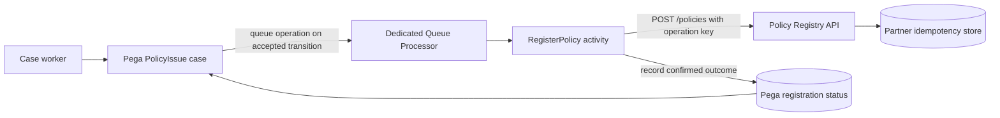
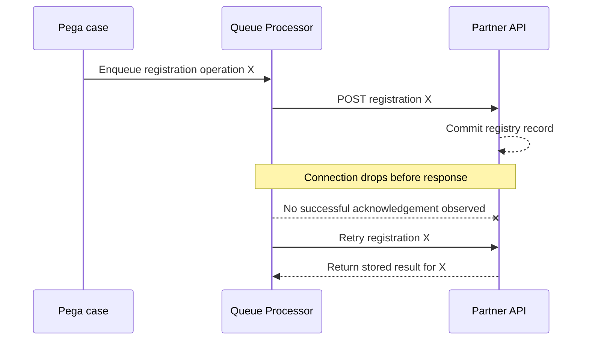
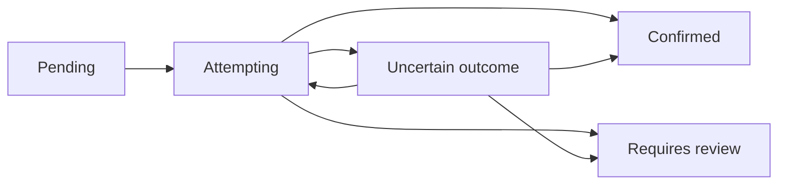

# Queue Processors: why a successful case commit can still produce two downstream requests

**Architecture subject:** Background execution, resilience, idempotency, integration boundaries  
**Audience:** Pega Senior System Architects and Lead System Architects  
**Status:** Design pattern, not yet lab-verified  
**Product applicability:** Pega Platform environments that support Queue Processor rules. Review configuration labels, deployment topology and background-processing controls against your actual release.

## The problem

An insurance application issues a policy, then sends the issuance event to a partner service. The case is saved successfully. A few seconds later, support discovers that two partner records exist for a single policy.

The first downstream request actually succeeded, but the HTTP response was lost. The Queue Processor activity retried, and the partner interpreted that retry as a new operation.

A Queue Processor can run work asynchronously and retry failed items. It does **not** make an arbitrary external API call exactly once. That guarantee requires an application-level contract.

This article explains where the transaction boundaries belong, how a dedicated Queue Processor fits into the architecture, and how to prove recovery works before release.

## 1. Start with the business contract

Example system:

- Pega manages the `PolicyIssue` case and remains the system of record for workflow state.
- An external Policy Registry owns the issued-policy record.
- A successful case transition schedules external registration.
- The UI should not wait for a slow or unavailable Policy Registry.
- A single policy version must not be registered more than once.
- A later genuine reissue is a *different business operation*.
- Partner registration status must be supportable and traceable.

**Non-functional requirements for this illustrative design**, not measured performance:

| Requirement | Example target |
|---|---|
| Interactive case response | p95 below 1 second |
| Normal downstream completion | Within 2 minutes |
| Temporary registry outage | Retry without double registration |
| End-to-end trace | Case ID, operation ID and partner correlation ID |
| Recovery | Operators can safely replay failed work |
| Audit | Distinguish attempted, accepted and confirmed registration |

The crucial distinction: **“case committed” is not equivalent to “partner transaction complete.”**

## 2. Architecture and responsibility boundaries



**Trust boundary:** Pega owns the case workflow. The partner owns registration. Neither Pega's case commit nor its queue item lifecycle can transactionally commit the remote HTTP service's database.

Recommended roles:

| Responsibility | System |
|---|---|
| Determine whether the case may be issued | Pega business rules |
| Allocate immutable operation ID | Pega application |
| Execute background delivery | Pega Queue Processor |
| Deduplicate requests by operation ID | Partner service or adapter |
| Record the registration outcome | Pega operational state |
| Provide retry and reconciliation controls | Pega support process plus partner lookup API |

If the partner cannot offer idempotency, a separate integration facade with a durable deduplication store may be needed. A short-lived in-memory flag is not enough to protect against process restarts or parallel workers.

## 3. Standard or dedicated Queue Processor?

Pega supports standard processing as well as dedicated Queue Processor rules. Dedicated Queue Processors allow more specific configuration and delayed processing, whereas standard processing is intended for more straightforward background tasks. This is documented in [Pega Academy's background-processing guidance](https://academy.pega.com/topic/queue-processors-and-job-schedulers/v2).

For this scenario choose a **dedicated** processor named `QP_RegisterPolicy`.

It deserves a separate operational profile because:
- Its downstream dependency has its own latency and request-rate limits.
- Its retries require distinct handling from notifications or search indexing.
- Operations staff need to see its broken items and queue backlog independently.
- Processing activity behaviour needs a controlled change and test cycle.

Illustrative rule inventory:

| Rule or artifact | Design role |
|---|---|
| `PolicyIssue` case type | Validates and commits the issuance decision |
| `.RegistrationOperationID` | Stable identity for this business operation |
| `.RegistrationState` | Proposed statuses: Pending, Confirmed, RequiresReview |
| `QP_RegisterPolicy` | Dedicated processor rule |
| `RegisterPolicy` activity | Resolve record, validate state, call adapter, classify response |
| `Connect-REST PolicyRegistry` | HTTP integration |
| `D_PolicyRegistrationStatus` | Read-only presentation of registration status |
| `PolicyRegistrationReceipt` | Durable local operational evidence for confirmed outcomes |

Class names and property names above are design examples, not delivered built-in rules.

## 4. Transaction boundaries: where the duplicate actually appears

The failure sequence:



The partner must make the repeated request safe. One effective contract is:

```http
POST /policies
Idempotency-Key: policy:POL-3812:issue:1
Content-Type: application/json

{
  "policyId": "POL-3812",
  "operationId": "policy:POL-3812:issue:1",
  "effectiveDate": "2026-01-01"
}
```

**Illustrative contract only:** the partner API must explicitly support this behaviour; neither the header nor the endpoint is a Pega-provided universal convention.

Required partner semantics:
1. A new operation ID creates one registered business outcome.
2. A replay with the same ID and identical payload returns the first outcome or a clear in-progress status.
3. A replay with the same ID but conflicting payload is rejected.
4. The deduplication record is durable for at least the full retry and reconciliation window.
5. A true second issuance uses a different immutable operation ID.

Do not derive a fresh UUID each time the Queue Processor activity runs. Generate the identifier at the *business operation* boundary and persist it so retries reuse the same value.

## 5. Where to place enqueueing and confirmation

**Issuance step**

- Validate user authority and policy state before accepting issuance.
- Assign an immutable operation ID.
- Persist an operational state such as `Pending`.
- Queue the processing operation using the supported case shape or activity method.
- Confirm, in a release-specific lab test, exactly how enqueueing behaves when the enclosing transaction rolls back. Pega documentation describes conditional commit capabilities, but do not assume every enqueue path has the same commit semantics.

**Background worker**

- Resolve the correct case and operation using stable identifiers.
- Confirm the operation is still relevant; cancellation or reissue may have superseded it.
- Call the partner with a stable idempotency key.
- On verified success, record confirmation and partner reference.
- On timeout, do *not* infer either success or failure. Retry or query the partner by operation ID.
- On permanent rejection, record an actionable failure rather than silently retrying forever.

**State model**



The diagram is a **proposed business status model**, not Pega's internal queue-item status machine.

## 6. Retry policy must reflect failure classification

Pega Queue Processor rules expose controls including maximum attempts, initial delay and delay factor. These should be chosen based on partner capabilities and business deadlines, not copied from another application. See [Creating a Queue Processor rule](https://academy.pega.com/de/topic/creating-queue-processor-rule/v2/in/14981).

| Failure | Recommended response |
|---|---|
| Connection reset / HTTP timeout | Outcome uncertain. Retry with the same operation ID or query status |
| HTTP 429 | Respect documented rate limits and retry guidance |
| HTTP 5xx | Bounded retry, backlog monitoring, escalation if sustained |
| HTTP 400 for invalid schema | Correct the request; avoid blind retry |
| HTTP 401/403 | Investigate credentials/permissions; don't create a massive retry storm |
| Conflict for existing operation ID | Retrieve existing result and verify payload equivalence |
| No lock on Pega case | Recover according to locking configuration and retry policy |
| Permanently broken item | Support runbook, manual review, replay with unchanged identity |

Queue Processor error handling and broken-item investigation are available through Admin Studio. Background failures may be visible in the Broken queue and traceable by administrators. See [Pega Academy: Background process management](https://academy.pega.com/topic/background-process-management/v8/in/108716).

Never interpret a broken queue item as evidence that the partner made no change. The service may have committed before the worker failed.

## 7. Ordering, concurrency and scale

Adding queue threads increases parallel execution. It does not automatically guarantee business ordering or exactly-once effects.

Consider two operations for the same policy:

- X: issue version 1
- Y: cancel version 1

If Y reaches the partner before X, the registry may reject the cancellation or create inconsistent state. Potential mitigations:

- Make the partner version-aware and reject stale transitions.
- Route changes for one policy through a serialized per-policy coordinator.
- Model version transitions with explicit preconditions and reconciliation.
- Choose a queue partitioning/order design only after confirming real platform and deployment behaviour.

Do not require a single global thread for all policies merely to preserve per-policy ordering. That becomes an avoidable throughput bottleneck.

A quick capacity model:

```text
Arrival rate = 180 messages/minute
Mean work duration = 1.5 seconds
Illustrative base worker demand = 180 * 1.5 / 60 = 4.5 concurrent work slots
```

This is **a theoretical lower bound**. It ignores retries, burstiness, tail latency, rate limits, lock contention and node failures. Real sizing requires a load test with representative failure scenarios.

## 8. Verification experiments before production

| Test | Injected condition | Evidence required |
|---|---|---|
| Normal path | Healthy partner | Exactly one partner registration; Pega status confirmed |
| Lost response | Commit partner, drop HTTP response | Retry uses same operation ID; still one registry record |
| Duplicate enqueue | Queue same operation twice | No duplicate business outcome |
| Concurrent items | Two workers handle same policy | Precondition/version rules prevent invalid transitions |
| Partner outage | Partner unavailable for 20 minutes | Bounded retries, observable backlog, no lost operations |
| Enqueue rollback | Force enclosing Pega transaction failure | Determine actual queue persistence outcome for your platform version |
| Security expiry | Revoke integration credentials | Identifiable failure and controlled recovery |
| Replay broken item | Operator requeues original operation | Same operation ID and idempotent partner behaviour |

Capture actual rule configurations, Admin Studio queue evidence, Tracer, PDC events where available, redacted HTTP traces and partner receipt data. Separate measured observations from expectations.

## 9. Production architecture checklist

- Stable business operation ID persisted before retries
- A documented and tested remote deduplication contract
- Correlation and partner reference recorded without sensitive payload leakage
- Classification of retryable, permanent and uncertain outcomes
- Backlog, failure count and queue age alerts
- Recovery runbook for broken queue items
- Clear case-state behaviour while partner outcome remains pending
- Per-policy ordering handled explicitly where the domain requires it
- No dependency on an interactive user requestor remaining active
- Version-specific tests for transaction and enqueue semantics

## Decision

Use a **dedicated Queue Processor** for partner registration, combined with **durable operation identity and downstream idempotency**. Treat background execution as potentially repeated and distinguish a queued work item's state from the outcome of the external business operation.

Do not choose this pattern for an operation that legally requires a single atomic transaction spanning Pega and the partner. That requirement needs a different distributed transaction or compensating business design, not optimistic claims about Queue Processor retries.

## References and verification status

- [Pega Academy: Queue processors and job schedulers](https://academy.pega.com/topic/queue-processors-and-job-schedulers/v2)
- [Pega Academy: Creating a Queue Processor rule](https://academy.pega.com/de/topic/creating-queue-processor-rule/v2/in/14981)
- [Pega Academy: Running a background process](https://academy.pega.com/topic/running-background-process/v2)
- [Pega Academy: Background process management](https://academy.pega.com/topic/background-process-management/v8/in/108716)

This article presents a documented-feature-backed **reference architecture** and a proposed test plan. It is not a report of a production system or completed Pega lab.
