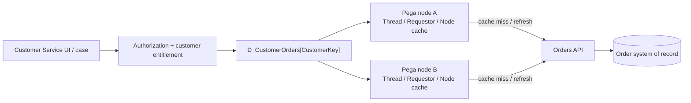

# Data Pages at Scale: Caching, Tenant Isolation and the Freshness Trap

**For:** Senior / Lead System Architects  
**Pattern:** Request-context-aware data caching and freshness control  
**Pega features:** Parameterized Data Pages, scope, refresh strategies, Report Definition / Connect REST sources, Clipboard, PAL  
**Status:** Documentation-backed architecture analysis; **not yet verified in a running Pega environment**  
**Applicability:** General Pega Platform concepts. Verify settings and restrictions against the release and deployment topology you operate.

> **Architecture decision:** Where should a customer-specific data lookup live when the business needs good response times, strong isolation, and near-real-time changes across a horizontally scaled Pega application?

## 1. Enterprise scenario: fast order lookup under load

Consider a **fictional** customer service application:

- 4,000 active agents at peak.
- Each agent handles different customer cases during a shift.
- The UI retrieves orders from an external **Order API**, where inventory/order status can change at any time.
- The data contains customer information that must never leak across agents or tenants.
- The UI has a target response time of **800 ms at p95** (this is a hypothetical *requirement*, not a measured result).
- The enterprise has a stated freshness objective of **60 seconds for status labels**; price/payment confirmation requires revalidation at write time.

The dangerous architecture is not simply an incorrect property mapping. It is a cache that *works* in one test session but behaves differently with **different requestors, tenants, parameter keys, refresh policies and app nodes**.

## 2. Runtime design: the boundaries that matter



**Architectural constraint:** A Node-scoped page is shared within *one Pega node*; it is not, by definition, one cluster-wide object. Thread- and Requestor-scoped pages also follow different visibility boundaries. Do not design a cluster-wide consistency contract by assuming that all nodes share the same in-memory cache. [Source: Pega Academy: Data Pages](https://academy.pega.com/topic/data-pages/v6).

### What is the cache key?

Think in terms of the *effective business identity* of the data:

```text
{TenantID, CustomerID, EntitlementContext, Locale?}
```

**Design recommendation, not a statement of Pega's automatic cache-key implementation:** these context dimensions must be represented by authorization checks, data partitioning, parameterization, or isolation boundaries wherever they affect the result. Passing just `CustomerID` may be an insufficient *business* cache key in a multi-tenant system.

**Security principle:** Cache scope alone is not an authorization mechanism. Always enforce access rights for the requested customer and API/data source, including on reused cached results.

## 3. Compare the viable architectures

| Design | Architectural strength | Main risk | When it fits |
|---|---|---|---|
| **Thread scoped, parameterized** | Isolates per-thread/case context naturally | Repeated fetches and many copies across open case threads | Case-specific or sensitive state with short reuse |
| **Requestor scoped, parameterized** | Reuses results across cases in a session | Retains many distinct customer keys and data beyond original workflow | Repeated agent lookups under firm isolation/freshness controls |
| **Node scoped** | Shares stable non-personal reference data across requestors on a node | Shared visibility, invalidation and multi-node divergence | Common, low-sensitivity reference lists; not an automatic choice for customer-specific orders |
| **No long-lived cache / direct integration** | Freshness is explicit, fewer in-memory reuse assumptions | Higher dependency load, latency and availability coupling | Strong read-time freshness requirements or highly sensitive responses |
| **App-specific materialized read model** | Potentially predictable scale and high-volume search | Replication, audit, data ownership and lag become your problem | Proven heavy-read requirements where eventing/replication is justified |

The final choice also depends on **data source behaviour**, platform version, memory limits, concurrency and the ability to revoke access promptly.

## 4. Reference design: segregate identity, mutable state and public reference data

For the example, start with **Requestor-scoped customer order *summaries*** only *if* the users repeatedly revisit customers in one session and the memory/freshness test supports it. Otherwise prefer a more isolated Thread scope. Keep shared, non-sensitive lookups (e.g. order status code descriptions) on a separate Node-scoped reference Data Page.

A possible naming inventory:

| Artifact | Proposed responsibility |
|---|---|
| `Atlas-Data-CustomerOrderSummary` | Response data model; strictly customer-scoped summary |
| `D_CustomerOrderSummaries` | Read-only, parameterized, customer-scoped retrieval |
| `D_OrderStatusCodes` | Common, comparatively static reference codes |
| `D_CustomerOrderByID` | Single-order detail, only after entitlement check |
| `Connect-REST GetOrdersForCustomer` | External service integration, timeouts and error mapping |
| `ValidateCustomerEntitlement` | Server-side access validation outside cache-hit assumptions |
| `GetOrderDetails` service | Fresh read before an irreversible write, where required |

**Illustrative pseudo-reference: not a verified Pega expression:**

```text
D_CustomerOrderSummaries[
  TenantID: currentTenant,
  CustomerID: selectedCustomer
]
```

The actual parameter names, reference binding, and source mapping need to be validated in the target application. A parameterized Data Page may have separate instances for parameter combinations; **Load Management** behaviour can change that expectation.

### Deliberate architectural decisions

1. **Authorization before reuse:** check the current requestor's customer access for every operation, rather than trusting the page parameter alone.
2. **Choose scope by data-sharing boundary:** never choose Node simply because it promises fewer backend calls.
3. **Separate shared and personalized data:** Node cache for genuine global reference lists; Thread/Requestor for customer-specific values.
4. **Set a freshness contract:** time-based reload is a bounded-staleness policy, not strong consistency.
5. **Keep writes separate:** a cached read view must not authorize an order/payment action; validate state against the system of record before commit.
6. **Make downstream failures explicit:** define loading, timeout, unavailable and partial-data behaviour. Do not silently serve incorrect data.

## 5. The capacity model architects should perform

A simple **illustrative** estimate of live cache memory pressure:

```text
Approximate logical payload =
  active requestors × customer parameter instances per requestor ×
  average orders per result × bytes per result
```

Example assumptions (**not measurements**):

- 4,000 active requestors
- 8 distinct customer queries retained per requestor
- 20 order rows each
- 2 KB average serialized business data per row

**Illustrative logical payload:** 4,000 × 8 × 20 × 2 KB ≈ **1.28 GB** before object overhead, JVM structures, indexes, other caches, replication, container/node distribution or garbage-collection effects. Actual JVM footprint and the number of retained instances must be profiled.

**Decision implication:** Changing from Thread to Requestor scope can reduce repeated loads *yet also prolong data retention*. With many customer keys it may raise session memory pressure. Evaluate both dimensions rather than assuming any scope always improves performance.

## 6. Freshness, eviction and consistency: three separate problems

**Freshness** answers: “How old can the result be?”  
**Eviction** answers: “How long and how much do we retain?”  
**Consistency** answers: “Can different users/nodes observe incompatible data, and does it matter?”

Examples:

- A status badge can tolerate 60 seconds of stale data, but a refund eligibility check may require a new server-side read.
- A short refresh interval can increase API requests enough to overload the dependency during peak traffic.
- A Node-scoped reference page may have different refresh times on nodes A and B; if users switch nodes, displayed values may differ for a period.
- **Reload once per interaction** has documented scope restrictions and is not a universal freshness solution. [Source: Pega Academy: Refresh strategies](https://academy.pega.com/topic/refresh-strategies-data-pages/v4).

### Failure scenario: entitlement changed while cache remains loaded

1. An agent is authorized to access customer C1001 and loads their orders.
2. The agent's entitlement is removed.
3. A cached instance remains available until eviction or refresh.
4. A design that treats “already cached” as “still authorized” creates a confidentiality risk.

**Mitigation:** Re-evaluate authorization at the operation boundary; consider immediate invalidation strategies where sensitive access changes have strict timing requirements.

## 7. Observability: how to prove your decision

Build a controlled test with multiple agents, different customer identities and at least two Pega nodes if available.

| Experiment | What to capture | Architectural question |
|---|---|---|
| Same requestor opens two cases | Clipboard scope/instances, API call count | Does reuse follow intended scope? |
| Two different requestors use same parameter | Returned data, authorization outcomes | Can one user see another user's information? |
| 100 distinct customer keys in one session | Heap and live instances, GC, elapsed time | Is parameter cardinality sustainable? |
| Different nodes refresh at different times | Status outputs and source timestamps | Is cross-node freshness acceptable? |
| Order API timeout or 5xx | Error path, log correlation, latency | Do failure policies keep UI safe? |
| Permission removed mid-session | Response, status and access log | Is revocation enforced despite loaded pages? |

Use **Clipboard** to inspect instances, **Tracer** for the Pega execution path, **PAL** for request-level performance comparisons, platform/server diagnostics for memory and GC, and integration logs for timeouts and call volumes. Define sampling and privacy rules before collecting traces. See the Pega Academy performance exercise for PAL instrumentation: [Assessing application performance](https://academy.pega.com/challenge/assessing-application-performance/v10).

### Suggested acceptance criteria

- No unauthorized cross-customer data observed in the test matrix.
- The service meets the *agreed* p95 objective at expected concurrency.
- Heap use stays within the agreed headroom during the peak scenario.
- API request volume and timeout behaviour stay within dependency capacity.
- Results are no older than the permitted threshold for their use case, or explicitly flagged.
- Writes do not rely on cached read state as the sole source of truth.

**These are acceptance criteria to test, not claims that the system passed.**

## 8. Decision record (ADR extract)

**Decision:** Separate shared reference data from sensitive customer data; prefer a scoped, parameterized Data Page for customer summaries with explicit authorization and measured capacity; use a fresh system-of-record validation for irreversible actions.

**Rejected as default:** Node-scoped cache containing sensitive per-customer order data solely to reduce API calls.

**Trade-off:** Lower reuse than unconstrained Node caching, with clearer isolation boundaries and auditability. Reassess once workload evidence and security requirements are available.

**Revisit triggers:** Tenant model changes, high cache-key cardinality, node-count growth, tightening freshness objectives, API rate limiting or unexpected JVM pressure.

## 9. What an architect should add from a real Pega sandbox

- Redacted screenshots of Data Page scope, Parameters and Load Management.
- Clipboard showing parameter instances across two cases/requestors.
- Tracer and PAL before/after, with release, workload and node details.
- Graphs from memory/API call observations.
- A measured design decision update, including any deviations from this proposed architecture.

No screenshots or performance figures in this article are presented as observed production/lab evidence.

## Primary references

- [Pega Academy: Data Pages / scope](https://academy.pega.com/topic/data-pages/v6)
- [Pega Academy: Refresh strategies for Data Pages](https://academy.pega.com/topic/refresh-strategies-data-pages/v4)
- [Pega Academy: Assessing application performance](https://academy.pega.com/challenge/assessing-application-performance/v10)

---

[← Architecture studies]({{ '/' | relative_url }})
