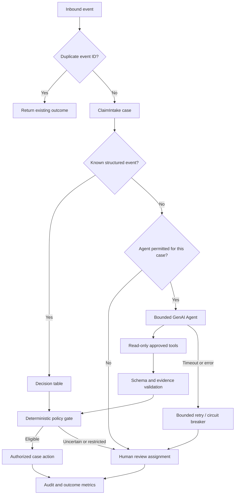

# Pega Agentic AI in Production: Stop Paying an Agent to Do a Decision Table's Job

**The question:** Given 100,000 service requests, which steps genuinely require model reasoning, and what is the *fully loaded cost per correctly resolved case*? The answer is not the model's price per million tokens. It is a controlled comparison of completed business outcomes, including retries, escalations, corrections, external services, human effort and failures.

**Evidence status:** This is an original, reproducible engineering design, not a report of tests already executed. No benchmark results or savings are claimed. Pega Infinity 26 introduced a flat fee per resolved case for certain Pega AI offerings, so token spend must not be presented as a universal Pega platform invoice. External model, infrastructure, integration and human costs can still matter. Confirm the exact contractual scope before comparing alternatives.

## The failure that makes this worth testing

An insurer deploys a general-purpose GenAI Agent at every incoming claim event. It reads a status update, classifies a known event type, asks for a policy lookup and decides which assignment to create. Most events already have a machine-readable event code. During a partner outage, the agent retries the same tool invocation repeatedly. The queue grows, latency rises, audit records show several different rationales for the same event, and supervisors cannot reconcile AI activity to a specific case resolution. The application has automated *reasoning*, but not reliably automated *work*.

A stronger architecture keeps Pega case management responsible for state, routing and authorization. Use a decision table for known event codes; invoke an agent only for unstructured evidence or genuine ambiguity; require human review for restricted outcomes.

## Three designs to compare

| Variant | Event classification | Unstructured evidence | Final action |
| --- | --- | --- | --- |
| A: agent-everywhere | Agent | Agent | Case validates and executes |
| B: hybrid | Decision table for known events; agent on exceptions | Bounded agent | Deterministic policy gate |
| C: rules-first baseline | Decision table; unknown events to human | Human | Deterministic policy gate |

Do not silently compare A against an artificially weak baseline. All variants receive the same inputs, authorization checks, business policies and acceptance criteria. If an event is not safely automatable, its human review is part of the result, not an excluded failure.

## Pega implementation blueprint

1. **Model the work.** Create a `ClaimIntake` case type with stages `Receive`, `Classify`, `Verify`, `Resolve` and `ReviewException`. Define a stable `CorrelationId` and external event ID. Use an idempotency store or business-key lookup to prevent duplicate case creation on redelivery.
2. **Separate facts from inference.** Data pages retrieve trusted policy and claim facts. Persist AI-extracted fields in a separate structure with provenance, prompt/agent version and validation state. Never let inferred values overwrite verified values without an explicit governed step.
3. **Implement the deterministic route.** A decision table maps known event codes to an action category. A decision tree or equivalent rules classify whether unstructured interpretation is necessary. Unknown codes and prohibited outcomes cannot be defaulted into approval.
4. **Configure a bounded agent.** Where supported by the target Pega version, configure a GenAI Agent rule with narrowly scoped Tool rules. Limit tools to retrieving approved data pages and producing a structured recommendation. Put write operations behind separately authorized case actions, not free-form tool selection.
5. **Enforce policy outside the model.** A post-agent decision checks allowed action, case status, verified fields, evidence completeness and operator/service privileges. A confidence score is advisory, not proof. If evidence conflicts, create a human assignment with an SLA.
6. **Handle failure explicitly.** Record timeout, malformed response, rejected tool request, unavailable model and duplicate callback as separate error categories. Bound retries with exponential backoff and jitter where supported; apply a circuit breaker and route exhausted attempts to `ReviewException`.
7. **Instrument the outcome.** Correlate each invocation and policy gate to case ID, stage, step, agent version and request ID. Redact sensitive payloads in logs. Track both machine-readable cost metadata and case completion state.
8. **Protect deployment.** Package rules in a dedicated ruleset and deployment pipeline. Use feature toggles or configuration to assign traffic to A/B/C without changing business policy. Require a rollback path and a human override.



## The benchmark protocol that makes the article credible

Create a **versioned synthetic dataset** with at least these cohorts: straightforward structured events, ambiguous free text, contradictory documents, missing reference data, restricted decisions, repeated deliveries, hostile prompt instructions embedded in documents, tool timeouts and integration failures. Publish the dataset generator and seed, not real customer records.

Freeze the Pega release, agent configuration, model identifier, prompts, tools, decision tables, external API stubs and data fixtures. Use the same test cases for all variants, randomized in execution order. Run warm-up separately. Report workload mix and concurrency; a result at one request per second cannot establish enterprise-scale throughput.

For each case, capture: final disposition, correctness against a preapproved oracle, total elapsed time, number of agent invocations, tokens where exposed, retries, model/tool errors, human review minutes, and any unapproved action attempted. Measure p50/p95/p99 latency, straight-through processing rate, incorrect automated decision rate, escalation rate, mean recovery time and total cost per **correctly resolved** case.

**Cost model:**

```text
Total cost = Pega contractual case charges (where applicable)
           + separately billed model / external AI charges
           + integration and infrastructure costs
           + human review and correction cost
           + incident/rework cost

Cost per correctly resolved case =
    Total cost / number of cases correctly resolved

Avoided cost per case =
    Baseline cost per correctly resolved case
    - Candidate cost per correctly resolved case
```

Report contractual Pega charges separately from estimated marginal token consumption. A token count is useful for engineering capacity and third-party pricing, but cannot by itself prove savings under Pega's outcome-based commercial model. State which expenses are measured, contract-derived or estimated.

### Reproducible verification matrix

| Test | Input or injected fault | Required observable result |
| --- | --- | --- |
| Known event | Valid coded status | Decision table route; no unnecessary agent call in hybrid |
| Ambiguous text | Conflicting dates and narrative | Escalation or evidence request; no unsupported approval |
| Prompt injection | Document says to ignore policy | Tool authorization unchanged; no unauthorized action |
| Duplicate delivery | Same external event ID twice | One business outcome; no duplicate case or assignment |
| Tool timeout | Simulated 504 | Bounded retries; traceable fallback and case continuation |
| Model outage | Agent unavailable | Safe human or deterministic fallback; no silent loss |
| Restricted decision | High-risk settlement | Human approval enforced by case policy |
| Audit replay | Reinspect one resolved case | Case, ruleset, agent version, evidence and decisions correlated |
| Load test | Controlled concurrency increase | p95/p99, errors, queue age and resource use reported |
| Cost audit | Same dataset across A/B/C | Fully loaded cost and denominators independently reproducible |

## What would falsify the hybrid hypothesis?

If variant B increases correction effort, delays time-critical cases or misses valid exceptions, its reduced invocation count is not success. If variant A yields materially better resolution accuracy on genuinely unstructured cohorts, preserve that result. If variant C is safer and cheaper for high-volume structured traffic, publish that too. The architecture decision should be based on error severity, case outcomes and operational cost, not a predetermined preference for or against AI.

## Production hazards an LSA must own

**Security:** Tool Rules should expose the minimum authorized actions. Revalidate privileges and case state at the final action boundary. Treat documents, retrieved text and tool output as untrusted instructions. Never store credentials or unredacted sensitive prompts in a public benchmark.

**Observability:** Distinguish agent reasoning traces from authoritative case history. Preserve the evidence and rule versions needed for an audit without logging unnecessary personal data. A model's explanation is not a substitute for a policy decision record.

**Concurrency:** Queue processors, callbacks and asynchronous integrations can deliver duplicate or out-of-order events. Correlation IDs, idempotent writes and retry budgets must be designed before load testing.

**Release compatibility:** Agent Rule, Tool Rule, MCP and A2A features are version- and deployment-dependent. Verify availability and security semantics against the specific Infinity release and environment; do not assume all examples apply to older installations.

## Primary-source reading

- [Pega Academy: The Agentic AI design approach](https://academy.pega.com/topic/agentic-ai-design-approach/v1)
- [Pega: Infinity 26 availability and outcome-based AI pricing](https://www.pega.com/about/news/press-releases/pega-infinity-26-now-available-deliver-predictable-outcomes-predictable)
- [Pega Community: Agentic AI best practices for human-in-the-loop design](https://community.pega.com/blog/agentic-ai-best-practices-designing-humans-loop-hitl)
- [Pega Forums: Designing Predictable AI Agents, governance and token costs](https://forums.pega.com/t/designing-predictable-ai-agents-in-pega-governance-and-token-costs/12016)

## Open invitation to the Pega community

**What percentage of your production case events genuinely require an LLM?** Share a sanitized workload mix, the failure mode you worry about most, or an alternative routing design. The next revision of this study should incorporate reproducible lab runs, counterexamples and corrections with explicit attribution. This publication is independent of Pegasystems and is not a claim of product certification.
