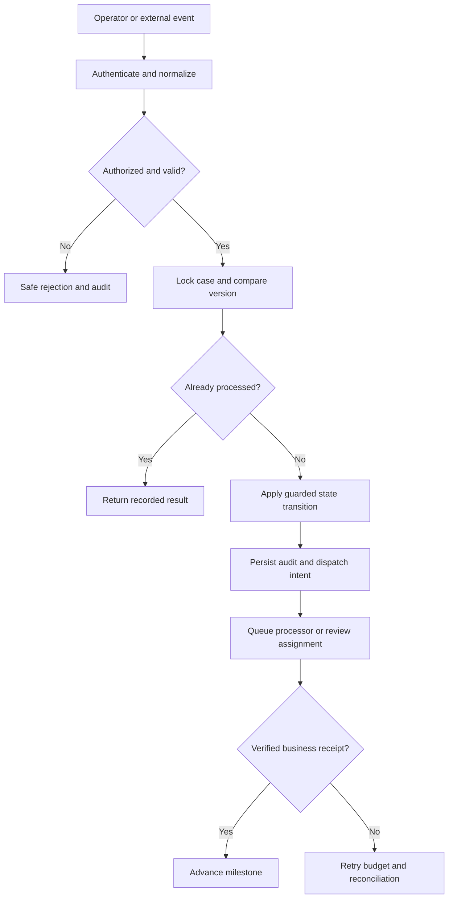

# Designing safe escalation from AI assistant to agent

## The enterprise failure

An agent treats a generated insurance coverage summary as authoritative despite missing citations. This is not merely a presentation defect. A wrong transition can contaminate case history, downstream work and management reporting. The LSA must establish which system owns the business truth, what constitutes a final outcome and how operators can safely recover after partial failure. This article specifies a proposed architecture, not executed lab evidence.

## Domain contract and Pega rule inventory

The core design invariant is **Require an explicit agent acceptance or rejection assignment**. Implement a governed **Data-AIAssistance** data class and a parameterized **D_AssistantEvidence** data page. Define properties for event ID, case ID, tenant, schema version, causation ID, actor, business timestamp, current status and last accepted version. Make all fields subject to appropriate data retention and authorization controls.

| Pega artifact | Responsibility | Review question |
|---|---|---|
| Case Type and flow | Business milestone and assignments | Is every transition explicit? |
| Data Transform | Contract mapping and guarded updates | Can stale data overwrite a reviewed fact? |
| Validate rule | Reject malformed or inconsistent events | Are invalid commands side-effect free? |
| Service REST | Inbound authenticated callback | Are identity and tenant checked? |
| Connect REST | Outbound command | Does a timeout leave outcome unknown? |
| Queue Processor | Async dispatch and bounded retry | Is the retry idempotent? |
| Report Definition | Operational exception and audit reporting | Can support identify unresolved cases? |
| Access Roles and Policies | Server-side access enforcement | Does a role switch invalidate cached results? |

Keep transport acknowledgement distinct from business completion. Do not use a flow action to invoke a slow external dependency synchronously when an asynchronous contract is appropriate. Determine data-page cache scope from tenant and authorization requirements, not performance convenience.

## Flow and failure containment

## Implementation walkthrough

1. Define the case lifecycle, its authoritative milestones and the boundary with external systems. Document what a successful operation means in business terms.
2. Version the event envelope and the **Data-AIAssistance** class. Include tenant ID, correlation ID, causation ID, idempotency key, contract version and a classified error code.
3. Configure **D_AssistantEvidence** with explicit parameters and a refresh strategy. Confirm whether requestor, thread or node scope is safe under access-group changes.
4. Create a validation rule for mandatory values and allowed state transitions. Authenticate the inbound principal and enforce authorization before the case mutation.
5. Acquire the case lock and compare current milestone and event version. On duplicate delivery, return the prior outcome without recreating assignments or repeating connectors.
6. Persist a durable audit record and outbound intent before invoking asynchronous processing. Preserve the same idempotency identity across retry attempts.
7. Define a queue processor retry budget, dead-letter handling, manual repair assignment and reconciliation report. Never assume a timed-out command failed remotely.
8. Run parallel callback, stale update, cross-tenant and delayed acknowledgement tests. Record the installed Pega release, ruleset versions, test inputs and redacted logs.
9. Deploy with an in-flight case migration plan, rollback threshold and accountable owners for exceptions. Verify audit and operational reports before promoting traffic.

## Design decisions specific to assistant escalation

**Primary evidence.** Snapshot of generated answer, model version, source references and human corrections. Record these attributes at the decision boundary, rather than attempting to reconstruct them from mutable data pages or application logs after the fact. Treat raw payload storage as a privacy decision with retention and access controls.

**Invariant enforcement.** Require an explicit agent acceptance or rejection assignment. Implement the check inside the authoritative case transition or data access layer, not solely in the UI. Every inbound integration, delegated work surface and background job must share the same rule of business ownership.

**Concurrency.** A Pega case lock protects the case instance, but it does not make an external service transaction atomic with the case commit. Model an outbox intent and idempotent consumer. When external status is unknown, reconcile rather than blindly resubmit with a new identifier.

**Human correction.** Provide an assignment with the original evidence, proposed change, operator identity, reason and final acknowledgement. Never erase the prior value to make the audit appear clean. Apply a new version and document whether downstream compensation is required.

**Security.** Test access groups, privileges and access control policies on the actual service and report rules. A hidden control is not an authorization mechanism. Parameterize or invalidate cached data when tenant or entitlement context changes.

**Operational recovery.** Expose backlog age, stale receipts, deterministic validation errors and terminal failures separately. Reconciliation should be safe to repeat and should create one actionable exception per unresolved business operation.

## Tradeoffs and production mechanics

Serial case updates reduce throughput but prevent conflicting milestone changes. Full audit payload retention aids investigations but creates privacy exposure; prefer minimal fields and protected source pointers when sufficient. Automatic retry improves recovery from transient transport errors but worsens deterministic failures. Synchronous calls simplify immediate UI feedback but tie case responsiveness to dependency latency. Versioned contracts cost maintenance effort while preventing silent semantic changes.

A production failure can occur after an external system commits but before the Pega connector receives its response. The retry path must query status or use the original idempotency key. A callback can arrive after an operator correction, and a replay can arrive after a deployment with a newer ruleset. Test both conditions explicitly. Never claim exactly-once delivery from an at-least-once transport without a business-level deduplication contract.

## Reproducible verification matrix

| Test | Reproduction | Expected evidence |
|---|---|---|
| Happy path | Valid case, valid role and new event | Exactly one permitted transition and audit event |
| Duplicate | Replay identical event twice | No repeated business side effect |
| Race | Concurrent case edit and callback | Lock or version conflict without lost update |
| Security | Mismatched tenant and unauthorized role | Rejection without data disclosure |
| Timeout | Drop downstream response after commit | Status reconciliation before retry |
| Upgrade | Repeat suite after ruleset promotion | Same approved contract and transitions |

Capture case ID, event ID, ruleset version, before and after case state, connector outcome and redacted audit record for every scenario. Run tests against the actual installed release. The matrix specifies acceptance criteria only; no lab results or performance measurements are claimed.

## Release acceptance

Require business sign-off for authoritative state ownership, security approval for data exposure, operations approval for exception handling and integration-owner approval for retry semantics. Establish monitoring thresholds from observed production baselines rather than invented numbers. Maintain a support runbook covering replay, reconciliation, manual repair and rollback. Preserve actual publication UTC separately from any historical Git author date.
