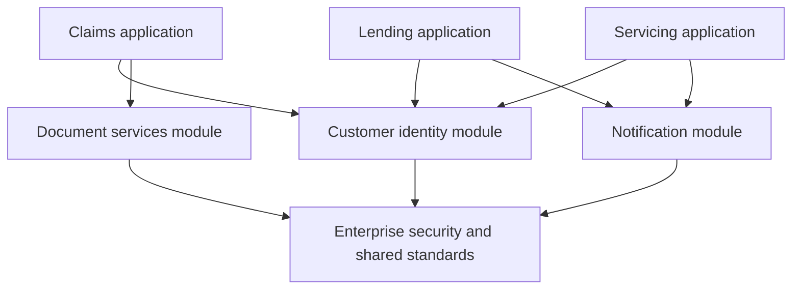

# Breaking a Pega Monolith Into Reusable Modules Without Rebuilding Another Framework

**PFA-257** | **Level:** SSA / LSA architecture | **Evidence status:** Design reference; not yet lab executed

## Business situation and the architectural mistake

Following an acquisition, a company has three large Pega applications. Each contains its own customer lookup, document validation and notification integrations. An architecture team proposes a universal CorporateFramework application to hold every common rule. This sounds reusable, but it introduces a broad dependency that every application must upgrade in lockstep. Current Pega application-structure guidance favours focused reusable modules unless a true framework need is established. The practical problem is finding independent capability boundaries and proving that a shared ruleset is a real dependency, not an accidental coupling.

## Reference architecture

The diagram describes a proposed component boundary. It is not a screenshot of a Pega test environment.

## Pega rules and components

| Object or rule category | Architectural responsibility |
|---|---|
| Business application | Owns case lifecycles, business outcomes and user channels |
| Customer identity module | Reusable customer/entitlement resolution with stable API |
| Document module | Document validation and storage abstractions |
| Notification module | Event-to-message processing, templates and delivery |
| Built-on application stack | Declares actual reuse dependencies and rule priority |
| Compatibility tests | Ensure modules evolve without changing consuming case logic |

Illustrative rule and domain names are not assertions that Pega creates those exact names out of the box.

## How to design and implement it

1. **Design step 1.** Create a dependency inventory based on rule use, not names. Find which implementations actually execute each shared component.

2. **Design step 2.** Identify candidates with independent ownership, stable interfaces, reusable data objects and measurable consumers.

3. **Design step 3.** Design module APIs around data page contracts, case-neutral interfaces or supported service rules. Keep consumer-specific business policy in the consuming application.

4. **Design step 4.** Measure coupling: if changing a module forces every consumer to modify its class hierarchy, the module has not achieved clean reuse.

5. **Design step 5.** Build a directed dependency graph of applications and rulesets. Reject cycles and document how runtime built-on stacks are flattened and prioritised.

6. **Design step 6.** Migrate one low-risk capability first, for example document format validation, then compare production traces and release dependency counts.

7. **Design step 7.** Only introduce a classic framework layer where a whole reusable case-processing foundation is a genuine requirement. Do not choose Framework simply for anticipated reuse.

Before changing a production application, reproduce the same process in an environment with the target Pega version, security model and dependency versions. Decide what should remain a Pega case responsibility and what belongs to an external service.

## Which approach should you choose?

| Design choice | Advantages and constraints |
|---|---|
| One enterprise framework | Useful for a genuinely shared end-to-end case foundation but expensive to version and govern |
| Focused built-on modules | Independent reuse and targeted upgrades, needs well-defined contracts |
| Duplicated code in each app | Preserves independence temporarily but increases defect drift and change cost |

No pattern wins merely because it is newer. Fit the design to recovery, ownership, runtime semantics, security and the actual business volume.

## What fails in production?

**Override collision:** a notification module and a business application both define identically named rules in related classes; inspect runtime stack. **Circular reuse:** module A builds on B and B's component calls back into A-specific rules, preventing independent deployment. **Data ownership confusion:** multiple applications attempt to persist the same customer entity differently. **Module size inflation:** every new common utility lands in one ruleset, turning it into a monolith. **Version lockstep:** upgrading one shared capability forces regression testing for every unrelated case type.

An architecture review should identify an observable signal, support owner and recovery action for every material failure. Do not assume that a successful Pega flow status proves every remote dependency or business process completed.

## Validation matrix

| Experiment to run | Expected evidence |
|---|---|
| Stack order | Check actual rule resolution for all consumers after adding a module |
| Dependency isolation | Upgrade notification component without changing Claims case processing |
| Contract test | All consumers conform to the same expected input/output data model |
| Regression | Compare previously supported customer and tenant behaviour |
| Removal drill | Identify whether one consuming application can retire a module without breaking another |

All results above are proposed assertions, not measured or executed outcomes. A verified edition of this article should include redacted rule screenshots, real diagnostics and release-specific deviations.

## Operations and support

Publish ownership, semantic versioning policy, supported consumers and deprecation lead time for each reusable application. Measure reusability by fewer duplicate fixes and safer independent releases, not by the number of rules moved into a common folder.

## Pega references

- [Pega Academy: Application structure](https://academy.pega.com/topic/application-structure/v5)
- [Pega Academy: Multiple built-on application stack](https://academy.pega.com/topic/multiple-built-application-stack/v1/in/105481)

**Applicability note:** Specific UI labels, background services and runtime behaviour may vary by Pega release. Verify target-platform behaviour, especially after a major upgrade. Original independent architectural material, not affiliated with Pegasystems.
