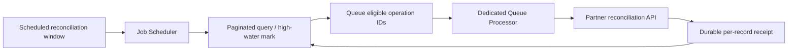

# Job Scheduler or Queue Processor: Designing Workload Ownership, Not Just Background Execution

**PFA-110** | **Level:** SSA / LSA architecture | **Evidence status:** Design reference; not yet lab executed

## Business situation and the architectural mistake

A finance application reconciles unsettled payment cases every night and sends each transaction for confirmation. Someone proposes a Job Scheduler that queries 500,000 items and processes every row in one run. Someone else proposes enqueueing 500,000 messages every minute. Both approaches couple discovery, scheduling and processing into a risky design. Pega distinguishes Job Scheduler rules for scheduled recurring jobs from Queue Processor rules for asynchronous queued work. A robust architecture uses a scheduler to find bounded work and dedicated queue processing for individual operations when needed.

## Reference architecture

The diagram describes a proposed component boundary. It is not a screenshot of a Pega test environment.

## Pega rules and components

| Object or rule category | Architectural responsibility |
|---|---|
| Job Scheduler | Clock- or startup-driven coordination and work discovery |
| Report Definition / discovery query | Find eligible records with indexed criteria and paging |
| Dedicated Queue Processor | Independent work execution with processing configuration |
| Reconciliation operation ID | Prevents the same business work being counted twice |
| Durable reconciliation ledger | Tracks discovered, enqueued, confirmed and failed operations |
| Admin Studio | Inspect background status and failed processing items |

Illustrative rule and domain names are not assertions that Pega creates those exact names out of the box.

## How to design and implement it

1. **Design step 1.** Separate **when to look** from **what each item does**. The schedule initiates discovery; queue workers own individual side-effect execution.

2. **Design step 2.** Define a bounded query by business state and stable time/ID ordering. Unbounded full scans can overload the case database.

3. **Design step 3.** Persist a durable cursor, high-water mark or reconciliation window. If the scheduler fails halfway through, the next execution must be able to resume without missing items.

4. **Design step 4.** Queue only operation IDs and essential immutable context. Workers should obtain current state and check eligibility before acting.

5. **Design step 5.** Use stable per-operation keys for external actions. Delayed, duplicated or retried messages must not create duplicate settlements.

6. **Design step 6.** Limit worker concurrency based on the downstream service rate, not only available Pega threads. Monitor backlog age and dependency 429/5xx.

7. **Design step 7.** Choose a supportable repair model for scheduler failure versus an individual broken queue item. The operator actions are not equivalent.

Before changing a production application, reproduce the same process in an environment with the target Pega version, security model and dependency versions. Decide what should remain a Pega case responsibility and what belongs to an external service.

## Which approach should you choose?

| Design choice | Advantages and constraints |
|---|---|
| Scheduler processes all items inline | Small fixed jobs only; long runs are harder to resume and isolate |
| Each event queues directly | Good for immediate, event-triggered work but may not find historical unprocessed records |
| Scheduler discovers plus QP processes | Supports bounded backfills, per-item retries and scalable control |

No pattern wins merely because it is newer. Fit the design to recovery, ownership, runtime semantics, security and the actual business volume.

## What fails in production?

A failed scheduler can leave discovery half complete; a completed scheduler does not prove every queued item succeeded. A queue backlog may also grow because one remote dependency has degraded. Diagnose scheduled execution timestamp, discovery watermark, count of enqueued IDs, queue oldest age and confirmed operation ledger independently. Never use a single job-level Success flag as proof of business reconciliation.

An architecture review should identify an observable signal, support owner and recovery action for every material failure. Do not assume that a successful Pega flow status proves every remote dependency or business process completed.

## Validation matrix

| Experiment to run | Expected evidence |
|---|---|
| Empty day | Scheduler exits safely without creating dummy queue records |
| Mid-page crash | Rerun resumes from durable watermark without losing records |
| Duplicate discovery | Same candidate listed twice, only one business outcome |
| Slow partner | Backlog grows within monitored headroom; rate limit prevents overload |
| Poison item | One malformed record does not block other unrelated operations |
| Deployment during run | Version-sensitive behaviour and worker recovery are understood |

All results above are proposed assertions, not measured or executed outcomes. A verified edition of this article should include redacted rule screenshots, real diagnostics and release-specific deviations.

## Operations and support

Define two SLAs: discovery lag and completion lag. Give support distinct playbooks for a missed schedule and a broken queued item. Avoid making the scheduler itself the sole durable source of state. Ensure its access group can see only the required records and that partner credentials rotate safely.

## Pega references

- [Pega Academy: Queue processors and Job Schedulers](https://academy.pega.com/topic/queue-processors-and-job-schedulers/v2)
- [Pega Academy: Background process management](https://academy.pega.com/topic/background-process-management/v8/in/108716)

**Applicability note:** Specific UI labels, background services and runtime behaviour may vary by Pega release. Verify target-platform behaviour, especially after a major upgrade. Original independent architectural material, not affiliated with Pegasystems.
