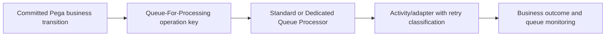

# Standard or Dedicated Queue Processor: Choosing an Operational Boundary

**PFA-106** | **Target reader:** Pega SSA / LSA | **Evidence:** Architecture design, live test pending

## Why this matters in a real enterprise application

A case application asynchronously sends confirmation emails, registers invoices and updates an external fraud service. All three tasks are placed into the same standard processing path. Email spikes now delay critical invoice registration, and fraud retries compete with noncritical messages. The design question is not whether queues are asynchronous; it is which workload deserves isolated scaling, recovery and operational ownership.

The technical target is not simply to configure a rule that works once. The design must remain correct when authorization changes, multiple requestors interact, dependent services fail and different rule versions coexist during deployment.

## Runtime architecture and trust boundaries

The diagram is an implementation proposal, not a screenshot or observed runtime trace.

## Pega rule and component inventory

| Pega component | What the architect must control |
|---|---|
| Queue-For-Processing in activity | Define the component's business ownership and version |
| Standard Queue Processor | Specify input fields, classes and caller contract |
| Dedicated Queue Processor rule | Confirm scope, access privileges and applicable rulesets |
| Processing activity with access group | Expose useful diagnostic evidence and correlation IDs |
| Admin Studio Broken queue and data flow monitoring | Define failure/recovery behavior and verification owner |

All custom names in the example should be replaced with classes and rule names from the target application. Do not blindly apply design examples to a different Pega release.

## Implementation design

1. **Step 1:** Group asynchronous tasks by downstream SLA, retry behavior, sensitivity and rate limits instead of by the team that first wrote them.

2. **Step 2:** Use standard processing for simple low-throughput background work where the shared processing characteristics fit.

3. **Step 3:** Introduce a dedicated Queue Processor for independently scaled or delayed/high-throughput work that needs tailored processing controls.

4. **Step 4:** Ensure each work item includes a stable business operation identity and enough immutable context to retrieve current record state safely.

5. **Step 5:** Set retry policy based on partner semantics. A timeout can leave remote effect uncertain; a validation rejection should not cause blind retries.

6. **Step 6:** Choose worker access group and privileges deliberately. A headless processor must not inherit browser-only assumptions.

7. **Step 7:** Monitor oldest item age, error categories, backlog growth and downstream receipt status. Define manual replay and poison-message repair processes.

### Decision contract

Before writing the rule, record the caller, authoritative system of record, access-group or service identity, acceptable stale age, latency target and required behaviour under duplicate execution. Where the feature supports multiple execution modes, the choice must be justified against these constraints.

## Alternative patterns

| Design approach | Why it may or may not fit |
|---|---|
| Standard processing | Minimal configuration for simple tasks, limited workload isolation |
| Dedicated Queue Processor | Independent configuration and scaling opportunities, more ownership requirements |
| Job Scheduler per message | Wrong abstraction for event-level message handling, use for recurring work discovery |

A more scalable option is not necessarily the most secure or operationally supportable. The decision should be driven by the application's actual workload and failure modes, not the convenience of one dev-environment demo.

## Production failure and diagnosis

Success of the user's flow only proves its part of the operation; it is not a remote receipt. Multiple workers may replay the same item when failure occurs around acknowledgement. Isolate critical processor performance from notification traffic and test duplicate-safe business actions.

When diagnosing a failure, capture the exact case ID in an approved test environment, the active application and ruleset versions, Pega node, relevant Data Page or flow state, and the downstream correlation ID. Avoid including tokens, customer personal information or confidential attachments.

## Verification plan

| Scenario | Evidence required |
|---|---|
| Experiment 1 | Flood noncritical notifications and observe critical processor latency. |
| Experiment 2 | Introduce 429 from one partner and verify its backoff does not block unrelated tasks. |
| Experiment 3 | Stop/restart worker and confirm a stable operation key is reused. |
| Experiment 4 | Replay a broken item and verify no duplicate external registration. |

**These are test instructions, not completed test results.** Once a supported Pega sandbox is available, record the installed release and attach redacted, authentic rule screenshots, Tracer/PAL or Clipboard evidence and expected versus observed outcomes.

## Operational acceptance and release considerations

Specify an accountable owner for this design, expected business volume, Pega and dependent-system resource limits, monitoring signals and a recovery runbook. Confirm an older persisted case or queued operation can safely resume after deployment where applicable. Create an Architecture Decision Record so future maintainers understand both the accepted approach and its rejected alternatives.

## Primary references and version caveat

- [Pega Academy: Queue processors and Job Schedulers](https://academy.pega.com/topic/queue-processors-and-job-schedulers/v2)

This independent article is based on published Pega concepts and a fictional scenario. UI labels, exact method semantics and feature availability must be verified in the chosen platform release.
