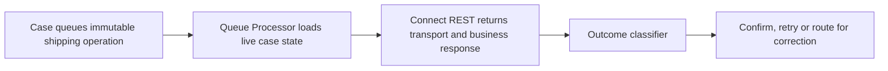

# Queue Processor Retries: Why a Business Rejection Must Not Be Treated as an Outage

**PFA-107** | **Audience:** Senior and Lead System Architects | **Status:** Architecture design, live Pega verification pending

## The actual failure

A shipping Queue Processor retries an invalid postal address with the same frequency as a temporary HTTP 503. Bad data repeatedly consumes worker attempts, fills the broken queue and creates false outage alarms. The design needs a domain-specific outcome contract between Queue Processor and shipping adapter.

## System interaction and ownership

This is a conceptual reference architecture, not a product screenshot or observed runtime trace. Its boundaries must be verified for the actual Pega deployment version and external systems.

## Pega implementation inventory

| Component or rule | Design consideration |
|---|---|
| Dedicated Queue Processor | Owns a defined runtime decision or state boundary |
| Queue-For-Processing | Needs a documented input/output contract |
| Shipping Connect REST | Requires version-specific access and execution testing |
| Error classification Data Transform | Produces diagnostics for failure isolation |
| Broken item support runbook | Carries operational ownership |

## How to implement and validate the architecture

1. Model the operation as repeatable and supply one stable external idempotency key across attempts.

2. Distinguish permanent bad input, authentication failure, 429 limit, transient server error and timeout with unknown remote effect.

3. Convert remote responses into an explicit Confirmed, Correctable, Retryable or Unknown result rather than treating all exceptions alike.

4. Define retry delay and maximum attempt window in terms of carrier cutoffs and contractual shipping times.

5. Send correctable input errors to a visible case exception assignment instead of consuming all remaining retries.

6. Monitor queue oldest age, retry rate, broken count and external receipt status independently.

For a production build, annotate the actual class names, access group, ruleset version, node role and recovery owner. Ensure each external operation has an explicit system of record; a successful Pega case save does not, by itself, certify that an external service committed a change.

## Architectural choices

| Pattern | Consequence |
|---|---|
| Retry everything automatically | Simple but creates storms and wastes attempts |
| Failure taxonomy with separate paths | More explicit code, safer recovery and support |
| Synchronous shipping in UI | Immediate feedback but couples case interaction to remote availability |

Choose by the actual confidentiality, scale, consistency and failure-recovery constraints. A seemingly quicker configuration can shift cost into production support, data repair or lost auditability.

## Failure mechanics and support diagnosis

A timeout may occur after the remote side has generated a shipping label. The queue can show a broken item even when the partner succeeded. Do not replay without checking operation status when the external service is not guaranteed idempotent.

Correlate one affected case ID and operation ID across rule execution, logs and dependent services. Record the effective application/ruleset versions and node. Avoid exporting live client data or confidential prompts in community evidence.

## Test matrix

| Test | Expected verification |
|---|---|
| Experiment 1 | Force HTTP 400 and verify it routes to correction. |
| Experiment 2 | Drop response after partner creates label and retry with same key. |
| Experiment 3 | Force HTTP 429 and confirm bounded backoff. |
| Experiment 4 | Replay broken item and check one partner shipment only. |

These are **experiments to execute**, not assertions of a completed test. Include Pega configuration screenshots and sanitized Clipboard, Tracer, PAL or service evidence only after an authorised lab run. A failing experiment is valuable evidence and should update the design.

## Release and production readiness

Before promoting the design, confirm: observable business state; retry and rollback constraints; tenant and privilege isolation; capacity target; accountable support team; release-specific configuration; and a documented repair procedure. A green rule test or a running node does not imply the complete business operation succeeded.

## Primary reference

- [Pega Academy technical documentation](https://academy.pega.com/topic/queue-processors-and-job-schedulers/v2)

This article is an independent architectural study. The example scenario is fictional. It is not affiliated with Pegasystems, and no performance measurement or live test result is claimed.
