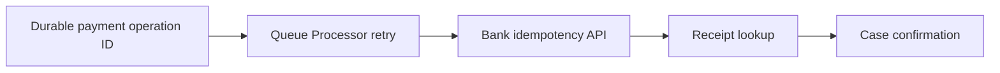

# Idempotent consumers for financial transactions

**PFA-108** | Pega SSA/LSA reference implementation | Actual lab test pending

## Incident and business outcome

A benefits payment Queue Processor delivers a disbursement to a bank, then the worker fails before marking the message processed. On retry it calls the bank again with a new payment request identifier, paying twice.

The architecture must identify a stable operation identity and separate case state, asynchronous delivery, integration outcome and authorization. The same message can execute more than once unless the business protocol rules out duplicate effects.

## Processing architecture

## Pega execution artifacts

1. **Queue Processor**. Document the version, queue/service context, business identifier and observable failure outcome.
2. **Queue-For-Processing**. Document the version, queue/service context, business identifier and observable failure outcome.
3. **Connect REST**. Document the version, queue/service context, business identifier and observable failure outcome.
4. **payment receipt class**. Document the version, queue/service context, business identifier and observable failure outcome.
5. **case state guard**. Document the version, queue/service context, business identifier and observable failure outcome.

## Implementation design steps

1. Generate a business operation ID at authorized payment approval, before the work enters the queue, and persist it with payment amount and beneficiary hash.

2. Send the same immutable key on every retry. A new UUID per worker attempt is a duplicate-payment bug.

3. Distinguish Confirmed, Rejected, Pending and Unknown outcomes; timeouts require partner lookup, not inferred failure.

4. Protect amount and beneficiary against alteration between attempts; reject a conflicting payload for an already used key.

5. Track final bank receipt and prevent the case from resolving as Paid until the outcome is confirmed.

A complete application example should use a documented rule and class naming scheme, stable case/operation IDs, data shape, service API contract and a support-owned recovery path. Exact settings must be tested in the target Pega release.

## Alternatives

- **Choice 1:** Best-effort retry tolerates delivery failure but risks duplicates.
- **Choice 2:** idempotent bank contract plus receipt ledger allows safe at-least-once processing.

Architecture acceptance depends on business correctness after a duplicate, delay or partial failure, not merely on low response time when the partner is healthy.

## Failure mechanics

A replayed queue item may be valid even after bank success. Broken queue status is not proof the bank did nothing.

For diagnostics capture the Pega case version, queue item/operation ID, current access group, retry attempt, outbound request correlation and remote receipt. An error status is not evidence the remote system made no change.

## Validation experiments

1. **Scenario 1:** Kill worker after bank commit. Record actual result, remote side effect count and elapsed time or backlog age.
2. **Scenario 2:** retry identical operation ID. Record actual result, remote side effect count and elapsed time or backlog age.
3. **Scenario 3:** send conflicting amount with same ID. Record actual result, remote side effect count and elapsed time or backlog age.

All tests remain proposed. The article does not claim that a live Pega lab was executed or that hypothetical measurements are production evidence.

## Deployment and ongoing support

Add a rollback or forward-repair plan for in-flight queue items and live cases. Include alerting for broken items, oldest age, invalid business payloads and provider failures, together with safe replay privileges and audit trail. For sensitive data, verify inbound/outbound minimization and identity controls.

## Official Pega reference

- [Pega Academy: Queue processors](https://academy.pega.com/topic/queue-processors-and-job-schedulers/v2)

*Independent technical study with fictional scenario. Verify configuration against the deployed Pega release.*
