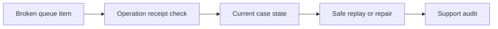

# Broken queue remediation and safe manual replay

**PFA-111** | Pega SSA/LSA reference implementation | Actual lab test pending

## Incident and business outcome

An external scoring service returns 500 and a Queue Processor message enters Broken. Support selects Retry without checking whether the scoring service already wrote a decision or whether the case moved forward.

The architecture must identify a stable operation identity and separate case state, asynchronous delivery, integration outcome and authorization. The same message can execute more than once unless the business protocol rules out duplicate effects.

## Processing architecture

## Pega execution artifacts

1. **Admin Studio broken queue**. Document the version, queue/service context, business identifier and observable failure outcome.
2. **Queue Processor**. Document the version, queue/service context, business identifier and observable failure outcome.
3. **Connect REST**. Document the version, queue/service context, business identifier and observable failure outcome.
4. **case state/lock**. Document the version, queue/service context, business identifier and observable failure outcome.
5. **manual repair procedure**. Document the version, queue/service context, business identifier and observable failure outcome.

## Implementation design steps

1. Create a support playbook that classifies broken items by retryable transport error, permanent data error and unknown remote effect.

2. Inspect the original operation ID, payload fingerprint, case status and partner receipt before replaying an external side effect.

3. If source input is invalid, correct the case or source data through an authorized workflow rather than repeating the exact broken payload indefinitely.

4. Ensure replay uses the same business operation identity, with a controlled support actor and audit trail.

5. Track item age, attempt count and repair outcome; separate a transport-level retry from an intentional new business operation.

A complete application example should use a documented rule and class naming scheme, stable case/operation IDs, data shape, service API contract and a support-owned recovery path. Exact settings must be tested in the target Pega release.

## Alternatives

- **Choice 1:** Blind retry is operationally easy but can duplicate work.
- **Choice 2:** verified repair path is slower but safe for high-value side effects.

Architecture acceptance depends on business correctness after a duplicate, delay or partial failure, not merely on low response time when the partner is healthy.

## Failure mechanics

A broken item may already have succeeded remotely. Support requeues it, creating another policy or payment.

For diagnostics capture the Pega case version, queue item/operation ID, current access group, retry attempt, outbound request correlation and remote receipt. An error status is not evidence the remote system made no change.

## Validation experiments

1. **Scenario 1:** Break after remote success. Record actual result, remote side effect count and elapsed time or backlog age.
2. **Scenario 2:** retry with same operation ID. Record actual result, remote side effect count and elapsed time or backlog age.
3. **Scenario 3:** send invalid input and require correction. Record actual result, remote side effect count and elapsed time or backlog age.

All tests remain proposed. The article does not claim that a live Pega lab was executed or that hypothetical measurements are production evidence.

## Deployment and ongoing support

Add a rollback or forward-repair plan for in-flight queue items and live cases. Include alerting for broken items, oldest age, invalid business payloads and provider failures, together with safe replay privileges and audit trail. For sensitive data, verify inbound/outbound minimization and identity controls.

## Official Pega reference

- [Pega Academy: Background process management](https://academy.pega.com/topic/background-process-management/v8/in/108716)

*Independent technical study with fictional scenario. Verify configuration against the deployed Pega release.*
