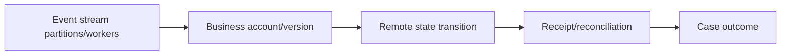

# Processing order versus horizontal throughput

**PFA-112** | Pega SSA/LSA reference implementation | Actual lab test pending

## Incident and business outcome

Multiple Queue Processor workers handle events for the same account. Transaction 2 reaches the partner before transaction 1, changing account state in the wrong order. Setting higher worker count improves throughput but removes accidental serialization.

The architecture must identify a stable operation identity and separate case state, asynchronous delivery, integration outcome and authorization. The same message can execute more than once unless the business protocol rules out duplicate effects.

## Processing architecture

## Pega execution artifacts

1. **Dedicated Queue Processor**. Document the version, queue/service context, business identifier and observable failure outcome.
2. **operation version**. Document the version, queue/service context, business identifier and observable failure outcome.
3. **case locking**. Document the version, queue/service context, business identifier and observable failure outcome.
4. **partner API**. Document the version, queue/service context, business identifier and observable failure outcome.
5. **correlation data**. Document the version, queue/service context, business identifier and observable failure outcome.

## Implementation design steps

1. Decide whether the business requires total order, per-account order or merely idempotent independent operations.

2. Do not infer FIFO execution from Queue Processor configuration without testing the actual stream/partition and retry behavior of the deployed release.

3. Include account operation version or predecessor ID in each message so receivers can reject or defer stale/out-of-order updates.

4. Parallelize across independent account keys while serializing only where genuine per-entity ordering is required.

5. Test retries and poison messages: a blocked earlier event may delay later updates or require reconciliation.

A complete application example should use a documented rule and class naming scheme, stable case/operation IDs, data shape, service API contract and a support-owned recovery path. Exact settings must be tested in the target Pega release.

## Alternatives

- **Choice 1:** One global worker preserves some ordering but sacrifices scale.
- **Choice 2:** per-entity sequencing supports throughput with explicit version checks.

Architecture acceptance depends on business correctness after a duplicate, delay or partial failure, not merely on low response time when the partner is healthy.

## Failure mechanics

A delayed event with version 1 arrives after version 2 and rolls account status backwards when no expected-version guard exists.

For diagnostics capture the Pega case version, queue item/operation ID, current access group, retry attempt, outbound request correlation and remote receipt. An error status is not evidence the remote system made no change.

## Validation experiments

1. **Scenario 1:** Enqueue A1,A2 with two workers. Record actual result, remote side effect count and elapsed time or backlog age.
2. **Scenario 2:** delay A1. Record actual result, remote side effect count and elapsed time or backlog age.
3. **Scenario 3:** force retry and inspect eventual state. Record actual result, remote side effect count and elapsed time or backlog age.

All tests remain proposed. The article does not claim that a live Pega lab was executed or that hypothetical measurements are production evidence.

## Deployment and ongoing support

Add a rollback or forward-repair plan for in-flight queue items and live cases. Include alerting for broken items, oldest age, invalid business payloads and provider failures, together with safe replay privileges and audit trail. For sensitive data, verify inbound/outbound minimization and identity controls.

## Official Pega reference

- [Pega Academy: Queue processors](https://academy.pega.com/topic/queue-processors-and-job-schedulers/v2)

*Independent technical study with fictional scenario. Verify configuration against the deployed Pega release.*
