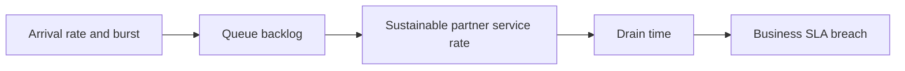

# Backlog sizing during upstream traffic spikes

**PFA-113** | Pega SSA/LSA reference implementation | Actual lab test pending

## Incident and business outcome

At the annual renewal deadline, 100,000 cases enqueue notifications in 30 minutes. The remote provider processes 200 per second but Pega generates 400 per second. Backlog grows even though worker CPU is underutilized.

The architecture must identify a stable operation identity and separate case state, asynchronous delivery, integration outcome and authorization. The same message can execute more than once unless the business protocol rules out duplicate effects.

## Processing architecture

## Pega execution artifacts

1. **Queue Processor**. Document the version, queue/service context, business identifier and observable failure outcome.
2. **Admin Studio monitoring**. Document the version, queue/service context, business identifier and observable failure outcome.
3. **rate-limit adapter**. Document the version, queue/service context, business identifier and observable failure outcome.
4. **Job Scheduler**. Document the version, queue/service context, business identifier and observable failure outcome.
5. **SLA**. Document the version, queue/service context, business identifier and observable failure outcome.

## Implementation design steps

1. Estimate arrival rate, service rate and average work time with realistic retries; use Little's Law or queue-rate modeling under stated assumptions.

2. If arrivals exceed sustainable completion, raising worker count cannot fix partner capacity. Negotiate rate or shift noncritical work.

3. Set alert thresholds on oldest queue age and time-to-deadline, not only total queued count.

4. Prioritize critical customer-impacting events separately from low-priority notifications if business rules justify separate processing.

5. Rehearse recovery from one-hour outage and calculate drain time with a bounded surge in worker concurrency.

A complete application example should use a documented rule and class naming scheme, stable case/operation IDs, data shape, service API contract and a support-owned recovery path. Exact settings must be tested in the target Pega release.

## Alternatives

- **Choice 1:** More threads helps CPU-bound processing until quota.
- **Choice 2:** admission control or spreading work reduces peak but affects timeliness.

Architecture acceptance depends on business correctness after a duplicate, delay or partial failure, not merely on low response time when the partner is healthy.

## Failure mechanics

Queue age increases during retry storms while raw queue count is stable because new and old messages churn; SLA breach can be hidden.

For diagnostics capture the Pega case version, queue item/operation ID, current access group, retry attempt, outbound request correlation and remote receipt. An error status is not evidence the remote system made no change.

## Validation experiments

1. **Scenario 1:** Simulate arrival 2x service rate. Record actual result, remote side effect count and elapsed time or backlog age.
2. **Scenario 2:** stop vendor for 20 min. Record actual result, remote side effect count and elapsed time or backlog age.
3. **Scenario 3:** measure recovery drain and oldest age. Record actual result, remote side effect count and elapsed time or backlog age.

All tests remain proposed. The article does not claim that a live Pega lab was executed or that hypothetical measurements are production evidence.

## Deployment and ongoing support

Add a rollback or forward-repair plan for in-flight queue items and live cases. Include alerting for broken items, oldest age, invalid business payloads and provider failures, together with safe replay privileges and audit trail. For sensitive data, verify inbound/outbound minimization and identity controls.

## Official Pega reference

- [Pega Academy: Background process management](https://academy.pega.com/topic/background-process-management/v8/in/108716)

*Independent technical study with fictional scenario. Verify configuration against the deployed Pega release.*
