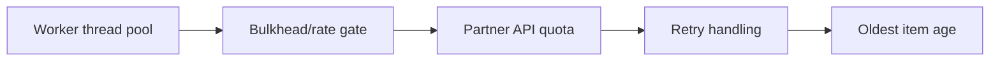

# Scaling background processing without API overload

**PFA-114** | Pega SSA/LSA reference implementation | Actual lab test pending

## Incident and business outcome

A claims application increases Queue Processor concurrency from 10 to 100 to clear backlog. The partner API has a small connection pool and rate limit; errors and retries multiply until both systems perform worse.

The architecture must identify a stable operation identity and separate case state, asynchronous delivery, integration outcome and authorization. The same message can execute more than once unless the business protocol rules out duplicate effects.

## Processing architecture

## Pega execution artifacts

1. **Dedicated Queue Processor**. Document the version, queue/service context, business identifier and observable failure outcome.
2. **Run in Background**. Document the version, queue/service context, business identifier and observable failure outcome.
3. **Connect REST**. Document the version, queue/service context, business identifier and observable failure outcome.
4. **API gateway**. Document the version, queue/service context, business identifier and observable failure outcome.
5. **rate governance**. Document the version, queue/service context, business identifier and observable failure outcome.

## Implementation design steps

1. Find real bottleneck first: CPU rule work, external API throughput, stream partitions or database lock wait.

2. Set concurrency according to partner contracted request rate and measured p95 service time; do not choose maximum based only on available Pega cores.

3. Use an approved shared rate limiter or integration gateway; per-node independent limits may exceed global vendor quota.

4. Classify 429 as backpressure and respect retry guidance, with jitter/bounded attempts to prevent synchronized storms.

5. Keep failed items visible and ensure critical workflows don't silently resolve while external work is pending.

A complete application example should use a documented rule and class naming scheme, stable case/operation IDs, data shape, service API contract and a support-owned recovery path. Exact settings must be tested in the target Pega release.

## Alternatives

- **Choice 1:** Aggressive worker scaling improves CPU work but can overload I/O partner.
- **Choice 2:** bounded concurrency stabilizes end-to-end throughput.

Architecture acceptance depends on business correctness after a duplicate, delay or partial failure, not merely on low response time when the partner is healthy.

## Failure mechanics

More queue threads create more simultaneous case locks and vendor 429 responses; apparent backlog growth is an effect of retries.

For diagnostics capture the Pega case version, queue item/operation ID, current access group, retry attempt, outbound request correlation and remote receipt. An error status is not evidence the remote system made no change.

## Validation experiments

1. **Scenario 1:** Vary workers 5/20/100. Record actual result, remote side effect count and elapsed time or backlog age.
2. **Scenario 2:** inject 429. Record actual result, remote side effect count and elapsed time or backlog age.
3. **Scenario 3:** measure real completion rate rather than attempt rate. Record actual result, remote side effect count and elapsed time or backlog age.

All tests remain proposed. The article does not claim that a live Pega lab was executed or that hypothetical measurements are production evidence.

## Deployment and ongoing support

Add a rollback or forward-repair plan for in-flight queue items and live cases. Include alerting for broken items, oldest age, invalid business payloads and provider failures, together with safe replay privileges and audit trail. For sensitive data, verify inbound/outbound minimization and identity controls.

## Official Pega reference

- [Pega Academy: Queue processors](https://academy.pega.com/topic/queue-processors-and-job-schedulers/v2)

*Independent technical study with fictional scenario. Verify configuration against the deployed Pega release.*
