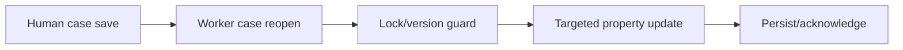

# Queue item locking and concurrent case updates

**PFA-115** | Pega SSA/LSA reference implementation | Actual lab test pending

## Incident and business outcome

A queue worker updates a claim's external assessment while an adjuster edits the same case. The worker opens stale case data and saves it after the user, overwriting fresh fields or failing a lock with no controlled retry.

The architecture must identify a stable operation identity and separate case state, asynchronous delivery, integration outcome and authorization. The same message can execute more than once unless the business protocol rules out duplicate effects.

## Processing architecture

## Pega execution artifacts

1. **Case Type locking**. Document the version, queue/service context, business identifier and observable failure outcome.
2. **Queue Processor**. Document the version, queue/service context, business identifier and observable failure outcome.
3. **Obj-Open-By-Handle**. Document the version, queue/service context, business identifier and observable failure outcome.
4. **case history**. Document the version, queue/service context, business identifier and observable failure outcome.
5. **retry policy**. Document the version, queue/service context, business identifier and observable failure outcome.

## Implementation design steps

1. Identify which fields the worker may update; avoid writing full old case clipboard after external API response.

2. Reopen the current case and apply supported case locking/version validation before modifying work data.

3. Separate lock-contention retry from integration failure; requeuing after a case lock conflict must not repeat external side effects already accepted.

4. Ensure background access group has only required privileges and entitlement boundary.

5. Test both Allow one user and Allow multiple users modes under concurrent worker/user updates.

A complete application example should use a documented rule and class naming scheme, stable case/operation IDs, data shape, service API contract and a support-owned recovery path. Exact settings must be tested in the target Pega release.

## Alternatives

- **Choice 1:** Exclusive case locking serializes writes but can block workers.
- **Choice 2:** optimistic conflict requires explicit re-open/reapply logic.

Architecture acceptance depends on business correctness after a duplicate, delay or partial failure, not merely on low response time when the partner is healthy.

## Failure mechanics

The worker's full-case save reverts a user-entered reserve after updating one assessment field. Replaying worker repeats vendor call.

For diagnostics capture the Pega case version, queue item/operation ID, current access group, retry attempt, outbound request correlation and remote receipt. An error status is not evidence the remote system made no change.

## Validation experiments

1. **Scenario 1:** Save user edit while worker pending. Record actual result, remote side effect count and elapsed time or backlog age.
2. **Scenario 2:** force lock conflict. Record actual result, remote side effect count and elapsed time or backlog age.
3. **Scenario 3:** inspect field-level history after retry. Record actual result, remote side effect count and elapsed time or backlog age.

All tests remain proposed. The article does not claim that a live Pega lab was executed or that hypothetical measurements are production evidence.

## Deployment and ongoing support

Add a rollback or forward-repair plan for in-flight queue items and live cases. Include alerting for broken items, oldest age, invalid business payloads and provider failures, together with safe replay privileges and audit trail. For sensitive data, verify inbound/outbound minimization and identity controls.

## Official Pega reference

- [Pega Academy: Case locking](https://academy.pega.com/topic/case-locking/v7)

*Independent technical study with fictional scenario. Verify configuration against the deployed Pega release.*
