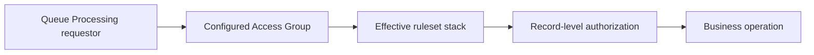

# Execution access groups and security context

**PFA-116** | Pega SSA/LSA reference implementation | Actual lab test pending

## Incident and business outcome

An automated fraud-screening Queue Processor is configured with a system-wide Access Group so it can process cases from different applications. It inadvertently obtains access to all tenants and executes a permissive generic rule version.

The architecture must identify a stable operation identity and separate case state, asynchronous delivery, integration outcome and authorization. The same message can execute more than once unless the business protocol rules out duplicate effects.

## Processing architecture

## Pega execution artifacts

1. **Access Group**. Document the version, queue/service context, business identifier and observable failure outcome.
2. **Queue Processor**. Document the version, queue/service context, business identifier and observable failure outcome.
3. **Access Role**. Document the version, queue/service context, business identifier and observable failure outcome.
4. **ABAC**. Document the version, queue/service context, business identifier and observable failure outcome.
5. **rule resolution**. Document the version, queue/service context, business identifier and observable failure outcome.

## Implementation design steps

1. Choose an explicit least-privileged worker identity that can run only the intended rules and access necessary data classes.

2. Verify the worker's effective application/ruleset stack and Pega class context; headless runtime is not automatically identical to a logged-in developer.

3. Implement record- and tenant-level authorization for the operation, not just a broad system access role.

4. Rotate integration secrets separately from interactive operator login and preserve audit of automated actions.

5. Run negative access tests from a restricted tenant, and test missing rules after application version changes.

A complete application example should use a documented rule and class naming scheme, stable case/operation IDs, data shape, service API contract and a support-owned recovery path. Exact settings must be tested in the target Pega release.

## Alternatives

- **Choice 1:** Shared admin group is convenient but dangerous.
- **Choice 2:** dedicated processing group requires governance but bounds impact.

Architecture acceptance depends on business correctness after a duplicate, delay or partial failure, not merely on low response time when the partner is healthy.

## Failure mechanics

A processor with high privileges can process cross-tenant case IDs supplied in its payload, or resolve stale rules after a framework version change.

For diagnostics capture the Pega case version, queue item/operation ID, current access group, retry attempt, outbound request correlation and remote receipt. An error status is not evidence the remote system made no change.

## Validation experiments

1. **Scenario 1:** Queue unauthorized tenant ID. Record actual result, remote side effect count and elapsed time or backlog age.
2. **Scenario 2:** compare worker and human ruleset stacks. Record actual result, remote side effect count and elapsed time or backlog age.
3. **Scenario 3:** remove access role and ensure rejection. Record actual result, remote side effect count and elapsed time or backlog age.

All tests remain proposed. The article does not claim that a live Pega lab was executed or that hypothetical measurements are production evidence.

## Deployment and ongoing support

Add a rollback or forward-repair plan for in-flight queue items and live cases. Include alerting for broken items, oldest age, invalid business payloads and provider failures, together with safe replay privileges and audit trail. For sensitive data, verify inbound/outbound minimization and identity controls.

## Official Pega reference

- [Pega Academy: Ruleset list](https://academy.pega.com/topic/ruleset-list/v6)

*Independent technical study with fictional scenario. Verify configuration against the deployed Pega release.*
