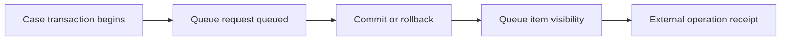

# Commit boundaries before and after enqueueing work

**PFA-117** | Senior/Lead System Architect design study | Platform verification pending

## The business and runtime problem

A flow saves a customer policy case and queues a partner registration in the same interaction. A developer assumes the queue item always exists if the case saves. During a controlled database rollback, the queue still appears to have been scheduled under one processing method, while another method behaves differently.

An architecture is useful only if it identifies the business state that must remain correct when a user retries, another operator acts, a queue item is delayed or a new Pega release changes rendering and rule execution.

## Data and execution boundaries

## Pega feature inventory

1. **Queue-For-Processing.** Establish the effective version, security principal, input/output contract and the responsible support owner.
2. **Run in Background.** Establish the effective version, security principal, input/output contract and the responsible support owner.
3. **Queue Processor.** Establish the effective version, security principal, input/output contract and the responsible support owner.
4. **Pega Commit.** Establish the effective version, security principal, input/output contract and the responsible support owner.
5. **business receipt ledger.** Establish the effective version, security principal, input/output contract and the responsible support owner.

## Reference architecture steps

1. Document the exact supported queueing API and conditional commit behavior of the deployed Pega release before reasoning about atomicity.

2. Separate the case's committed Pending operation state from a queue transport acknowledgment and from remote partner completion.

3. Force a local transaction rollback at several execution points and inspect whether a queue item is persisted and eventually dispatched.

4. Prevent a pre-commit event from being interpreted by a remote consumer as a finalized case state; use an authorized operation/version check.

5. Reconcile committed Pending business operations against confirmed external receipts, irrespective of queue technical status.

The implementation should preserve authoritative business decisions on the Pega server and use published interfaces when integrating external UI or asynchronous systems. Internal details and UI markup are not a stable substitute for an explicit supported contract.

## Design choices

- **Alternative 1:** Inline external send creates partial remote commits.
- **Alternative 2:** queueing improves decoupling but must have tested enqueue transaction semantics.

Select the design based on platform support, latency and dependency limits, auditability, maintenance ownership and ability to recover from an interrupted operation.

## Failure mode to investigate

A queue item can be lost or sent at the wrong boundary if the caller uses an inappropriate commit pattern. Production correctness needs an actual lab trace for that method.

Keep the case/operation identity, applied ruleset, security context, error classification and timestamp with incident evidence. For a UI extension, also record the DX API response and supported SDK/runtime versions without exposing private customer data.

## Acceptance test matrix

1. **Test 1:** Rollback before enqueue. Log the expected result, observed behavior and failure recovery.
2. **Test 2:** rollback after enqueue but before commit. Log the expected result, observed behavior and failure recovery.
3. **Test 3:** kill worker after external success. Log the expected result, observed behavior and failure recovery.

These are planned tests, not completed observations. Authenticate to a permitted Pega sandbox before collecting authentic screenshots or metrics. Test both happy path and error path on the actual deployment release.

## Operational readiness

Assign explicit ownership for version compatibility, current-case authorization and business completion. Put alerts on unresolved outcomes, stale UI state, broken background items or contract failures rather than just node health. Include a safe rollback/repair plan for cases that cross deployments.

## Pega reference

- [Pega Academy: Queue processors](https://academy.pega.com/topic/queue-processors-and-job-schedulers/v2)

*Independent technical article, fictional scenario, no claim of production execution.*
