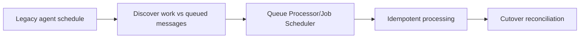

# Replacing legacy agents safely

**PFA-118** | Senior/Lead System Architect design study | Platform verification pending

## The business and runtime problem

An older Pega application uses a standard agent to poll work records and send documents. A modernization project replaces it with a Queue Processor without preserving schedule semantics or duplicate processing controls. Some work runs twice and other work is never discovered.

An architecture is useful only if it identifies the business state that must remain correct when a user retries, another operator acts, a queue item is delayed or a new Pega release changes rendering and rule execution.

## Data and execution boundaries

## Pega feature inventory

1. **Standard/Advanced Agent.** Establish the effective version, security principal, input/output contract and the responsible support owner.
2. **Job Scheduler.** Establish the effective version, security principal, input/output contract and the responsible support owner.
3. **Queue Processor.** Establish the effective version, security principal, input/output contract and the responsible support owner.
4. **Report Definition.** Establish the effective version, security principal, input/output contract and the responsible support owner.
5. **operation receipt ledger.** Establish the effective version, security principal, input/output contract and the responsible support owner.

## Reference architecture steps

1. Inventory each existing agent's cadence, task discovery, execution identity, retry behavior and state checkpoint before choosing replacement.

2. Use Job Scheduler for periodic work discovery and Queue Processor for independently queued item processing; the two often need to cooperate.

3. Maintain a stable operation identity so an old agent and a new worker cannot both complete the same external side effect during dual-run.

4. Turn off old production agent only after controlled cutover and reconciliation of existing pending work; avoid leaving two active producers.

5. Measure backlog age and failed items during cutover and have a rollback that re-enables discovery without replaying completed operations.

The implementation should preserve authoritative business decisions on the Pega server and use published interfaces when integrating external UI or asynchronous systems. Internal details and UI markup are not a stable substitute for an explicit supported contract.

## Design choices

- **Alternative 1:** Replacing poller only with QP misses discovery.
- **Alternative 2:** separating scheduler and QP clarifies responsibilities but needs two monitored components.

Select the design based on platform support, latency and dependency limits, auditability, maintenance ownership and ability to recover from an interrupted operation.

## Failure mode to investigate

The old agent restarts during deployment and sends the same notification as the Queue Processor; mismatched Access Groups resolve different rules.

Keep the case/operation identity, applied ruleset, security context, error classification and timestamp with incident evidence. For a UI extension, also record the DX API response and supported SDK/runtime versions without exposing private customer data.

## Acceptance test matrix

1. **Test 1:** Shadow-run new discovery without sending. Log the expected result, observed behavior and failure recovery.
2. **Test 2:** cut over with pending backlog. Log the expected result, observed behavior and failure recovery.
3. **Test 3:** roll back worker and verify no duplicate. Log the expected result, observed behavior and failure recovery.

These are planned tests, not completed observations. Authenticate to a permitted Pega sandbox before collecting authentic screenshots or metrics. Test both happy path and error path on the actual deployment release.

## Operational readiness

Assign explicit ownership for version compatibility, current-case authorization and business completion. Put alerts on unresolved outcomes, stale UI state, broken background items or contract failures rather than just node health. Include a safe rollback/repair plan for cases that cross deployments.

## Pega reference

- [Pega Academy: Background processing](https://academy.pega.com/topic/background-processing/v2)

*Independent technical article, fictional scenario, no claim of production execution.*
