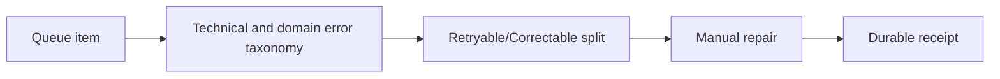

# Separating poison-message retries from business retries

**PFA-119** | Senior/Lead System Architect design study | Platform verification pending

## The business and runtime problem

One queued item contains a malformed customer postal code while a different item fails because an API is temporarily down. The same generic retry strategy repeats both. Invalid data wastes all attempts and consumes stream capacity needed by recoverable work.

An architecture is useful only if it identifies the business state that must remain correct when a user retries, another operator acts, a queue item is delayed or a new Pega release changes rendering and rule execution.

## Data and execution boundaries

## Pega feature inventory

1. **Dedicated Queue Processor.** Establish the effective version, security principal, input/output contract and the responsible support owner.
2. **Connect REST.** Establish the effective version, security principal, input/output contract and the responsible support owner.
3. **error-mapping Data Transform.** Establish the effective version, security principal, input/output contract and the responsible support owner.
4. **Broken queue.** Establish the effective version, security principal, input/output contract and the responsible support owner.
5. **case exception status.** Establish the effective version, security principal, input/output contract and the responsible support owner.

## Reference architecture steps

1. Classify outcome into confirmed, correctable input, temporary dependency, unknown remote effect and permanent rejection.

2. When a business input is invalid, stop automatic retry of the unchanged payload and create a specific correction assignment or dead-letter support route.

3. When a dependency is unavailable, bound retry attempts and delays by the business SLA and vendor recovery policy.

4. For uncertain remote writes, query partner status or retry using the same idempotency key instead of generating a fresh request.

5. Monitor error-category distribution and age of uncorrected items separately from raw retries, and require operator reason for manual requeue.

The implementation should preserve authoritative business decisions on the Pega server and use published interfaces when integrating external UI or asynchronous systems. Internal details and UI markup are not a stable substitute for an explicit supported contract.

## Design choices

- **Alternative 1:** Retry everything simplifies worker code but creates retry storms.
- **Alternative 2:** typed repair flows reduce repeated load and preserve business context.

Select the design based on platform support, latency and dependency limits, auditability, maintenance ownership and ability to recover from an interrupted operation.

## Failure mode to investigate

A poison message may enter Broken but still carry sensitive contents. Support replay without revalidation can cause unauthorized or duplicate operations.

Keep the case/operation identity, applied ruleset, security context, error classification and timestamp with incident evidence. For a UI extension, also record the DX API response and supported SDK/runtime versions without exposing private customer data.

## Acceptance test matrix

1. **Test 1:** Send invalid address. Log the expected result, observed behavior and failure recovery.
2. **Test 2:** force remote 503. Log the expected result, observed behavior and failure recovery.
3. **Test 3:** simulate timeout after successful external commit. Log the expected result, observed behavior and failure recovery.

These are planned tests, not completed observations. Authenticate to a permitted Pega sandbox before collecting authentic screenshots or metrics. Test both happy path and error path on the actual deployment release.

## Operational readiness

Assign explicit ownership for version compatibility, current-case authorization and business completion. Put alerts on unresolved outcomes, stale UI state, broken background items or contract failures rather than just node health. Include a safe rollback/repair plan for cases that cross deployments.

## Pega reference

- [Pega Academy: Background processing](https://academy.pega.com/topic/background-processing/v2)

*Independent technical article, fictional scenario, no claim of production execution.*
