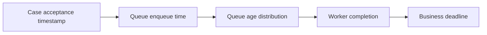

# Monitoring queue latency against customer-facing SLAs

**PFA-120** | Senior/Lead System Architect design study | Platform verification pending

## The business and runtime problem

A case portal promises that a new customer identity check will finish within two minutes, while average queue processing is under ten seconds. During peak traffic the oldest queued item waits fifteen minutes even though mean duration looks healthy.

An architecture is useful only if it identifies the business state that must remain correct when a user retries, another operator acts, a queue item is delayed or a new Pega release changes rendering and rule execution.

## Data and execution boundaries

## Pega feature inventory

1. **Queue Processor.** Establish the effective version, security principal, input/output contract and the responsible support owner.
2. **Admin Studio.** Establish the effective version, security principal, input/output contract and the responsible support owner.
3. **case SLA.** Establish the effective version, security principal, input/output contract and the responsible support owner.
4. **PDC.** Establish the effective version, security principal, input/output contract and the responsible support owner.
5. **operation receipt data.** Establish the effective version, security principal, input/output contract and the responsible support owner.

## Reference architecture steps

1. Measure enqueue-to-start lag, execution duration and end-to-end business completion separately.

2. Track percentile and maximum queue age by priority/business case, not just average worker execution time.

3. Use queue backlog/arrival rate to predict the chance of breaching an explicit case deadline, including retries.

4. Alert before the oldest item reaches its business threshold; count broken and delayed items as unresolved work.

5. Surface Pending verification transparently in the case rather than marking Complete when the queue accepted a message.

The implementation should preserve authoritative business decisions on the Pega server and use published interfaces when integrating external UI or asynchronous systems. Internal details and UI markup are not a stable substitute for an explicit supported contract.

## Design choices

- **Alternative 1:** High thread count can lower start lag until partner quota saturates.
- **Alternative 2:** separate prioritized queues can protect critical cases with operational overhead.

Select the design based on platform support, latency and dependency limits, auditability, maintenance ownership and ability to recover from an interrupted operation.

## Failure mode to investigate

A failed queue item may be marked handled technically while business status remains Pending indefinitely. A fast mean conceals long-tail breach.

Keep the case/operation identity, applied ruleset, security context, error classification and timestamp with incident evidence. For a UI extension, also record the DX API response and supported SDK/runtime versions without exposing private customer data.

## Acceptance test matrix

1. **Test 1:** Inject 10x message burst. Log the expected result, observed behavior and failure recovery.
2. **Test 2:** stop one worker. Log the expected result, observed behavior and failure recovery.
3. **Test 3:** simulate vendor quota and compare oldest age to SLA. Log the expected result, observed behavior and failure recovery.

These are planned tests, not completed observations. Authenticate to a permitted Pega sandbox before collecting authentic screenshots or metrics. Test both happy path and error path on the actual deployment release.

## Operational readiness

Assign explicit ownership for version compatibility, current-case authorization and business completion. Put alerts on unresolved outcomes, stale UI state, broken background items or contract failures rather than just node health. Include a safe rollback/repair plan for cases that cross deployments.

## Pega reference

- [Pega Academy: Background process management](https://academy.pega.com/topic/background-process-management/v8/in/108716)

*Independent technical article, fictional scenario, no claim of production execution.*
