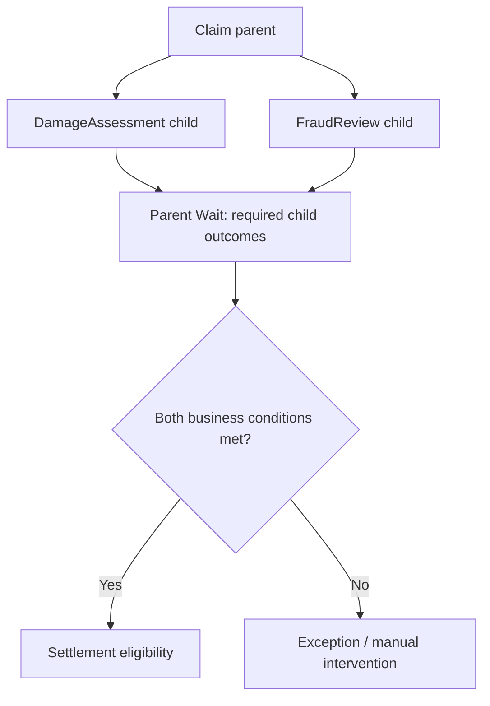

# Parent and Child Cases: Orchestrating Independent Teams Without Locking the Whole Process

**PFA-032** | **Level:** SSA / LSA architecture | **Evidence status:** Design reference; not yet lab executed

## Business situation and the architectural mistake

An insurance Claim case creates two independently assigned child cases: DamageAssessment and FraudReview. A third process calculates a final settlement only when both outcomes have reached a safe state. Initially, a developer adds a wait for any child to resolve. The parent advances after the first successful child, before the fraud result arrives. A different team proposes a single parent case with parallel assignments, but that increases locking interference between teams. The LSA must decide how case hierarchy, dependency status, cancellation and event ordering work together.

## Reference architecture

The diagram describes a proposed component boundary. It is not a screenshot of a Pega test environment.

## Pega rules and components

| Object or rule category | Architectural responsibility |
|---|---|
| Claim parent case | Coordinates the business outcome and owns closure criteria |
| DamageAssessment child | Separate ownership, assignment queue and lifecycle |
| FraudReview child | Independent control process with its own resolution reasons |
| Wait step, Case Dependency | Blocks parent until configured child case condition |
| Parent status aggregation | Application-specific interpretation of child states |
| Settlement calculation | Runs after fresh validation of child results |

Illustrative rule and domain names are not assertions that Pega creates those exact names out of the box.

## How to design and implement it

1. **Design step 1.** Define a business completion matrix before creating the hierarchy. Resolved-Approved, Resolved-Rejected and Resolved-Cancelled must not all mean the same thing.

2. **Design step 2.** Create independent child case types when they require separate teams, permissions, SLAs or long-running processes. Do not split work into a child merely to render a second form.

3. **Design step 3.** Configure a parent Wait step with Case Dependency for the applicable child case types and required status; Pega supports waiting for all or any child according to the configured condition.

4. **Design step 4.** Make the parent transition re-evaluate *business* conditions after the wait. Even if all children are resolved, a rejected fraud review may prevent settlement.

5. **Design step 5.** Decide what happens if a child is cancelled, replaced or recreated. A new child should not silently inherit the previous approval outcome.

6. **Design step 6.** Design parent-child locking deliberately. Parallel child teams must be able to work without frequent contention; test actual locking inheritance and override settings.

7. **Design step 7.** Where child work lives in an external system, do not assume a Pega case dependency can directly wait on a remote workflow. Use a trusted callback/adapter to update a local case or record an explicit external dependency.

Before changing a production application, reproduce the same process in an environment with the target Pega version, security model and dependency versions. Decide what should remain a Pega case responsibility and what belongs to an external service.

## Which approach should you choose?

| Design choice | Advantages and constraints |
|---|---|
| Independent Pega child cases | Clear work ownership, audit and separate lifecycles; dependency and lock complexity |
| Parallel assignments in a single case | Simpler structure for short tasks, potentially more shared-state locking |
| External orchestration with callbacks | Appropriate across system boundaries, needs correlation, idempotency and reconciliation |

No pattern wins merely because it is newer. Fit the design to recovery, ownership, runtime semantics, security and the actual business volume.

## What fails in production?

Failure A: The parent uses an Any child condition but the business requires All. Failure B: A child gets Resolved-Cancelled, which technically satisfies a generic resolved check yet should halt settlement. Failure C: the parent locks while a child is in a long user assignment, blocking unrelated activity. Failure D: a late callback updates the previous child after the parent has restarted assessment. Trace the actual child IDs, child types, status transitions, dependency state and operation correlation, not merely the parent status shown on the screen.

An architecture review should identify an observable signal, support owner and recovery action for every material failure. Do not assume that a successful Pega flow status proves every remote dependency or business process completed.

## Validation matrix

| Experiment to run | Expected evidence |
|---|---|
| Both completed | Settlement begins only after both required children satisfy business criteria |
| Only one completed | Parent remains waiting |
| Child rejection | Resolved-rejected path does not enter settlement |
| Child cancelled | Business-specific cancellation handling is invoked |
| Concurrent teams | Two different operators can progress child work without unintended lock interference |
| Recreated child | Stale callback or obsolete child cannot authorize new settlement |

All results above are proposed assertions, not measured or executed outcomes. A verified edition of this article should include redacted rule screenshots, real diagnostics and release-specific deviations.

## Operations and support

An operational dashboard should show parents blocked by dependencies, age of waiting parents, failed child creation and children with no active owner. A recovery procedure must explain whether to reopen, restart or create replacement children and how to preserve audit history.

## Pega references

- [Pega Academy: Case workflow dependency](https://academy.pega.com/topic/case-workflow-dependency/v3)
- [Pega Academy: Case locking](https://academy.pega.com/topic/case-locking/v7)

**Applicability note:** Specific UI labels, background services and runtime behaviour may vary by Pega release. Verify target-platform behaviour, especially after a major upgrade. Original independent architectural material, not affiliated with Pegasystems.
