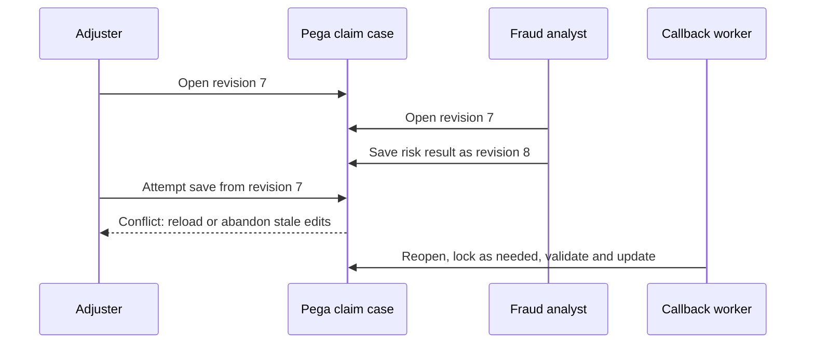

# Case Locking Under Concurrency: Designing Safe Parallel Updates

**PFA-033** | **Audience:** Senior and Lead System Architects | **Status:** Reference architecture; live Pega test pending

Two claim handlers, an automated update and an external callback all touch the same case. Choosing optimistic locking without designing conflict recovery does not solve the process.

## 1. The enterprise failure this design prevents

A major-loss claims case is reviewed by a loss adjuster while a fraud analyst updates risk information. A background callback also changes the external assessment status. The business wants concurrent access but cannot accept lost financial amounts. With exclusive locking the adjuster can block the analyst. With optimistic locking both can open the case, but a stale user save must be handled deliberately. Pega documents the choices as **Allow one user** and **Allow multiple users**; the latter checks for changed case data when saving.

## 2. Component and execution architecture

The following diagram is an **illustrative reference design**. It is not a screenshot from a running Pega environment.

## 3. Which Pega objects own each concern?

| Component | Why it exists |
|---|---|
| `Claim case type / Locking` | Choose one-user or multiple-users strategy |
| `Claim parent / Damage child` | Understand parent-child lock interactions |
| `UpdateAssessment service/activity` | Reopen and protect automated mutation |
| `RecalculateReserve` | Recalculate from current persisted values |
| `Conflict message and re-entry UX` | Prevent silent overwrites and data loss |

The named objects above are a mix of actual Pega rule categories and illustrative application-specific names. They are not a claim that all such rules exist in a default Pega installation.

## 4. Implementation design and decision sequence

1. Identify exactly which fields need serial updates. A reserve amount and audit status must not share the same conflict tolerance as free-form comments.

2. Choose Allow one user when the work has short, financial-critical edit sessions and a clear lock owner. Choose Allow multiple users when concurrent review is central and users can reapply edits safely.

3. Design conflict handling in the user journey. Display what changed and never quietly submit a stale page a second time.

4. Before a worker changes case data, reopen the current instance, check lock or save conflict rules, and ensure required privileges. Test the lock behaviour of the actual method or step used.

5. For parent-child case designs, check whether opening a child locks the parent. Pega's documented override behaviour depends on the selected parent strategy.

6. Place irreversible financial calls behind a case-state check and an external idempotency boundary. Case locking does not protect a remote bank or payout API from repeated calls.

## 5. What an architect must choose

| Approach | Effect and trade-off |
|---|---|
| Exclusive lock | Predictable edit ownership but users can wait or hit expiry |
| Optimistic save check | More concurrent readers but explicit reload/reapply UX required |
| Separate child cases | Independent work orchestration but parent synchronization must be designed |

**Decision standard:** choose the smallest design that satisfies consistency, auditability, security, performance and operational recovery, not the design that simply looks easiest in Dev Studio.

## 6. Failure modes and root-cause investigation

**Lost-update risk:** A custom activity uses an object method without honoring case lock behaviour. **Expired lock:** a 30-minute review spans a meeting, so reopening after timeout must be handled safely. **Deadlock-like user experience:** a child locks its parent and another team cannot progress work. **Callback race:** an async worker reads old case status, then overwrites a later human update. Diagnose each by comparing case history, lock owner, case version and actual worker sequence; a single happy-path test is insufficient.

For troubleshooting, preserve the application/ruleset version, access context, precise business identity, timestamp and correlation ID. Never include secrets or production customer documents in publicly shared traces.

## 7. Verification matrix for a Pega lab

These are **tests to run**, not tests that have already passed.

| Experiment | Evidence and expected assertion |
|---|---|
| Two agents | Open same case, save B first, attempt stale save A |
| Timeout | Allow an exclusive lock to expire, then test resumed interaction |
| Child case | Open child and verify parent accessibility under configured strategy |
| Worker collision | Run callback while human edits; confirm safe retry or exception |
| Security | Attempt background update under a role without required privileges |

At the end of the experiment, attach redacted screenshots of the relevant rule forms, Clipboard/Tracer/PAL evidence when applicable, and an actual observed outcome. If any result differs, update the design instead of changing the evidence description.

## 8. Production readiness and ownership

Record lock duration, contention rate and stale-save frequency. Provide a support procedure to identify the lock owner without routinely bypassing locks. When a flow is redesigned for longer-lived human work, retest lock lifetimes and parent-child interactions, not just form rendering.

**Architecture acceptance:** the design has an explicit owner, a version-specific reproducible test, a failure/recovery procedure, the relevant security controls and a way to detect regressions.

## 9. Product references and limitations

- [Pega Academy: Case locking](https://academy.pega.com/topic/case-locking/v7)
- [Pega Academy: Managing concurrent case access](https://academy.pega.com/topic/managing-concurrent-access-case/v1/in/2881/12861)

Pega functionality changes by release. Treat exact editor labels, extension points and service behaviours as version-sensitive until verified in the target environment. This independent article is neither an official Pega document nor a claim of an executed customer implementation.
