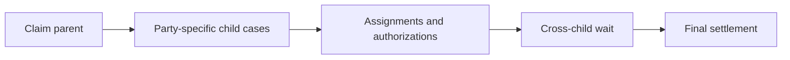

# Modelling multi-party enterprise case hierarchies

**PFA-031** | Senior/Lead System Architect | Design case study, laboratory evidence pending

## The failure to prevent

A commercial-insurance claim involves claimant, broker, adjuster, insurer and external reinsurer. Teams model every participant as another field or single parallel process in one case, creating confused ownership and case locking.

The useful outcome is a repeatable design that remains correct across application variations, case versions and retries, not a single Dev Studio screen that happens to work.

## Execution and data boundaries

## Pega rules that must be considered

- **Parent Case Type:** confirm the effective class, ruleset/app version and input/output contract for the specific business use case.
- **Child Case:** confirm the effective class, ruleset/app version and input/output contract for the specific business use case.
- **Case Dependency Wait:** confirm the effective class, ruleset/app version and input/output contract for the specific business use case.
- **ABAC:** confirm the effective class, ruleset/app version and input/output contract for the specific business use case.
- **case lock:** confirm the effective class, ruleset/app version and input/output contract for the specific business use case.

## Detailed design sequence

1. Create case types around independently accountable business outcomes, not simply organization-chart departments.

2. Keep claimant details in a reusable data object, while child cases own their workflow-specific audit and assignment history.

3. Apply participant-specific permissions and record access to each case boundary, rather than hiding tabs in one portal.

4. Use parent Wait conditions for required child results, and inspect whether any resolved status counts as success under your business policy.

5. Design cancellation/replacement of a child and the status aggregation that re-evaluates business criteria before parent settlement.

A production-ready implementation should document the actual rule keys, test classes, authorized operators, system-of-record fields and accepted exception states. An external system's response should never be considered atomic with a Pega case commit without an explicit verified transaction model.

## Design alternatives

- **Pattern 1:** One giant case simplifies IDs but creates shared locks.
- **Pattern 2:** independent children preserve work ownership but require correlation and dependency design.

Select the pattern by testable business requirements: record ownership, controlled override scope, rollback of active cases, and failure recovery. An apparently easier class inheritance or flow design may have wider long-term maintenance cost.

## Diagnose the production failure

A child is Resolved-Rejected yet the generic parent Wait sees resolution and advances. A party's data may be exposed through broad parent permissions.

For a meaningful incident review, collect the effective ruleset list and precise selected rule, case history, assignments, node/requestor and trace of the failing execution. A screenshot of a rule form does not show which rule the case executed.

## Lab verification matrix

1. **Experiment 1:** Resolve one rejected child. Save the input, expected business state, actual outcome and supporting trace.
2. **Experiment 2:** cancel and recreate child. Save the input, expected business state, actual outcome and supporting trace.
3. **Experiment 3:** edit two children concurrently under distinct roles. Save the input, expected business state, actual outcome and supporting trace.

These tests have not been executed for this article. Once run, add screenshots from a permitted Pega sandbox, with the actual version, reproduced steps and redacted identifiers.

## Release and operating guidance

Include negative cases and old active work in regression, particularly if a new ruleset or flow changes what can be resolved. Use a controlled change process for rules affecting authorization, eligibility or financial outcomes. Define who diagnoses an unresolved work item and how a safe retry is performed.

## Reference

- [Pega Academy: Case workflow dependency](https://academy.pega.com/topic/case-workflow-dependency/v3)

*Independent architectural design based on a fictional scenario. Validate platform-version details before implementation.*
