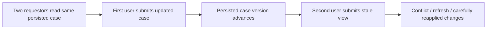

# Optimistic Case Locking: Designing the Conflict Experience Instead of Just Enabling It

**PFA-034** | **Target reader:** Pega SSA / LSA | **Evidence:** Architecture design, live test pending

## Why this matters in a real enterprise application

Two claim handlers open the same case. One amends a reserve amount and saves; the other keeps a browser tab open for twenty minutes and then updates the incident narrative. Both must contribute, but the system must not silently overwrite the new reserve amount with a stale copy. Selecting Allow multiple users changes the concurrency model but does not decide what the second user should see when a conflict occurs.

The technical target is not simply to configure a rule that works once. The design must remain correct when authorization changes, multiple requestors interact, dependent services fail and different rule versions coexist during deployment.

## Runtime architecture and trust boundaries

The diagram is an implementation proposal, not a screenshot or observed runtime trace.

## Pega rule and component inventory

| Pega component | What the architect must control |
|---|---|
| Case Type locking strategy: Allow multiple users | Define the component's business ownership and version |
| Case assignment Flow Actions | Specify input fields, classes and caller contract |
| Case version / save validation | Confirm scope, access privileges and applicable rulesets |
| Clipboard and case history | Expose useful diagnostic evidence and correlation IDs |
| Re-entry UX / conflict recovery design | Define failure/recovery behavior and verification owner |

All custom names in the example should be replaced with classes and rule names from the target application. Do not blindly apply design examples to a different Pega release.

## Implementation design

1. **Step 1:** Split fields into independent and dependent sets. A free-form comment may be reapplied after reload; a financial reserve or decision outcome requires fresh validation.

2. **Step 2:** Record the intended locking mode on the Case Type and which case types or inherited lock behavior apply. Changing it affects concurrent edits and automation.

3. **Step 3:** Do not build UI logic that retries a failed save with the stale clipboard. Present a conflict and allow the user to reload or deliberately reapply their own values.

4. **Step 4:** If keeping user draft data locally, never merge protected or computed server fields by default. Store candidate inputs separately from authoritative case state.

5. **Step 5:** Ensure REST callbacks, queue workers and human users reopen the latest case state before mutating it. Use supported locking/commit methods and test their actual behavior.

6. **Step 6:** For a parent with multiple child cases, test parent locking independently. A child may interact with its parent lock depending on the configuration.

7. **Step 7:** Instrument conflict frequency, case revision, affected Flow Action and the elapsed time between read and save; high conflict rate may signal poor case boundaries.

### Decision contract

Before writing the rule, record the caller, authoritative system of record, access-group or service identity, acceptable stale age, latency target and required behaviour under duplicate execution. Where the feature supports multiple execution modes, the choice must be justified against these constraints.

## Alternative patterns

| Design approach | Why it may or may not fit |
|---|---|
| Allow one user | Serializes editing, but creates waiting and lock-expiry concerns |
| Allow multiple users | Improves concurrent access, but requires stale-save handling |
| Split independent work into child cases | Reduces shared write contention, adds orchestration and synchronization |

A more scalable option is not necessarily the most secure or operationally supportable. The decision should be driven by the application's actual workload and failure modes, not the convenience of one dev-environment demo.

## Production failure and diagnosis

A custom post-processing activity may overwrite the case after a conflict because it retained an old step page. A browser tab can show apparently valid choices even after the case progressed. A background listener using elevated privileges can bypass the intended human workflow. Trace the version observed on read, version persisted by the first actor and the second actor's exact save result.

When diagnosing a failure, capture the exact case ID in an approved test environment, the active application and ruleset versions, Pega node, relevant Data Page or flow state, and the downstream correlation ID. Avoid including tokens, customer personal information or confidential attachments.

## Verification plan

| Scenario | Evidence required |
|---|---|
| Experiment 1 | User A and B open same case; B saves reserve before A changes notes. |
| Experiment 2 | One user finishes assignment while second retains original tab. |
| Experiment 3 | Background worker updates case as an agent edits it. |
| Experiment 4 | Parent and child edits overlap; no lost required data. |

**These are test instructions, not completed test results.** Once a supported Pega sandbox is available, record the installed release and attach redacted, authentic rule screenshots, Tracer/PAL or Clipboard evidence and expected versus observed outcomes.

## Operational acceptance and release considerations

Specify an accountable owner for this design, expected business volume, Pega and dependent-system resource limits, monitoring signals and a recovery runbook. Confirm an older persisted case or queued operation can safely resume after deployment where applicable. Create an Architecture Decision Record so future maintainers understand both the accepted approach and its rejected alternatives.

## Primary references and version caveat

- [Pega Academy: Case locking](https://academy.pega.com/topic/case-locking/v7)

This independent article is based on published Pega concepts and a fictional scenario. UI labels, exact method semantics and feature availability must be verified in the chosen platform release.
