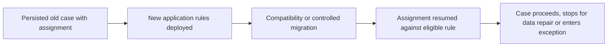

# Long-Running Cases: Deploying New Flows Without Stranding Old Assignments

**PFA-035** | **Audience:** Senior and Lead System Architects | **Status:** Architecture design, live Pega verification pending

## The actual failure

A mortgage application can remain open for six months. During that time the lender inserts a new approval stage and makes new fields mandatory. Fresh cases pass; previously opened cases resume at older persisted assignments and fail the new validations. A deployment needs an explicit compatibility design for saved case data, flow state, assignments and rule availability.

## System interaction and ownership

This is a conceptual reference architecture, not a product screenshot or observed runtime trace. Its boundaries must be verified for the actual Pega deployment version and external systems.

## Pega implementation inventory

| Component or rule | Design consideration |
|---|---|
| Case Type and flow versions | Owns a defined runtime decision or state boundary |
| Assignment instances | Needs a documented input/output contract |
| Migration Data Transform or supported upgrade mechanism | Requires version-specific access and execution testing |
| Case history | Produces diagnostics for failure isolation |
| Cross-version regression fixtures | Carries operational ownership |

## How to implement and validate the architecture

1. Inventory open cases by stage, status, age, pending assignment and external dependency.

2. Classify proposed change as compatible, additively migratable or breaking. New required data must have a strategy for old records.

3. Create test fixtures by parking cases in each important old stage, then deploy the candidate version and resume them.

4. Retain necessary rule versions or use a deliberate supported migration path where flow semantics change.

5. Ensure downstream side effects are idempotent across resumes, retries and restarted flows.

6. After release, monitor stalled assignments and unexpected status distributions; compare them to the prerelease baseline.

For a production build, annotate the actual class names, access group, ruleset version, node role and recovery owner. Ensure each external operation has an explicit system of record; a successful Pega case save does not, by itself, certify that an external service committed a change.

## Architectural choices

| Pattern | Consequence |
|---|---|
| Force all old cases onto new flow | Uniform design, high breakage risk |
| Retain compatible old paths until natural closure | Safer but increases maintenance and version complexity |
| Migrate actively with controlled mapping | Necessary for some breaking changes, requires proof per persisted state |

Choose by the actual confidentiality, scale, consistency and failure-recovery constraints. A seemingly quicker configuration can shift cost into production support, data repair or lost auditability.

## Failure mechanics and support diagnosis

An old case without a newly mandatory field can fail at save. A withdrawn flow version may prevent a parked assignment from resuming. A migration may skip approval history, or a retry may repeat a payment request. Preserve original flow state and a reversible migration ledger.

Correlate one affected case ID and operation ID across rule execution, logs and dependent services. Record the effective application/ruleset versions and node. Avoid exporting live client data or confidential prompts in community evidence.

## Test matrix

| Test | Expected verification |
|---|---|
| Experiment 1 | Open before deploy, park at approval, deploy and resume. |
| Experiment 2 | Exercise all added mandatory fields against historical test data. |
| Experiment 3 | Simulate old callback after migration; it cannot overwrite new outcome. |
| Experiment 4 | Compare audit history and approval checkpoints before and after a controlled migration. |

These are **experiments to execute**, not assertions of a completed test. Include Pega configuration screenshots and sanitized Clipboard, Tracer, PAL or service evidence only after an authorised lab run. A failing experiment is valuable evidence and should update the design.

## Release and production readiness

Before promoting the design, confirm: observable business state; retry and rollback constraints; tenant and privilege isolation; capacity target; accountable support team; release-specific configuration; and a documented repair procedure. A green rule test or a running node does not imply the complete business operation succeeded.

## Primary reference

- [Pega Academy technical documentation](https://academy.pega.com/topic/case-locking/v7)

This article is an independent architectural study. The example scenario is fictional. It is not affiliated with Pegasystems, and no performance measurement or live test result is claimed.
