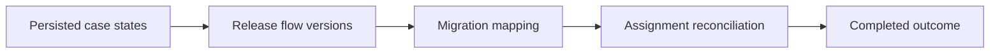

# Active case migration after flow redesign

**PFA-036** | Senior/Lead System Architect | Design case study, laboratory evidence pending

## The failure to prevent

A retail loan workflow is redesigned while hundreds of cases wait at the previous verification stage. The new flow has different field requirements; trying to force all pending work into the new shape breaks persisted assignments.

The useful outcome is a repeatable design that remains correct across application variations, case versions and retries, not a single Dev Studio screen that happens to work.

## Execution and data boundaries

## Pega rules that must be considered

- **Case Type lifecycle:** confirm the effective class, ruleset/app version and input/output contract for the specific business use case.
- **flow version:** confirm the effective class, ruleset/app version and input/output contract for the specific business use case.
- **Data Transform:** confirm the effective class, ruleset/app version and input/output contract for the specific business use case.
- **case history:** confirm the effective class, ruleset/app version and input/output contract for the specific business use case.
- **Product packaging:** confirm the effective class, ruleset/app version and input/output contract for the specific business use case.

## Detailed design sequence

1. Catalogue active cases by stage, status and assignment before deploying a breaking Flow or Case Type change.

2. Choose coexistence of old rules versus an explicit migration, based on whether legacy paths can be safely maintained.

3. Build a migration map for each relevant old stage: target stage, required fields and assignment owner, with a repair outcome for incomplete data.

4. Test one staged old case through its next critical step in the target ruleset stack, including callbacks and delayed queue items.

5. Log old/new state, migration ID and exceptions so support can resolve inconsistent records without repeating business side effects.

A production-ready implementation should document the actual rule keys, test classes, authorized operators, system-of-record fields and accepted exception states. An external system's response should never be considered atomic with a Pega case commit without an explicit verified transaction model.

## Design alternatives

- **Pattern 1:** Keep old paths through closure uses more rule versions.
- **Pattern 2:** active migration reduces mixed paths but demands verified transformations.

Select the pattern by testable business requirements: record ownership, controlled override scope, rollback of active cases, and failure recovery. An apparently easier class inheritance or flow design may have wider long-term maintenance cost.

## Diagnose the production failure

An active assignment points to a withdrawn flow or a payment step executes twice after restart. A version bump alone is not a migration strategy.

For a meaningful incident review, collect the effective ruleset list and precise selected rule, case history, assignments, node/requestor and trace of the failing execution. A screenshot of a rule form does not show which rule the case executed.

## Lab verification matrix

1. **Experiment 1:** Resume cases from every old stage. Save the input, expected business state, actual outcome and supporting trace.
2. **Experiment 2:** test partial missing fields. Save the input, expected business state, actual outcome and supporting trace.
3. **Experiment 3:** run migration twice without duplicate transitions. Save the input, expected business state, actual outcome and supporting trace.

These tests have not been executed for this article. Once run, add screenshots from a permitted Pega sandbox, with the actual version, reproduced steps and redacted identifiers.

## Release and operating guidance

Include negative cases and old active work in regression, particularly if a new ruleset or flow changes what can be resolved. Use a controlled change process for rules affecting authorization, eligibility or financial outcomes. Define who diagnoses an unresolved work item and how a safe retry is performed.

## Reference

- [Pega Academy: Case life cycle](https://academy.pega.com/topic/case-lifecycle/v7)

*Independent architectural design based on a fictional scenario. Validate platform-version details before implementation.*
