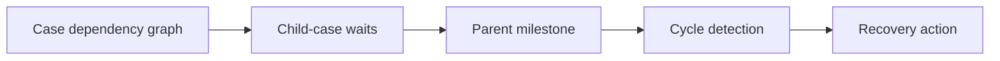

# Cross-case dependencies without circular waits

**PFA-037** | Senior/Lead System Architect | Design case study, laboratory evidence pending

## The failure to prevent

A policy case waits for IdentityCheck and PaymentConfirmation child cases. PaymentConfirmation waits indirectly for the parent to publish approval, creating a cycle in the dependency graph. No activity is broken, yet every case stays open.

The useful outcome is a repeatable design that remains correct across application variations, case versions and retries, not a single Dev Studio screen that happens to work.

## Execution and data boundaries

## Pega rules that must be considered

- **Wait Step Case Dependency:** confirm the effective class, ruleset/app version and input/output contract for the specific business use case.
- **parent/child case:** confirm the effective class, ruleset/app version and input/output contract for the specific business use case.
- **case status:** confirm the effective class, ruleset/app version and input/output contract for the specific business use case.
- **SLA escalation:** confirm the effective class, ruleset/app version and input/output contract for the specific business use case.

## Detailed design sequence

1. Draw a directed graph of each case or external event waited upon, not just hierarchy lines in App Studio.

2. Reject dependency cycles, including indirect waits via callbacks, job schedulers or external orchestrators.

3. Separate information gathering from approval release so a child never waits on a parent decision that itself requires the child.

4. Set business timeouts and clear exception paths for dependencies that can never resolve or have been cancelled.

5. Maintain an observability view of parent wait age, outstanding children and the exact condition that prevents progress.

A production-ready implementation should document the actual rule keys, test classes, authorized operators, system-of-record fields and accepted exception states. An external system's response should never be considered atomic with a Pega case commit without an explicit verified transaction model.

## Design alternatives

- **Pattern 1:** Serial orchestration is simple but longer latency.
- **Pattern 2:** parallel children improve throughput yet require robust join conditions.

Select the pattern by testable business requirements: record ownership, controlled override scope, rollback of active cases, and failure recovery. An apparently easier class inheritance or flow design may have wider long-term maintenance cost.

## Diagnose the production failure

The parent waits for all children but a child waits for the parent decision, yielding permanent deadlock without an error. Generic Resolved statuses may also satisfy wrong join.

For a meaningful incident review, collect the effective ruleset list and precise selected rule, case history, assignments, node/requestor and trace of the failing execution. A screenshot of a rule form does not show which rule the case executed.

## Lab verification matrix

1. **Experiment 1:** Construct two-node cycle in test. Save the input, expected business state, actual outcome and supporting trace.
2. **Experiment 2:** cancel one child. Save the input, expected business state, actual outcome and supporting trace.
3. **Experiment 3:** verify parent cannot advance on partial approval. Save the input, expected business state, actual outcome and supporting trace.

These tests have not been executed for this article. Once run, add screenshots from a permitted Pega sandbox, with the actual version, reproduced steps and redacted identifiers.

## Release and operating guidance

Include negative cases and old active work in regression, particularly if a new ruleset or flow changes what can be resolved. Use a controlled change process for rules affecting authorization, eligibility or financial outcomes. Define who diagnoses an unresolved work item and how a safe retry is performed.

## Reference

- [Pega Academy: Case dependency](https://academy.pega.com/topic/case-workflow-dependency/v3)

*Independent architectural design based on a fictional scenario. Validate platform-version details before implementation.*
