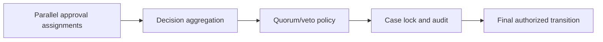

# Parallel approvals and partial completion handling

**PFA-038** | Senior/Lead System Architect | Design case study, laboratory evidence pending

## The failure to prevent

Three reviewers approve a corporate loan in parallel. Risk approves, Fraud rejects and Compliance never responds. A simplistic join step that waits for all approvals stalls unnecessarily, while an Any completion policy may approve the loan on the first vote.

The useful outcome is a repeatable design that remains correct across application variations, case versions and retries, not a single Dev Studio screen that happens to work.

## Execution and data boundaries

## Pega rules that must be considered

- **Parallel flow branches:** confirm the effective class, ruleset/app version and input/output contract for the specific business use case.
- **Wait/Join:** confirm the effective class, ruleset/app version and input/output contract for the specific business use case.
- **Decision Table:** confirm the effective class, ruleset/app version and input/output contract for the specific business use case.
- **case history:** confirm the effective class, ruleset/app version and input/output contract for the specific business use case.

## Detailed design sequence

1. Specify the business aggregation contract as data: unanimous, quorum, mandatory veto or priority review. Do not infer it from a flow diagram.

2. Persist every reviewer decision with identity, timestamp and evidence, separately from the final aggregate result.

3. Implement an aggregation rule that reevaluates current decisions when a branch completes and accounts for an outstanding veto or revoked approval.

4. Handle late responses and cancellation of no-longer-needed assignments after definitive rejection, preserving their audit.

5. Test multiple reviewers saving concurrently under selected case locking strategy; avoid lost decision values.

A production-ready implementation should document the actual rule keys, test classes, authorized operators, system-of-record fields and accepted exception states. An external system's response should never be considered atomic with a Pega case commit without an explicit verified transaction model.

## Design alternatives

- **Pattern 1:** Wait for all is safe for unanimous policy but can stall.
- **Pattern 2:** early veto closes promptly but must cancel and audit outstanding work.

Select the pattern by testable business requirements: record ownership, controlled override scope, rollback of active cases, and failure recovery. An apparently easier class inheritance or flow design may have wider long-term maintenance cost.

## Diagnose the production failure

A stale branch completion arrives after final rejection and restarts a settlement step. An Any join is not proof the required quorum was met.

For a meaningful incident review, collect the effective ruleset list and precise selected rule, case history, assignments, node/requestor and trace of the failing execution. A screenshot of a rule form does not show which rule the case executed.

## Lab verification matrix

1. **Experiment 1:** Risk approve Fraud reject. Save the input, expected business state, actual outcome and supporting trace.
2. **Experiment 2:** two concurrent approvals. Save the input, expected business state, actual outcome and supporting trace.
3. **Experiment 3:** late decision after final rejection. Save the input, expected business state, actual outcome and supporting trace.

These tests have not been executed for this article. Once run, add screenshots from a permitted Pega sandbox, with the actual version, reproduced steps and redacted identifiers.

## Release and operating guidance

Include negative cases and old active work in regression, particularly if a new ruleset or flow changes what can be resolved. Use a controlled change process for rules affecting authorization, eligibility or financial outcomes. Define who diagnoses an unresolved work item and how a safe retry is performed.

## Reference

- [Pega Academy: Case life cycle](https://academy.pega.com/topic/case-lifecycle/v7)

*Independent architectural design based on a fictional scenario. Validate platform-version details before implementation.*
