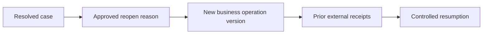

# Re-opening cases without duplicate side effects

**PFA-039** | Lead System Architect study | Architecture design, not yet run as a lab

## Scenario and business consequence

A previously rejected refund case is reopened after new evidence arrives. The implementation simply re-enters the payment stage and fires a connector that was already called on the original attempt. The bank posts a second credit.

The critical design issue is the boundary between case lifecycle state, human ownership, persistence and remote side effects. A flow diagram alone cannot establish that business outcomes remain correct under failures or parallel work.

## Proposed execution flow

## Pega implementation assets

1. **Case reopen flow.** Confirm its Apply To class, version, owner and how it behaves when the case is already in a newer state.
2. **Case history.** Confirm its Apply To class, version, owner and how it behaves when the case is already in a newer state.
3. **payment Connect REST.** Confirm its Apply To class, version, owner and how it behaves when the case is already in a newer state.
4. **operation receipt ledger.** Confirm its Apply To class, version, owner and how it behaves when the case is already in a newer state.

## Implementation architecture

1. Define which final states are legally reopenable and which require a new child/revision case instead.

2. Capture reopen reason, requester authority, original decision and links to the earlier outcome before allowing change.

3. Do not reuse a stage transition as proof that side effects should be reissued. Identify all previous external receipts and generate a new operation identity only for a genuinely new economic event.

4. Reopen into a dedicated review stage rather than automatically re-running payout approval.

5. Test old callbacks arriving after reopen and preserve the ability to distinguish first and second decisions.

### Example rule inventory

Use concrete names such as `D_OperationReceipt`, `ValidateCurrentCaseState`, `D_EligibleAssignments` or `ResolveExternalOperation` only where they match this scenario's needs. These are illustrative application-specific names, not built-in Pega rules. A real implementation should specify exact classes and rule parameters in the reviewed design.

## Design options

- **Choice 1:** Reusing the original case preserves history but complicates versioned effects.
- **Choice 2:** creating a new related case offers clean operation identity.

Each option shifts cost among latency, data integrity, recoverability, user experience and operational support. Choose the trade-off explicitly rather than inferring it from a diagram.

## How the design fails and how to diagnose it

A retry triggered by reopening can repeat a completed payout; a stale original approval can satisfy the new workflow incorrectly.

Capture case ID, operation IDs, case version, operator access group, assignment/child status, application ruleset stack, queued processing state and partner receipt as relevant. Never treat a successful Pega case save as evidence that an independent remote transaction succeeded.

## Reproduction checklist

1. **Experiment 1:** Reopen rejected case with new evidence. Compare expected and observed case history plus external receipts.
2. **Experiment 2:** reopen already-paid case and confirm no second payment. Compare expected and observed case history plus external receipts.
3. **Experiment 3:** deliver old callback late. Compare expected and observed case history plus external receipts.

Run the matrix in a representative Pega sandbox and document the actual version, Flow/Rule configurations and sanitized diagnostics. These experiments have not yet been executed for this article.

## Production release criteria

Document how the case or queue item can be safely resumed after deployment, who owns business exceptions and what signals will identify overdue unresolved work. Test concurrent users and retries for workflows with shared state. Keep compensation and archive operations auditable.

## Official foundation

- [Pega Academy: Case life cycle](https://academy.pega.com/topic/case-lifecycle/v7)

*This is an independent scenario-driven design study, not a vendor guide or a claim of verified performance.*
