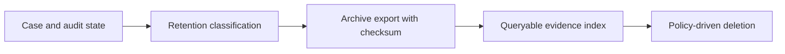

# Case archival with searchable audit history

**PFA-040** | Lead System Architect study | Architecture design, not yet run as a lab

## Scenario and business consequence

A regulated claims portfolio must retain decision evidence for seven years, but operational case databases are too large. An archive job deletes old cases while business search and regulator evidence requests still assume case history is available.

The critical design issue is the boundary between case lifecycle state, human ownership, persistence and remote side effects. A flow diagram alone cannot establish that business outcomes remain correct under failures or parallel work.

## Proposed execution flow

## Pega implementation assets

1. **Case history.** Confirm its Apply To class, version, owner and how it behaves when the case is already in a newer state.
2. **attachment metadata.** Confirm its Apply To class, version, owner and how it behaves when the case is already in a newer state.
3. **archive repository.** Confirm its Apply To class, version, owner and how it behaves when the case is already in a newer state.
4. **Pega search/report.** Confirm its Apply To class, version, owner and how it behaves when the case is already in a newer state.
5. **purge process.** Confirm its Apply To class, version, owner and how it behaves when the case is already in a newer state.

## Implementation architecture

1. Define retention per case type, decision, jurisdiction and legal hold; do not apply one age cutoff to all records.

2. Identify the authoritative archive package: case data, audit trail, document references, timestamps, permissions and version metadata.

3. Export and validate integrity before any destructive purge, using a receipt or checksum stored outside the source case.

4. Design search results that distinguish an archived record from an active case; access policies must continue to apply to archive data.

5. Provide a tested restoration or evidence-production process for an audit, including attachment availability and immutable history.

### Example rule inventory

Use concrete names such as `D_OperationReceipt`, `ValidateCurrentCaseState`, `D_EligibleAssignments` or `ResolveExternalOperation` only where they match this scenario's needs. These are illustrative application-specific names, not built-in Pega rules. A real implementation should specify exact classes and rule parameters in the reviewed design.

## Design options

- **Choice 1:** Keep all cases in live DB simplifies access but increases cost.
- **Choice 2:** archive/restore reduces operational load but needs verified completeness.

Each option shifts cost among latency, data integrity, recoverability, user experience and operational support. Choose the trade-off explicitly rather than inferring it from a diagram.

## How the design fails and how to diagnose it

Purged case evidence may survive in indexes without attachments or vice versa; legal hold can invalidate a scheduled deletion.

Capture case ID, operation IDs, case version, operator access group, assignment/child status, application ruleset stack, queued processing state and partner receipt as relevant. Never treat a successful Pega case save as evidence that an independent remote transaction succeeded.

## Reproduction checklist

1. **Experiment 1:** Archive case with documents and verify complete restoration. Compare expected and observed case history plus external receipts.
2. **Experiment 2:** search by case ID after purge. Compare expected and observed case history plus external receipts.
3. **Experiment 3:** apply legal hold and confirm exclusion. Compare expected and observed case history plus external receipts.

Run the matrix in a representative Pega sandbox and document the actual version, Flow/Rule configurations and sanitized diagnostics. These experiments have not yet been executed for this article.

## Production release criteria

Document how the case or queue item can be safely resumed after deployment, who owns business exceptions and what signals will identify overdue unresolved work. Test concurrent users and retries for workflows with shared state. Keep compensation and archive operations auditable.

## Official foundation

- [Pega Academy: Data storage](https://academy.pega.com/topic/data-modeling/v1)

*This is an independent scenario-driven design study, not a vendor guide or a claim of verified performance.*
