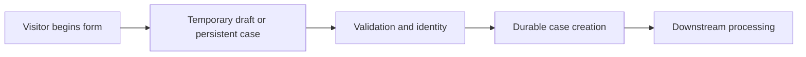

# Temporary cases versus immediate persistence

**PFA-041** | Lead System Architect study | Architecture design, not yet run as a lab

## Scenario and business consequence

A loan quotation wizard creates thousands of cases whenever a visitor opens the first step. Most visitors abandon it, leaving huge volumes of incomplete work and audit noise. Switching to temporary cases reduces persistence but changes when a durable case ID and recovery record exist.

The critical design issue is the boundary between case lifecycle state, human ownership, persistence and remote side effects. A flow diagram alone cannot establish that business outcomes remain correct under failures or parallel work.

## Proposed execution flow

## Pega implementation assets

1. **Case Type Create stage.** Confirm its Apply To class, version, owner and how it behaves when the case is already in a newer state.
2. **temporary cases.** Confirm its Apply To class, version, owner and how it behaves when the case is already in a newer state.
3. **data capture views.** Confirm its Apply To class, version, owner and how it behaves when the case is already in a newer state.
4. **case creation service.** Confirm its Apply To class, version, owner and how it behaves when the case is already in a newer state.

## Implementation architecture

1. Map the exact point at which the business requires a legal work record or immutable case ID.

2. Before that point, consider temporary case interaction and explicit persistence only when the visitor submits a real application, subject to release support.

3. Do not enqueue external side effects, register documents or issue references that presume the temporary case already exists durably.

4. Design abandonment/recovery behavior for browser failure and session expiration; ephemeral input might be intentionally lost.

5. After durable creation, enforce deduplicated submission by a stable client request key to prevent two cases from double-click or retry.

### Example rule inventory

Use concrete names such as `D_OperationReceipt`, `ValidateCurrentCaseState`, `D_EligibleAssignments` or `ResolveExternalOperation` only where they match this scenario's needs. These are illustrative application-specific names, not built-in Pega rules. A real implementation should specify exact classes and rule parameters in the reviewed design.

## Design options

- **Choice 1:** Persist at first step provides durable history but large abandonment volume.
- **Choice 2:** temporary flow saves DB load but needs recovery design.

Each option shifts cost among latency, data integrity, recoverability, user experience and operational support. Choose the trade-off explicitly rather than inferring it from a diagram.

## How the design fails and how to diagnose it

Browser refresh can destroy unsaved form state; a downstream payment request created before a durable case may lack a reconciliation anchor.

Capture case ID, operation IDs, case version, operator access group, assignment/child status, application ruleset stack, queued processing state and partner receipt as relevant. Never treat a successful Pega case save as evidence that an independent remote transaction succeeded.

## Reproduction checklist

1. **Experiment 1:** Abandon after first step and inspect DB. Compare expected and observed case history plus external receipts.
2. **Experiment 2:** submit twice with same request key. Compare expected and observed case history plus external receipts.
3. **Experiment 3:** lose session before persistence and verify user messaging. Compare expected and observed case history plus external receipts.

Run the matrix in a representative Pega sandbox and document the actual version, Flow/Rule configurations and sanitized diagnostics. These experiments have not yet been executed for this article.

## Production release criteria

Document how the case or queue item can be safely resumed after deployment, who owns business exceptions and what signals will identify overdue unresolved work. Test concurrent users and retries for workflows with shared state. Keep compensation and archive operations auditable.

## Official foundation

- [Pega Academy: Case life cycle](https://academy.pega.com/topic/case-lifecycle/v7)

*This is an independent scenario-driven design study, not a vendor guide or a claim of verified performance.*
