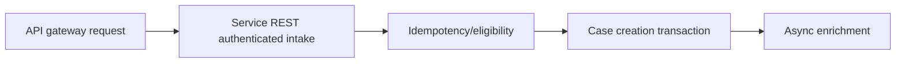

# High-volume case creation through service endpoints

**PFA-042** | Lead System Architect study | Architecture design, not yet run as a lab

## Scenario and business consequence

An intake partner posts 20,000 requests an hour to create benefit cases. The Service REST method creates cases synchronously and waits for multiple partner API calls. At peak traffic, the intake endpoint times out and the partner retries, causing duplicate cases.

The critical design issue is the boundary between case lifecycle state, human ownership, persistence and remote side effects. A flow diagram alone cannot establish that business outcomes remain correct under failures or parallel work.

## Proposed execution flow

## Pega implementation assets

1. **Service REST.** Confirm its Apply To class, version, owner and how it behaves when the case is already in a newer state.
2. **Service Package.** Confirm its Apply To class, version, owner and how it behaves when the case is already in a newer state.
3. **Create Case API.** Confirm its Apply To class, version, owner and how it behaves when the case is already in a newer state.
4. **case ID.** Confirm its Apply To class, version, owner and how it behaves when the case is already in a newer state.
5. **Queue Processor.** Confirm its Apply To class, version, owner and how it behaves when the case is already in a newer state.

## Implementation architecture

1. Authenticate and authorize the caller independently of interactive Access Groups, and validate input size before case creation.

2. Require a stable external submission ID, with transaction-safe uniqueness or a lookup that handles concurrent retries.

3. Complete only the minimal authoritative case creation synchronously; queue slow enrichment and notifications if business policy permits.

4. Return a durable case identifier and acceptance state, not a claim that every dependent check completed.

5. Apply backpressure and quota per sender; measure database write/lock pressure and backlog created by an intake spike.

### Example rule inventory

Use concrete names such as `D_OperationReceipt`, `ValidateCurrentCaseState`, `D_EligibleAssignments` or `ResolveExternalOperation` only where they match this scenario's needs. These are illustrative application-specific names, not built-in Pega rules. A real implementation should specify exact classes and rule parameters in the reviewed design.

## Design options

- **Choice 1:** Full synchronous workflow simplifies caller but couples availability.
- **Choice 2:** accept-and-process scales intake but requires status query and callback contract.

Each option shifts cost among latency, data integrity, recoverability, user experience and operational support. Choose the trade-off explicitly rather than inferring it from a diagram.

## How the design fails and how to diagnose it

A timeout after Pega has committed creates uncertainty for the caller. Retrying without request identity creates duplicate case IDs.

Capture case ID, operation IDs, case version, operator access group, assignment/child status, application ruleset stack, queued processing state and partner receipt as relevant. Never treat a successful Pega case save as evidence that an independent remote transaction succeeded.

## Reproduction checklist

1. **Experiment 1:** Repeat same submission concurrently. Compare expected and observed case history plus external receipts.
2. **Experiment 2:** drop response after successful creation. Compare expected and observed case history plus external receipts.
3. **Experiment 3:** load-test with slow downstream service. Compare expected and observed case history plus external receipts.

Run the matrix in a representative Pega sandbox and document the actual version, Flow/Rule configurations and sanitized diagnostics. These experiments have not yet been executed for this article.

## Production release criteria

Document how the case or queue item can be safely resumed after deployment, who owns business exceptions and what signals will identify overdue unresolved work. Test concurrent users and retries for workflows with shared state. Keep compensation and archive operations auditable.

## Official foundation

- [Pega Academy: Authentication](https://academy.pega.com/topic/authentication/v6)

*This is an independent scenario-driven design study, not a vendor guide or a claim of verified performance.*
