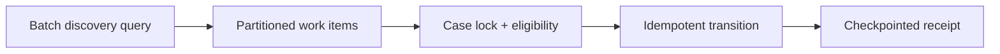

# Bulk case transitions without lock storms

**PFA-043** | Lead System Architect study | Architecture design, not yet run as a lab

## Scenario and business consequence

A policy adjustment changes 50,000 active cases after a regulation update. A Job Scheduler opens and updates every case in a tight loop, saturating row locks, causing SLA escalations to delay and slowing agent actions.

The critical design issue is the boundary between case lifecycle state, human ownership, persistence and remote side effects. A flow diagram alone cannot establish that business outcomes remain correct under failures or parallel work.

## Proposed execution flow

## Pega implementation assets

1. **Job Scheduler.** Confirm its Apply To class, version, owner and how it behaves when the case is already in a newer state.
2. **Queue Processor.** Confirm its Apply To class, version, owner and how it behaves when the case is already in a newer state.
3. **Report Definition.** Confirm its Apply To class, version, owner and how it behaves when the case is already in a newer state.
4. **case locking.** Confirm its Apply To class, version, owner and how it behaves when the case is already in a newer state.
5. **batch progress ledger.** Confirm its Apply To class, version, owner and how it behaves when the case is already in a newer state.

## Implementation architecture

1. Define a stable eligibility predicate and a finite snapshot/watermark so cases added mid-run are handled in a later cycle.

2. Partition by case ID or another stable key and cap worker concurrency based on observed DB lock capacity, not nominal JVM thread count.

3. Acquire supported case locks per item, re-evaluate state and skip cases that no longer qualify.

4. Persist success/skip/failure per case, with stable operation IDs so restart does not apply a stage change twice.

5. Provide backoff for lock contention and a human-facing dashboard for unresolved exceptions, rather than force-saving stale clipboard data.

### Example rule inventory

Use concrete names such as `D_OperationReceipt`, `ValidateCurrentCaseState`, `D_EligibleAssignments` or `ResolveExternalOperation` only where they match this scenario's needs. These are illustrative application-specific names, not built-in Pega rules. A real implementation should specify exact classes and rule parameters in the reviewed design.

## Design options

- **Choice 1:** Single synchronous batch has simple control but hot locks.
- **Choice 2:** partitioned queue workers permit pacing and repair.

Each option shifts cost among latency, data integrity, recoverability, user experience and operational support. Choose the trade-off explicitly rather than inferring it from a diagram.

## How the design fails and how to diagnose it

Bulk jobs can repeatedly lock the same case while agents edit, and retries can resubmit already-completed actions.

Capture case ID, operation IDs, case version, operator access group, assignment/child status, application ruleset stack, queued processing state and partner receipt as relevant. Never treat a successful Pega case save as evidence that an independent remote transaction succeeded.

## Reproduction checklist

1. **Experiment 1:** Run 1000 synthetic cases under concurrent agents. Compare expected and observed case history plus external receipts.
2. **Experiment 2:** restart halfway. Compare expected and observed case history plus external receipts.
3. **Experiment 3:** repeat batch to verify idempotency. Compare expected and observed case history plus external receipts.

Run the matrix in a representative Pega sandbox and document the actual version, Flow/Rule configurations and sanitized diagnostics. These experiments have not yet been executed for this article.

## Production release criteria

Document how the case or queue item can be safely resumed after deployment, who owns business exceptions and what signals will identify overdue unresolved work. Test concurrent users and retries for workflows with shared state. Keep compensation and archive operations auditable.

## Official foundation

- [Pega Academy: Queue processors](https://academy.pega.com/topic/queue-processors-and-job-schedulers/v2)

*This is an independent scenario-driven design study, not a vendor guide or a claim of verified performance.*
