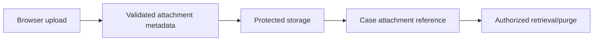

# Case attachments and content lifecycle boundaries

**PFA-044** | Lead System Architect study | Architecture design, not yet run as a lab

## Scenario and business consequence

A claims case accepts police statements, medical scans and identity documents. The team stores binary content in the case database and gives every portal user the ability to download any attachment associated with the parent case. Storage, access and retention have all become coupled.

The critical design issue is the boundary between case lifecycle state, human ownership, persistence and remote side effects. A flow diagram alone cannot establish that business outcomes remain correct under failures or parallel work.

## Proposed execution flow

## Pega implementation assets

1. **Case attachment category.** Confirm its Apply To class, version, owner and how it behaves when the case is already in a newer state.
2. **document repository.** Confirm its Apply To class, version, owner and how it behaves when the case is already in a newer state.
3. **malware screening.** Confirm its Apply To class, version, owner and how it behaves when the case is already in a newer state.
4. **Access Control Policy.** Confirm its Apply To class, version, owner and how it behaves when the case is already in a newer state.
5. **retention policy.** Confirm its Apply To class, version, owner and how it behaves when the case is already in a newer state.

## Implementation architecture

1. Classify documents by legal purpose, owner and sensitivity before designing upload and access.

2. Use the deployment's supported attachment storage integration; record a durable reference and content checksum instead of repeating large binary data in the case clipboard.

3. Check type, size and malware-screening requirements before making files available to other users.

4. Authorize each download using current case/party entitlements, not just a guessable attachment ID or hidden button.

5. Coordinate archive, legal hold and deletion for both the case record and the external content repository; broken references are audit failures.

### Example rule inventory

Use concrete names such as `D_OperationReceipt`, `ValidateCurrentCaseState`, `D_EligibleAssignments` or `ResolveExternalOperation` only where they match this scenario's needs. These are illustrative application-specific names, not built-in Pega rules. A real implementation should specify exact classes and rule parameters in the reviewed design.

## Design options

- **Choice 1:** Database binary storage reduces external dependencies but grows operations burden.
- **Choice 2:** external content service scales content but needs reference integrity.

Each option shifts cost among latency, data integrity, recoverability, user experience and operational support. Choose the trade-off explicitly rather than inferring it from a diagram.

## How the design fails and how to diagnose it

An attachment may remain accessible through a direct download URL after case access is revoked. Virus scanning may complete after users can already open the file.

Capture case ID, operation IDs, case version, operator access group, assignment/child status, application ruleset stack, queued processing state and partner receipt as relevant. Never treat a successful Pega case save as evidence that an independent remote transaction succeeded.

## Reproduction checklist

1. **Experiment 1:** Upload oversized file. Compare expected and observed case history plus external receipts.
2. **Experiment 2:** attempt cross-tenant download by ID. Compare expected and observed case history plus external receipts.
3. **Experiment 3:** archive case then restore attachment integrity. Compare expected and observed case history plus external receipts.

Run the matrix in a representative Pega sandbox and document the actual version, Flow/Rule configurations and sanitized diagnostics. These experiments have not yet been executed for this article.

## Production release criteria

Document how the case or queue item can be safely resumed after deployment, who owns business exceptions and what signals will identify overdue unresolved work. Test concurrent users and retries for workflows with shared state. Keep compensation and archive operations auditable.

## Official foundation

- [Pega Academy: Data modeling](https://academy.pega.com/topic/data-modeling/v1)

*This is an independent scenario-driven design study, not a vendor guide or a claim of verified performance.*
