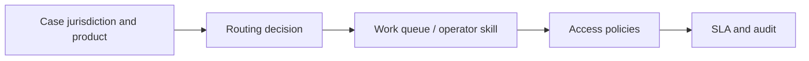

# Case ownership models across teams and jurisdictions

**PFA-045** | Lead System Architect study | Architecture design, not yet run as a lab

## Scenario and business consequence

A shared service centre handles cases in UK, India and Germany, but assignment queues and permission rules are based on physical team alone. Agents transferring regions retain access to old clients, while regulatory language requirements are bypassed during re-routing.

The critical design issue is the boundary between case lifecycle state, human ownership, persistence and remote side effects. A flow diagram alone cannot establish that business outcomes remain correct under failures or parallel work.

## Proposed execution flow

## Pega implementation assets

1. **Work queue and Work Group.** Confirm its Apply To class, version, owner and how it behaves when the case is already in a newer state.
2. **Assignment routing.** Confirm its Apply To class, version, owner and how it behaves when the case is already in a newer state.
3. **Decision Table.** Confirm its Apply To class, version, owner and how it behaves when the case is already in a newer state.
4. **Access Control Policy.** Confirm its Apply To class, version, owner and how it behaves when the case is already in a newer state.
5. **SLA calendar.** Confirm its Apply To class, version, owner and how it behaves when the case is already in a newer state.

## Implementation architecture

1. Separate who may read a case from who is available to work it. Assignment routing cannot substitute for record access control.

2. Model required language, jurisdiction, product accreditation and current capacity as explicit routing inputs.

3. Use stable skills/qualification and workgroup ownership data rather than hard-coded operator IDs in flows.

4. Re-evaluate authorization on assignment open and save, including if an agent's region or employment status changes.

5. Track the governing SLA calendar when ownership moves, with an explicit contractual deadline policy.

### Example rule inventory

Use concrete names such as `D_OperationReceipt`, `ValidateCurrentCaseState`, `D_EligibleAssignments` or `ResolveExternalOperation` only where they match this scenario's needs. These are illustrative application-specific names, not built-in Pega rules. A real implementation should specify exact classes and rule parameters in the reviewed design.

## Design options

- **Choice 1:** Fixed queues are simple but brittle under demand.
- **Choice 2:** dynamic routing uses richer data but needs consistent availability and fairness.

Each option shifts cost among latency, data integrity, recoverability, user experience and operational support. Choose the trade-off explicitly rather than inferring it from a diagram.

## How the design fails and how to diagnose it

A queue transfer can allow an unqualified operator to update a regulated case, even if assignment appears assigned correctly.

Capture case ID, operation IDs, case version, operator access group, assignment/child status, application ruleset stack, queued processing state and partner receipt as relevant. Never treat a successful Pega case save as evidence that an independent remote transaction succeeded.

## Reproduction checklist

1. **Experiment 1:** Remove operator qualification mid-session. Compare expected and observed case history plus external receipts.
2. **Experiment 2:** simulate queue overload. Compare expected and observed case history plus external receipts.
3. **Experiment 3:** transfer case across time zones and inspect SLA. Compare expected and observed case history plus external receipts.

Run the matrix in a representative Pega sandbox and document the actual version, Flow/Rule configurations and sanitized diagnostics. These experiments have not yet been executed for this article.

## Production release criteria

Document how the case or queue item can be safely resumed after deployment, who owns business exceptions and what signals will identify overdue unresolved work. Test concurrent users and retries for workflows with shared state. Keep compensation and archive operations auditable.

## Official foundation

- [Pega Academy: Case life cycle](https://academy.pega.com/topic/case-lifecycle/v7)

*This is an independent scenario-driven design study, not a vendor guide or a claim of verified performance.*
