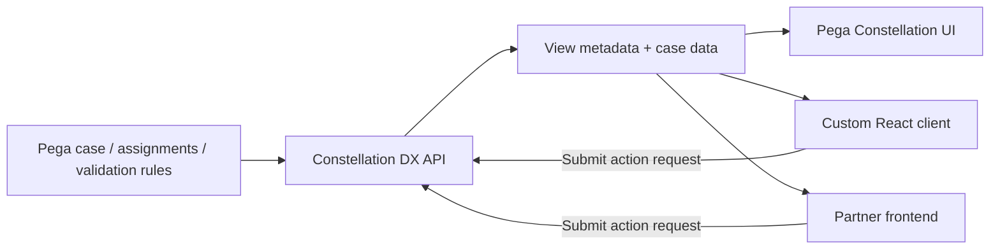

# Constellation DX API: Separating Case Semantics from Rendering

**PFA-121** | **Audience:** Senior and Lead System Architects | **Status:** Reference architecture; live Pega test pending

A custom portal may look like a Constellation application, yet break when it treats DX API view metadata as a static form schema.

## 1. The enterprise failure this design prevents

An enterprise wants one case lifecycle presented in three channels: a Pega Constellation portal, a partner React portal and a limited mobile experience. One team proposes copying Pega view fields into a handwritten frontend schema. That would detach visibility, validation and action availability from the Pega case model. Constellation's **DX API** supplies case data and view metadata. A correct custom UI must respect both the API contract and server-side rule enforcement rather than assuming the UI alone owns workflow logic.

## 2. Component and execution architecture

The following diagram is an **illustrative reference design**. It is not a screenshot from a running Pega environment.

## 3. Which Pega objects own each concern?

| Component | Why it exists |
|---|---|
| `Case Type and life cycle` | Server-owned workflow, assignments and actions |
| `View Rules` | Model-driven metadata for fields, layout and runtime presentation |
| `Constellation DX API` | Retrieval and submission contract for case data and views |
| `Client authentication/session` | User identity, scopes and requestor access |
| `Reusable UI component` | Presentation extension where supported by chosen Constellation release |

The named objects above are a mix of actual Pega rule categories and illustrative application-specific names. They are not a claim that all such rules exist in a default Pega installation.

## 4. Implementation design and decision sequence

1. Decide which parts belong to Pega: case state, validation, routing, assignments and business decisions. The client should not duplicate these as independent authority.

2. Design the frontend as a consumer of DX API responses, not a parser of screenshots or internal DOM markup. Inspect the supported API version and required authentication.

3. Request only the metadata needed for each interaction. Pega documents viewType options including Page, Form, Fields and None for suitable endpoints.

4. Render mandatory, read-only and visibility behaviour from the response. Server actions remain authoritative when data changes between rendering and submission.

5. On submission, handle validation errors and changed assignments from the API response rather than assuming the original form remains valid.

6. Design a controlled extension strategy for unsupported UI components. Prefer supported Constellation extension points over depending on internal generated markup.

7. Capture wire-level contract tests against the actual version and validate both standard and custom clients through case completion.

## 5. What an architect must choose

| Approach | Effect and trade-off |
|---|---|
| Standard Constellation portal | Maximum alignment with platform metadata and supported behaviour |
| Custom DX API-driven frontend | Greater channel control, but the team owns rendering and behavioural parity |
| Manually reimplemented workflow API | High drift risk, duplicated server logic and complex upgrade support |

**Decision standard:** choose the smallest design that satisfies consistency, auditability, security, performance and operational recovery, not the design that simply looks easiest in Dev Studio.

## 6. Failure modes and root-cause investigation

**Missing dynamic field:** a custom frontend ignores refreshed view metadata after another field changes. **Improper authorisation:** client hides an action but server rejects request, or a developer mistakenly assumes the hidden state is security. **Breaking API change:** one client assumes an older response shape while a platform release changes supported metadata. **Premature optimistic UI:** frontend shows completion before the server confirms the case action. The remedy is a versioned consumer contract and server-owned state.

For troubleshooting, preserve the application/ruleset version, access context, precise business identity, timestamp and correlation ID. Never include secrets or production customer documents in publicly shared traces.

## 7. Verification matrix for a Pega lab

These are **tests to run**, not tests that have already passed.

| Experiment | Evidence and expected assertion |
|---|---|
| Three channels | Create the same case through supported UIs and compare lifecycle state |
| Conditional view | Change a field that controls another field's visibility and inspect returned metadata |
| Validation | Submit an invalid payload directly; server must reject it |
| Authorization | Try unavailable actions with lower-privilege identity |
| Upgrade | Replay captured contract assertions against a target supported Pega release |
| Latency | Compare payload sizes and end-to-end response time for Page versus more targeted views where supported |

At the end of the experiment, attach redacted screenshots of the relevant rule forms, Clipboard/Tracer/PAL evidence when applicable, and an actual observed outcome. If any result differs, update the design instead of changing the evidence description.

## 8. Production readiness and ownership

Own the frontend-to-DX API compatibility matrix. Record the exact platform and Constellation versions, supported components and accessibility checks. Publish an integration guide for new frontend teams that states which business decisions must never be reimplemented on the client.

**Architecture acceptance:** the design has an explicit owner, a version-specific reproducible test, a failure/recovery procedure, the relevant security controls and a way to detect regressions.

## 9. Product references and limitations

- [Pega Academy: The Constellation DX API](https://academy.pega.com/topic/constellation-dx-api/v1/in/70306)

Pega functionality changes by release. Treat exact editor labels, extension points and service behaviours as version-sensitive until verified in the target environment. This independent article is neither an official Pega document nor a claim of an executed customer implementation.
