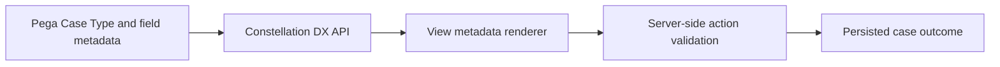

# View metadata and server-side business rules

**PFA-122** | Senior/Lead System Architect design study | Platform verification pending

## The business and runtime problem

A Constellation frontend receives a View definition with conditional fields and actions. A team reimplements visibility and validation in custom React code with rules copied from Pega. Over time the browser displays actions that the server does not allow.

An architecture is useful only if it identifies the business state that must remain correct when a user retries, another operator acts, a queue item is delayed or a new Pega release changes rendering and rule execution.

## Data and execution boundaries

## Pega feature inventory

1. **View Rule.** Establish the effective version, security principal, input/output contract and the responsible support owner.
2. **Constellation DX API.** Establish the effective version, security principal, input/output contract and the responsible support owner.
3. **Case Type.** Establish the effective version, security principal, input/output contract and the responsible support owner.
4. **server validation.** Establish the effective version, security principal, input/output contract and the responsible support owner.
5. **client SDK.** Establish the effective version, security principal, input/output contract and the responsible support owner.

## Reference architecture steps

1. Model business validations and available case actions in Pega rules, not separate per-channel JavaScript condition tables.

2. Consume View metadata for fields, visibility and actions through the supported DX API contract for the target release.

3. Treat metadata as presentation guidance, not authorization; the server must reject unauthorized or invalid actions directly.

4. Refresh View/action state after changing data or completing assignment when the server returns new conditions.

5. Contract-test the frontend by submitting both allowed and disallowed actions against the real server version.

The implementation should preserve authoritative business decisions on the Pega server and use published interfaces when integrating external UI or asynchronous systems. Internal details and UI markup are not a stable substitute for an explicit supported contract.

## Design choices

- **Alternative 1:** Standard Constellation rendering maximizes rule parity.
- **Alternative 2:** custom frontend via DX API gives brand control but requires strict metadata fidelity.

Select the design based on platform support, latency and dependency limits, auditability, maintenance ownership and ability to recover from an interrupted operation.

## Failure mode to investigate

Client-only field hiding can be bypassed. A stale View may still display Submit after another user resolves the case; server rejection must be handled.

Keep the case/operation identity, applied ruleset, security context, error classification and timestamp with incident evidence. For a UI extension, also record the DX API response and supported SDK/runtime versions without exposing private customer data.

## Acceptance test matrix

1. **Test 1:** Toggle conditional field through server data. Log the expected result, observed behavior and failure recovery.
2. **Test 2:** call forbidden action directly. Log the expected result, observed behavior and failure recovery.
3. **Test 3:** refresh assignment after external update. Log the expected result, observed behavior and failure recovery.

These are planned tests, not completed observations. Authenticate to a permitted Pega sandbox before collecting authentic screenshots or metrics. Test both happy path and error path on the actual deployment release.

## Operational readiness

Assign explicit ownership for version compatibility, current-case authorization and business completion. Put alerts on unresolved outcomes, stale UI state, broken background items or contract failures rather than just node health. Include a safe rollback/repair plan for cases that cross deployments.

## Pega reference

- [Pega Academy: Constellation components](https://academy.pega.com/topic/components-constellation/v2)

*Independent technical article, fictional scenario, no claim of production execution.*
