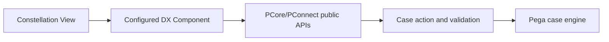

# Constellation DX Components: Building a React Extension That Survives Upgrades

**PFA-123** | Senior / Lead System Architect level | Design reference, not a lab result

## The practical failure

A bank requires a specialist side-by-side document comparison inside a Constellation case. One team proposes injecting DOM scripts and overriding generated CSS. That may appear to work in a narrow test but creates coupling to internals rather than supported public APIs. A supported DX Component is built with React and PCore/PConnect and published as a Rule-UI-Component.

## Technical flow

The diagram describes a proposed execution boundary rather than a captured Pega implementation.

## Pega rules and interfaces involved

| Rule or component | Architect's checklist |
|---|---|
| Constellation DX Component Builder | Owns one part of this design |
| React component with runtime props | Requires clear data and security contract |
| PCore / PConnect public APIs | Needs actual release-specific configuration |
| Rule-UI-Component | Should yield evidence for diagnostics |
| App Studio View configuration | Has a testable operational responsibility |

## Implementation design

1. First confirm that standard Constellation patterns and prescribed components cannot satisfy the document comparison requirement.

2. Create a minimal React component with the documented DX Component Builder; remove unused generated components to keep bundles small.

3. Define design-time configuration and runtime-bound field references separately. Do not duplicate authoritative workflow state inside the component.

4. Use public PCore/PConnect methods and documented event channels instead of relying on generated DOM selectors or private CSS.

5. Publish the compiled component as the supported Pega component rule and reference it from a View in App Studio.

6. Test loading and field updates under different case permissions; server-side case validation remains authoritative.

7. Maintain a compatibility suite for the component across target Constellation releases, including accessibility and mobile layout.

## Competing patterns

| Approach | Trade-off |
|---|---|
| Standard Constellation control | Most upgrade-friendly, may not meet the specialist interaction |
| Supported DX Component | Controlled extension with explicit maintenance ownership |
| DOM injection | Fragile, hard to secure and likely to break on upgrade |

A valid architecture makes the consistency, permission and recovery contract explicit. Do not optimize for one successful demonstration while ignoring the retry or failure case.

## Why it breaks in production

A component can silently stop updating when a data path or runtime context differs from its assumptions. A local React validation can disagree with a server rule. Theme overrides can introduce inaccessible controls. Measure component output with actual View metadata and an upgraded test runtime.

For incident triage, retain a redacted operation/case ID, node, ruleset/app version, timestamp and evidence of the dependent system. Never publish private client payloads or authentication tokens.

## Reproduction and verification plan

| Scenario | Evidence to obtain |
|---|---|
| Test 1 | Render empty and very large document lists with realistic file metadata. |
| Test 2 | Change a bound property and verify the component reflects authoritative case state. |
| Test 3 | Attempt an action with a denied privilege and verify server enforcement. |
| Test 4 | Upgrade the component and Constellation runtime together in test and check public API compatibility. |

These are proposed tests. No claim is made that the scenario has been executed in a Pega lab. A complete validated edition should show the actual Pega rule forms, configuration values and observed result for the target release.

## Release checklist

Record system of record, data and authorization boundary, expected volume, timeout/retry or conflict strategy, owner of failures, migration impact and a repair runbook. Confirm behavior across at least two realistic user/role contexts where applicable.

## Source and version note

- [Relevant Pega Academy reference](https://academy.pega.com/topic/constellation-dx-components/v2)

Independent original engineering content. Version-specific editor names and configuration controls must be checked against the Pega release used by the reader.
