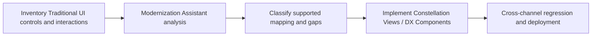

# Traditional UI to Constellation: Creating a Migration Decision Before Rebuilding Views

**PFA-124** | **Target reader:** Pega SSA / LSA | **Evidence:** Architecture design, live test pending

## Why this matters in a real enterprise application

A Pega 8 application has many custom sections, JavaScript functions, action sets and embedded legacy UI components. Leadership assumes moving to Constellation is simply switching a UI architecture setting and converting every screen. The case model may be reusable, but custom client behavior can violate the supported Constellation metadata and component model. Migration must start with an asset assessment, not a mass search-and-replace exercise.

The technical target is not simply to configure a rule that works once. The design must remain correct when authorization changes, multiple requestors interact, dependent services fail and different rule versions coexist during deployment.

## Runtime architecture and trust boundaries

The diagram is an implementation proposal, not a screenshot or observed runtime trace.

## Pega rule and component inventory

| Pega component | What the architect must control |
|---|---|
| Constellation Modernization Assistant | Define the component's business ownership and version |
| Case Type and Flow Action rules | Specify input fields, classes and caller contract |
| Traditional Sections and client scripts | Confirm scope, access privileges and applicable rulesets |
| Constellation View rules | Expose useful diagnostic evidence and correlation IDs |
| Supported DX Component extension points | Define failure/recovery behavior and verification owner |

All custom names in the example should be replaced with classes and rule names from the target application. Do not blindly apply design examples to a different Pega release.

## Implementation design

1. **Step 1:** Inventory screens by business capability, custom JavaScript, action sets, dynamic layouts and unsupported controls. Tag each with criticality and usage.

2. **Step 2:** Use Pega's Constellation Modernization Assistant on a representative application in a suitable supported environment and review its findings rather than treating output as an automatic migration guarantee.

3. **Step 3:** Separate server-owned business logic from browser-specific behavior. Rule validations and assignments often survive the UI change more naturally than custom scripts.

4. **Step 4:** Map each user journey to Constellation Views, supported components and data references. Document gaps requiring legitimate DX Components.

5. **Step 5:** Decide how an external custom frontend will use DX API metadata and authoritative case actions, if external embedding is part of the target state.

6. **Step 6:** Run regression tests for conditional visibility, validation, accessibility, attachment flows, browser navigation and case completion.

7. **Step 7:** Phase migration by vertical business journey with rollback boundaries, rather than changing every portal simultaneously.

### Decision contract

Before writing the rule, record the caller, authoritative system of record, access-group or service identity, acceptable stale age, latency target and required behaviour under duplicate execution. Where the feature supports multiple execution modes, the choice must be justified against these constraints.

## Alternative patterns

| Design approach | Why it may or may not fit |
|---|---|
| Retain Traditional UI temporarily | Low short-term change but longer modernization and maintenance burden |
| Rebuild in standard Constellation | More platform-aligned, requires feature gap remediation |
| Custom DX frontend for specific channels | Greater control but owns metadata contract and upgrade testing |

A more scalable option is not necessarily the most secure or operationally supportable. The decision should be driven by the application's actual workload and failure modes, not the convenience of one dev-environment demo.

## Production failure and diagnosis

A legacy button calling a JavaScript function may have no direct equivalent. A custom component may bypass server-state transitions. Partial migration can create inconsistent navigation and validation for cases moved between portals. Track the exact component/action replacement and acceptance evidence for each journey.

When diagnosing a failure, capture the exact case ID in an approved test environment, the active application and ruleset versions, Pega node, relevant Data Page or flow state, and the downstream correlation ID. Avoid including tokens, customer personal information or confidential attachments.

## Verification plan

| Scenario | Evidence required |
|---|---|
| Experiment 1 | Analyze sample app and record unconvertible custom components. |
| Experiment 2 | Complete same case journey in Traditional UI and Constellation and compare business state. |
| Experiment 3 | Exercise conditional fields and server validation after API response. |
| Experiment 4 | Test keyboard-only interaction and contrast with user accessibility requirements. |

**These are test instructions, not completed test results.** Once a supported Pega sandbox is available, record the installed release and attach redacted, authentic rule screenshots, Tracer/PAL or Clipboard evidence and expected versus observed outcomes.

## Operational acceptance and release considerations

Specify an accountable owner for this design, expected business volume, Pega and dependent-system resource limits, monitoring signals and a recovery runbook. Confirm an older persisted case or queued operation can safely resume after deployment where applicable. Create an Architecture Decision Record so future maintainers understand both the accepted approach and its rejected alternatives.

## Primary references and version caveat

- [Pega Academy: Migrating applications to Constellation UI](https://academy.pega.com/module/migrating-applications-constellation-ui/v1/in/88886)
- [Pega Academy: Analyzing Traditional UI app](https://academy.pega.com/challenge/analyzing-traditional-ui-pega-application/v1)

This independent article is based on published Pega concepts and a fictional scenario. UI labels, exact method semantics and feature availability must be verified in the chosen platform release.
