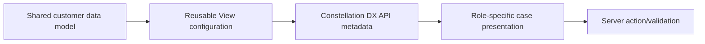

# Reusable Constellation Views: Sharing Field Structure Without Sharing the Wrong Workflow

**PFA-125** | Technical design study for Pega Senior and Lead System Architects | Laboratory verification pending

## Architecture problem

Three case types need the same customer contact card. The first team copies sections and custom visibility conditions into each experience; the second suggests one reusable model-driven view. Both must acknowledge that Constellation views are tied to a data model and runtime metadata, while case actions and assignment logic remain server-owned.

## System design

This diagram records a proposed boundary, not a fabricated Pega runtime screenshot. The interfaces and exact rule forms must be verified in a permitted sandbox.

## Feature inventory and design responsibilities

| Pega rule or component | Review requirement |
|---|---|
| Data Type and properties | Primary configuration and ownership boundary |
| App Studio View | Explicit input/output and identity contract |
| Constellation DX API | Apply platform-version-specific controls |
| Business validation rules | Test failure handling and observability |
| Component extension only if prescribed controls insufficient | Validate runtime access and support procedure |

## Implementation approach

1. Separate reusable data presentation from case-specific business steps. A common customer card does not mean every case has the same approval action.

2. Define a stable customer data model and property access constraints before reusing Views.

3. Use prescribed Constellation controls and View metadata; prefer configuration over hand-coded UI components.

4. Validate that each consuming case returns the correct read-only, visibility and mandatory metadata in the active operator context.

5. Keep server-side validation and authorization as the authority regardless of client rendering.

6. Test View evolution against all consuming case types; adding a required property must not break legacy cases.

7. Create a custom DX component only for a real unsatisfied interaction, with a documented upgrade owner.

## Design alternatives

| Option | Architectural trade-off |
|---|---|
| Copy a section for each case | Easy initially, high drift and upgrade cost |
| Reuse model-driven Views | Consistency with shared property contract |
| Custom React UI for all cases | Maximum control but duplicates rendering responsibilities |

Choose the option that satisfies the business consistency contract and operational constraints. Avoid proving only the success path while deferring security, stale state and recovery behaviour.

## Failure modes and troubleshooting

A View that assumes one case's page structure may break another. A field hidden through metadata is not an authorization boundary. Overloaded reusable views can become one giant form with conditional logic that is harder to maintain than a few focused views.

Capture a sanitized case ID or operation identifier, relevant runtime node, application/ruleset version and timestamps. Correlate the origin and outcome across Pega and partner systems instead of relying on a single status message.

## Verification experiments

| Scenario | Evidence required |
|---|---|
| Experiment 1 | Render View in three case types and compare metadata. |
| Experiment 2 | Deny permission to one field and verify server enforcement. |
| Experiment 3 | Change shared property to mandatory; test each case lifecycle. |
| Experiment 4 | Verify one existing case created before the view change still renders and saves. |

These are experiments to perform in a Pega lab. The article does not claim that any test has passed. A lab-verified version should include actual configuration screenshots, observed results and target Pega version.

## Production acceptance

Before deployment, the implementation needs documented data ownership, access context, expected peak volume, case compatibility, timeouts and retry boundaries, monitoring, escalation owner and a tested operational repair path. If the design changes a data model or class structure, verify legacy case paths and queued work.

## Pega technical source

- [Primary Pega reference](https://academy.pega.com/topic/constellation-dx-api/v2)

Independent original technical analysis. Pega version-specific features and terminology must be confirmed against the target release; the scenario is fictional.
