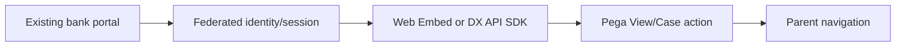

# Embedding a case experience into an external portal

**PFA-126** | Senior/Lead System Architect design study | Platform verification pending

## The business and runtime problem

A bank wants to embed a small Pega dispute case flow into its existing React portal while keeping customer login, navigation and styling consistent. One team plans to iframe a whole internal portal, another plans to copy every Pega form as custom JSON.

An architecture is useful only if it identifies the business state that must remain correct when a user retries, another operator acts, a queue item is delayed or a new Pega release changes rendering and rule execution.

## Data and execution boundaries

## Pega feature inventory

1. **Web Embed.** Establish the effective version, security principal, input/output contract and the responsible support owner.
2. **Constellation DX API.** Establish the effective version, security principal, input/output contract and the responsible support owner.
3. **React SDK.** Establish the effective version, security principal, input/output contract and the responsible support owner.
4. **Authentication Service.** Establish the effective version, security principal, input/output contract and the responsible support owner.
5. **Case Type.** Establish the effective version, security principal, input/output contract and the responsible support owner.

## Reference architecture steps

1. Choose embedding depth based on interaction requirements: a narrow Web Embed for a Pega workflow or an SDK-driven custom experience for more control.

2. Keep business workflow and authorization in the Pega Case Type, while the host portal supplies user navigation and surrounding design.

3. Define SSO/token exchange and cross-origin boundaries; never put reusable Pega credentials in frontend JavaScript.

4. Propagate context and correlation IDs through the supported embed/API contract instead of constructing internal Pega URLs manually.

5. Test deep links, session expiry, browser back navigation, validation errors and multi-tab state updates.

The implementation should preserve authoritative business decisions on the Pega server and use published interfaces when integrating external UI or asynchronous systems. Internal details and UI markup are not a stable substitute for an explicit supported contract.

## Design choices

- **Alternative 1:** Full iframe can be expedient but limits integration and accessibility.
- **Alternative 2:** DX API SDK provides deep branding with higher engineering ownership.

Select the design based on platform support, latency and dependency limits, auditability, maintenance ownership and ability to recover from an interrupted operation.

## Failure mode to investigate

An embedded case displays user A's data after a shared login token is reused; CORS or session expiry breaks case submit without clear recovery.

Keep the case/operation identity, applied ruleset, security context, error classification and timestamp with incident evidence. For a UI extension, also record the DX API response and supported SDK/runtime versions without exposing private customer data.

## Acceptance test matrix

1. **Test 1:** Expire session mid-assignment. Log the expected result, observed behavior and failure recovery.
2. **Test 2:** open case from deep link. Log the expected result, observed behavior and failure recovery.
3. **Test 3:** try unauthorized tenant case in portal. Log the expected result, observed behavior and failure recovery.

These are planned tests, not completed observations. Authenticate to a permitted Pega sandbox before collecting authentic screenshots or metrics. Test both happy path and error path on the actual deployment release.

## Operational readiness

Assign explicit ownership for version compatibility, current-case authorization and business completion. Put alerts on unresolved outcomes, stale UI state, broken background items or contract failures rather than just node health. Include a safe rollback/repair plan for cases that cross deployments.

## Pega reference

- [Pega Academy: Extensions to Constellation](https://academy.pega.com/topic/extensions-constellation-ui/v1)

*Independent technical article, fictional scenario, no claim of production execution.*
