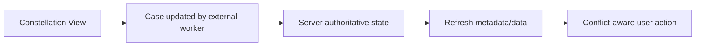

# State refresh when data changes outside the browser

**PFA-127** | Senior/Lead System Architect design study | Platform verification pending

## The business and runtime problem

An insurance case is open in the browser while a background fraud callback updates its decision. The current Constellation View still shows an Approve action that has become invalid, and the operator attempts to execute it using stale state.

An architecture is useful only if it identifies the business state that must remain correct when a user retries, another operator acts, a queue item is delayed or a new Pega release changes rendering and rule execution.

## Data and execution boundaries

## Pega feature inventory

1. **Constellation DX API.** Establish the effective version, security principal, input/output contract and the responsible support owner.
2. **View Rule.** Establish the effective version, security principal, input/output contract and the responsible support owner.
3. **Case locking.** Establish the effective version, security principal, input/output contract and the responsible support owner.
4. **external callback.** Establish the effective version, security principal, input/output contract and the responsible support owner.
5. **server-side validation.** Establish the effective version, security principal, input/output contract and the responsible support owner.

## Reference architecture steps

1. Decide which changes require immediate user notification and which may be reloaded when the next action starts.

2. Use supported server/API refresh behavior to obtain current case data and view metadata after out-of-band updates.

3. Make action submission validate the current server assignment and case status even if the browser has not refreshed yet.

4. Use a clear stale-state recovery UX that preserves unsaved user input only where its values can safely be reapplied.

5. Exercise background updates concurrently with an open browser assignment and measure the elapsed time to discover new state.

The implementation should preserve authoritative business decisions on the Pega server and use published interfaces when integrating external UI or asynchronous systems. Internal details and UI markup are not a stable substitute for an explicit supported contract.

## Design choices

- **Alternative 1:** Aggressive polling keeps UI fresher but costs calls.
- **Alternative 2:** event-driven updates reduce polling with more infrastructure.

Select the design based on platform support, latency and dependency limits, auditability, maintenance ownership and ability to recover from an interrupted operation.

## Failure mode to investigate

A browser can remain on a stale assignment even after its server work has been reassigned; hiding the action does not enforce business rules.

Keep the case/operation identity, applied ruleset, security context, error classification and timestamp with incident evidence. For a UI extension, also record the DX API response and supported SDK/runtime versions without exposing private customer data.

## Acceptance test matrix

1. **Test 1:** Callback updates case before user submit. Log the expected result, observed behavior and failure recovery.
2. **Test 2:** operator opens two tabs. Log the expected result, observed behavior and failure recovery.
3. **Test 3:** send background cancellation during form edit. Log the expected result, observed behavior and failure recovery.

These are planned tests, not completed observations. Authenticate to a permitted Pega sandbox before collecting authentic screenshots or metrics. Test both happy path and error path on the actual deployment release.

## Operational readiness

Assign explicit ownership for version compatibility, current-case authorization and business completion. Put alerts on unresolved outcomes, stale UI state, broken background items or contract failures rather than just node health. Include a safe rollback/repair plan for cases that cross deployments.

## Pega reference

- [Pega Academy: Constellation components](https://academy.pega.com/topic/components-constellation/v2)

*Independent technical article, fictional scenario, no claim of production execution.*
