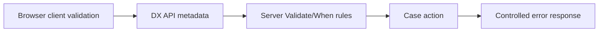

# Validation design across UI and server boundaries

**PFA-128** | Senior/Lead System Architect design study | Platform verification pending

## The business and runtime problem

A Constellation form conditionally requires a proof-of-address field. A custom frontend incorrectly makes the field optional because its local logic ignores a new product variant. A direct API request bypasses any UI-side validation as well.

An architecture is useful only if it identifies the business state that must remain correct when a user retries, another operator acts, a queue item is delayed or a new Pega release changes rendering and rule execution.

## Data and execution boundaries

## Pega feature inventory

1. **View Rule.** Establish the effective version, security principal, input/output contract and the responsible support owner.
2. **Validate Rule.** Establish the effective version, security principal, input/output contract and the responsible support owner.
3. **Flow Action.** Establish the effective version, security principal, input/output contract and the responsible support owner.
4. **Constellation DX API.** Establish the effective version, security principal, input/output contract and the responsible support owner.
5. **property constraints.** Establish the effective version, security principal, input/output contract and the responsible support owner.

## Reference architecture steps

1. Define field requirements as server-owned Pega rules, with View metadata reflecting the current case context.

2. Use client validation for immediate feedback but never as the only enforcement of eligibility or record integrity.

3. Map server validation errors into field and global UI feedback without swallowing unfamiliar error codes.

4. Test conditional visibility when a dependent field changes and when an assignment is reopened on another node.

5. Execute the same invalid submission directly against the API and ensure the server rejects it.

The implementation should preserve authoritative business decisions on the Pega server and use published interfaces when integrating external UI or asynchronous systems. Internal details and UI markup are not a stable substitute for an explicit supported contract.

## Design choices

- **Alternative 1:** Frontend-only validation is easy to alter and bypass.
- **Alternative 2:** server-authoritative validation supports multiple channels but needs good error UX.

Select the design based on platform support, latency and dependency limits, auditability, maintenance ownership and ability to recover from an interrupted operation.

## Failure mode to investigate

Conditional field logic copied into React becomes stale after ruleset upgrade; the server rejects form but the client misclassifies the response.

Keep the case/operation identity, applied ruleset, security context, error classification and timestamp with incident evidence. For a UI extension, also record the DX API response and supported SDK/runtime versions without exposing private customer data.

## Acceptance test matrix

1. **Test 1:** Submit without document in required case. Log the expected result, observed behavior and failure recovery.
2. **Test 2:** change condition mid-session. Log the expected result, observed behavior and failure recovery.
3. **Test 3:** post payload directly to action API. Log the expected result, observed behavior and failure recovery.

These are planned tests, not completed observations. Authenticate to a permitted Pega sandbox before collecting authentic screenshots or metrics. Test both happy path and error path on the actual deployment release.

## Operational readiness

Assign explicit ownership for version compatibility, current-case authorization and business completion. Put alerts on unresolved outcomes, stale UI state, broken background items or contract failures rather than just node health. Include a safe rollback/repair plan for cases that cross deployments.

## Pega reference

- [Pega Academy: Constellation components](https://academy.pega.com/topic/components-constellation/v2)

*Independent technical article, fictional scenario, no claim of production execution.*
