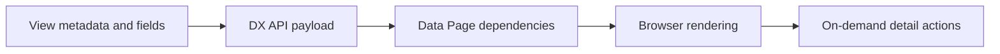

# Optimizing payload size for large case views

**PFA-129** | Senior/Lead System Architect design study | Platform verification pending

## The business and runtime problem

A complex case View loads a page of policy details, dozens of attachments and a long transaction history even when only the case summary is visible. The first DX API response becomes large and expensive to render for every operator.

An architecture is useful only if it identifies the business state that must remain correct when a user retries, another operator acts, a queue item is delayed or a new Pega release changes rendering and rule execution.

## Data and execution boundaries

## Pega feature inventory

1. **Constellation View.** Establish the effective version, security principal, input/output contract and the responsible support owner.
2. **DX API viewType.** Establish the effective version, security principal, input/output contract and the responsible support owner.
3. **Data Page.** Establish the effective version, security principal, input/output contract and the responsible support owner.
4. **paginated lists.** Establish the effective version, security principal, input/output contract and the responsible support owner.
5. **PAL/network traces.** Establish the effective version, security principal, input/output contract and the responsible support owner.

## Reference architecture steps

1. Capture actual first-load DX API payload size, request count and time spent in Pega, network and browser, using the supported release APIs.

2. Simplify the initial View to mandatory summary data; put large history/attachments behind paged or separately invoked experiences.

3. Audit nested Data Page references so hidden fields do not trigger per-row connector fan-out on first render.

4. Choose targeted DX API views or supported metadata options where appropriate, and keep data schemas stable across clients.

5. Measure trade-offs for large cases and low-bandwidth users, including caching sensitive case data and refresh after updates.

The implementation should preserve authoritative business decisions on the Pega server and use published interfaces when integrating external UI or asynchronous systems. Internal details and UI markup are not a stable substitute for an explicit supported contract.

## Design choices

- **Alternative 1:** Eager full page gives immediate access after load but high startup cost.
- **Alternative 2:** targeted/paged views improve first response with incremental fetch complexity.

Select the design based on platform support, latency and dependency limits, auditability, maintenance ownership and ability to recover from an interrupted operation.

## Failure mode to investigate

Rendering hundreds of hidden fields loads Data Pages and remote connectors despite the user not needing them, making a UX issue a platform scale issue.

Keep the case/operation identity, applied ruleset, security context, error classification and timestamp with incident evidence. For a UI extension, also record the DX API response and supported SDK/runtime versions without exposing private customer data.

## Acceptance test matrix

1. **Test 1:** Measure payload for summary vs full. Log the expected result, observed behavior and failure recovery.
2. **Test 2:** add 1000 related records. Log the expected result, observed behavior and failure recovery.
3. **Test 3:** throttle mobile network and compare p95. Log the expected result, observed behavior and failure recovery.

These are planned tests, not completed observations. Authenticate to a permitted Pega sandbox before collecting authentic screenshots or metrics. Test both happy path and error path on the actual deployment release.

## Operational readiness

Assign explicit ownership for version compatibility, current-case authorization and business completion. Put alerts on unresolved outcomes, stale UI state, broken background items or contract failures rather than just node health. Include a safe rollback/repair plan for cases that cross deployments.

## Pega reference

- [Pega Academy: Constellation DX API](https://academy.pega.com/topic/components-constellation/v2)

*Independent technical article, fictional scenario, no claim of production execution.*
