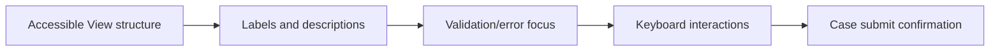

# Accessibility architecture for enterprise forms

**PFA-130** | Senior/Lead System Architect design study | Platform verification pending

## The business and runtime problem

A public-service case form contains multiple conditional questions, a custom date input and an attachments table. Sighted users complete it, but screen-reader and keyboard-only users cannot reach error messages or understand required fields.

An architecture is useful only if it identifies the business state that must remain correct when a user retries, another operator acts, a queue item is delayed or a new Pega release changes rendering and rule execution.

## Data and execution boundaries

## Pega feature inventory

1. **Constellation Design System.** Establish the effective version, security principal, input/output contract and the responsible support owner.
2. **View Rules.** Establish the effective version, security principal, input/output contract and the responsible support owner.
3. **DX Components.** Establish the effective version, security principal, input/output contract and the responsible support owner.
4. **validation labels.** Establish the effective version, security principal, input/output contract and the responsible support owner.
5. **accessibility tests.** Establish the effective version, security principal, input/output contract and the responsible support owner.

## Reference architecture steps

1. Prefer accessible standard Constellation components and layouts before considering custom widgets.

2. Provide meaningful field labels, descriptions and error context; color alone must not communicate status.

3. Order focus consistently through conditional visibility and after failed validation so keyboard users can locate errors.

4. For any custom DX Component, require keyboard, screen-reader, contrast and mobile tests as part of its maintenance contract.

5. Include accessibility regression against actual case workflows and role-specific views, not just static screenshots.

The implementation should preserve authoritative business decisions on the Pega server and use published interfaces when integrating external UI or asynchronous systems. Internal details and UI markup are not a stable substitute for an explicit supported contract.

## Design choices

- **Alternative 1:** Standard design system provides accessible baseline.
- **Alternative 2:** custom components meet specialized needs but transfer accessibility responsibility.

Select the design based on platform support, latency and dependency limits, auditability, maintenance ownership and ability to recover from an interrupted operation.

## Failure mode to investigate

A new conditional field is rendered without an accessible label, or focus disappears after an error. Platform-level accessibility does not exempt application design.

Keep the case/operation identity, applied ruleset, security context, error classification and timestamp with incident evidence. For a UI extension, also record the DX API response and supported SDK/runtime versions without exposing private customer data.

## Acceptance test matrix

1. **Test 1:** Navigate whole case by keyboard. Log the expected result, observed behavior and failure recovery.
2. **Test 2:** submit invalid form with screen reader. Log the expected result, observed behavior and failure recovery.
3. **Test 3:** test custom component on narrow mobile viewport. Log the expected result, observed behavior and failure recovery.

These are planned tests, not completed observations. Authenticate to a permitted Pega sandbox before collecting authentic screenshots or metrics. Test both happy path and error path on the actual deployment release.

## Operational readiness

Assign explicit ownership for version compatibility, current-case authorization and business completion. Put alerts on unresolved outcomes, stale UI state, broken background items or contract failures rather than just node health. Include a safe rollback/repair plan for cases that cross deployments.

## Pega reference

- [Pega Academy: Accessible Constellation](https://academy.pega.com/topic/building-accessible-applications-constellation/v1)

*Independent technical article, fictional scenario, no claim of production execution.*
