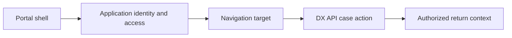

# Routing and navigation across multi-application portals

**PFA-131** | Senior/Lead System Architect design study | Platform verification pending

## The business and runtime problem

A shared service operator moves between Claims and Customer Service applications in one portal. Each application has different Access Groups, available case actions and navigation context. A common link menu displays cases the user cannot open.

An architecture is useful only if it identifies the business state that must remain correct when a user retries, another operator acts, a queue item is delayed or a new Pega release changes rendering and rule execution.

## Data and execution boundaries

## Pega feature inventory

1. **Access Group.** Establish the effective version, security principal, input/output contract and the responsible support owner.
2. **Application stack.** Establish the effective version, security principal, input/output contract and the responsible support owner.
3. **Constellation View.** Establish the effective version, security principal, input/output contract and the responsible support owner.
4. **DX API.** Establish the effective version, security principal, input/output contract and the responsible support owner.
5. **navigation contracts.** Establish the effective version, security principal, input/output contract and the responsible support owner.

## Reference architecture steps

1. Define the app boundary for each case type and how the operator receives legitimate access to multiple stacks.

2. Build navigation from authorized application capabilities rather than hard-coded case class URLs.

3. Preserve the case ID, channel and return-location context across app transitions without relying on stale browser global state.

4. Use server-side role and ABAC checks on target case open even if navigation already filtered links.

5. Test session expiry and switching the active operator/application context while a case assignment is open.

The implementation should preserve authoritative business decisions on the Pega server and use published interfaces when integrating external UI or asynchronous systems. Internal details and UI markup are not a stable substitute for an explicit supported contract.

## Design choices

- **Alternative 1:** Unified portal reduces context switching but complicates multi-app identity.
- **Alternative 2:** separate portals isolate concerns but burden users.

Select the design based on platform support, latency and dependency limits, auditability, maintenance ownership and ability to recover from an interrupted operation.

## Failure mode to investigate

A navigation link opens a case under the wrong application/ruleset stack, selecting a different rule or denying a valid action.

Keep the case/operation identity, applied ruleset, security context, error classification and timestamp with incident evidence. For a UI extension, also record the DX API response and supported SDK/runtime versions without exposing private customer data.

## Acceptance test matrix

1. **Test 1:** Open same case via two portal entries. Log the expected result, observed behavior and failure recovery.
2. **Test 2:** switch between access groups. Log the expected result, observed behavior and failure recovery.
3. **Test 3:** revoke one role and refresh navigation. Log the expected result, observed behavior and failure recovery.

These are planned tests, not completed observations. Authenticate to a permitted Pega sandbox before collecting authentic screenshots or metrics. Test both happy path and error path on the actual deployment release.

## Operational readiness

Assign explicit ownership for version compatibility, current-case authorization and business completion. Put alerts on unresolved outcomes, stale UI state, broken background items or contract failures rather than just node health. Include a safe rollback/repair plan for cases that cross deployments.

## Pega reference

- [Pega Academy: Constellation components](https://academy.pega.com/topic/components-constellation/v2)

*Independent technical article, fictional scenario, no claim of production execution.*
