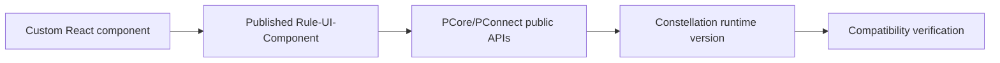

# Custom component upgrade compatibility

**PFA-132** | Senior/Lead System Architect design study | Platform verification pending

## The business and runtime problem

A bank deploys a custom document comparison DX Component built against an older Constellation SDK. After a platform upgrade, its internal PConnect assumptions stop working even though the case workflow is healthy.

An architecture is useful only if it identifies the business state that must remain correct when a user retries, another operator acts, a queue item is delayed or a new Pega release changes rendering and rule execution.

## Data and execution boundaries

## Pega feature inventory

1. **Constellation DX Component Builder.** Establish the effective version, security principal, input/output contract and the responsible support owner.
2. **Rule-UI-Component.** Establish the effective version, security principal, input/output contract and the responsible support owner.
3. **React bundle.** Establish the effective version, security principal, input/output contract and the responsible support owner.
4. **public PCore/PConnect.** Establish the effective version, security principal, input/output contract and the responsible support owner.
5. **View Rules.** Establish the effective version, security principal, input/output contract and the responsible support owner.

## Reference architecture steps

1. Inventory all custom DX Components, exact builder/runtime versions, peer dependencies and APIs used.

2. Restrict component logic to supported public PCore/PConnect contracts; never patch private generated DOM or internal renderer state.

3. Establish a compatibility matrix pairing Pega release and component build, with automated View-level contract tests.

4. Test accessibility, localization and browser interactions as part of every upgrade, since imported gallery components are customer-maintained.

5. Keep a fallback standard UI path where the custom component is noncritical, with clear failure visibility and rollback.

The implementation should preserve authoritative business decisions on the Pega server and use published interfaces when integrating external UI or asynchronous systems. Internal details and UI markup are not a stable substitute for an explicit supported contract.

## Design choices

- **Alternative 1:** Custom component gives specialized UX but owns lifecycle.
- **Alternative 2:** standard Constellation patterns reduce upgrade risk.

Select the design based on platform support, latency and dependency limits, auditability, maintenance ownership and ability to recover from an interrupted operation.

## Failure mode to investigate

A React dependency mismatch breaks only a specialist View. A component may continue rendering but submit stale data through an obsolete API assumption.

Keep the case/operation identity, applied ruleset, security context, error classification and timestamp with incident evidence. For a UI extension, also record the DX API response and supported SDK/runtime versions without exposing private customer data.

## Acceptance test matrix

1. **Test 1:** Upgrade Pega/React SDK in sandbox. Log the expected result, observed behavior and failure recovery.
2. **Test 2:** test conditional metadata. Log the expected result, observed behavior and failure recovery.
3. **Test 3:** turn off component to validate fallback. Log the expected result, observed behavior and failure recovery.

These are planned tests, not completed observations. Authenticate to a permitted Pega sandbox before collecting authentic screenshots or metrics. Test both happy path and error path on the actual deployment release.

## Operational readiness

Assign explicit ownership for version compatibility, current-case authorization and business completion. Put alerts on unresolved outcomes, stale UI state, broken background items or contract failures rather than just node health. Include a safe rollback/repair plan for cases that cross deployments.

## Pega reference

- [Pega Academy: DX Components](https://academy.pega.com/topic/constellation-dx-components/v2)

*Independent technical article, fictional scenario, no claim of production execution.*
