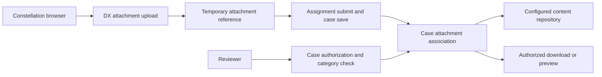

# Attachment workflows across browser and Pega storage

> Architecture study for Lead System Architects. The failure narrative is a hypothetical engineering scenario; no production incident or test result is claimed.

## Enterprise failure scenario

A regulated claims portal accepts a PDF on the evidence step. The browser shows an uploaded-file badge, but the claims handler opens the case from a second session and sees no document. The team initially blames object storage. In fact, the browser completed the upload stage without proving that the attachment had been associated with the committed work object. A second failure is possible when a file is linked correctly but the reviewer lacks access to its category. The architecture must distinguish browser upload success, temporary attachment state, case association, storage persistence and authorized retrieval.

## Architecture decision and Pega rule design

Use the supported Constellation attachment experience as the default, with an attachment field or case attachments widget selected according to whether evidence belongs to a particular form step or the case as a whole. Model a document classification such as ProofOfAddress in an attachment category and record the business-required document type separately on the case. Do not use a client-side success toast as the acceptance criterion. The server-side case association is authoritative. Configure the application content-management integration and retention location explicitly. Where documents must reside in an enterprise repository, validate the supported repository integration for the deployed Pega version before inventing a custom DX API proxy. Keep binary content outside case properties and never copy base64 payloads into the work BLOB for convenience.

## Technical flow

## Implementation sequence

1. Define the business lifecycle: required evidence type, maximum size, accepted MIME types, retention period, access roles and when the document becomes legally submitted. Record whether partial upload is allowed before the case exists.

2. Configure the case type and supported Constellation attachment field or case attachments widget. Prefer specific labels such as 'Proof of residence' over a generic 'File'. Confirm attachment category configuration and user privileges.

3. Set upload constraints at every applicable layer: browser affordance, Pega platform setting, gateway or reverse proxy and storage service. Validate actual server enforcement rather than relying on the file extension or a JavaScript check.

4. Bind successful submission to a case identifier and a persisted attachment reference. Keep a separate business status, such as EvidenceReceived, that is set only after the association can be read back in a fresh requestor.

5. Where malware scanning is required, quarantine untrusted content and prevent case progression or download until the scan outcome is approved. Implement a recoverable PendingScan state and an explicit rejection reason.

6. Use a second operator and a new browser session to verify authorized retrieval, denied retrieval, file integrity and audit history. Test deletion and retention against the selected repository's documented behavior.

## How the design fails in production

A request timeout after the upload response can lead a user to retry and create two attachments. Deduplicate with a business document key, content hash only where permitted, and an explicit replacement policy. A temporary object left after an abandoned form must be expired by supported platform lifecycle handling, not assumed to disappear immediately. A database row that references a deleted repository object creates a broken link; alert on retrieval failures and reconcile metadata with repository availability. Conversely, deleting a case link does not necessarily satisfy a legal requirement to erase every physical copy. Do not treat browser preview as proof of successful storage.

## Genuine tradeoffs

Direct-to-repository upload can reduce application-node bandwidth but increases token, CORS and ownership complexity. Pega-managed upload centralizes authorization but can impose heap and request-size constraints. Case-wide attachments are easier to discover; field-specific evidence is easier to validate against a particular assignment. Select the smallest supported pattern that preserves traceability.

## Reproducible verification matrix

| Test setup and stimulus | Expected observable result |
| --- | --- |
| Upload completes but assignment is cancelled | No business-received status; orphan lifecycle documented |
| Submit succeeds then fresh requestor opens case | One linked, downloadable document with correct category |
| Unsupported type or oversize payload | Server rejects and does not mark evidence received |
| Unauthorized operator guesses attachment identifier | Download and preview denied without content leakage |
| Repository unavailable after metadata save | Recoverable error, no false success, correlation captured |
| Malware scan pending or rejected | Content inaccessible until approved; rejection auditable |

Run each test against a named application version with independent requestors where relevant. Record configuration, input fixtures, observed response, persisted state and log correlation identifiers. The expected results above are acceptance criteria, not claims of execution. A failed row blocks a production recommendation until investigated.

## Release and evidence boundaries

Constellation widget behavior and preview support are version dependent. Pega's 24.2 design-system reference describes its attachments widget and preview enhancements; validate the exact Infinity release, repository provider and DX API behavior in a non-production environment. Verify behavior with a version-matched Pega environment and approved sample data. Include security review, recovery runbook, and rollback assessment in the change record. Do not infer correctness from a successful UI response alone.

## Primary references

- [Pega product guidance](https://design.pega.com/versions/24/design/attachments/index.html)
