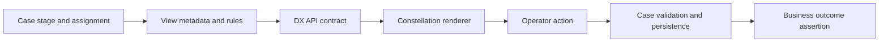

# Testing Constellation Views Through Stable Contracts

**PFA-134** | Pega LSA architecture study | Laboratory verification pending

## The failure that changes the testing strategy

A mortgage lender migrates its underwriting work area to Constellation. The old browser suite finds a button by generated CSS class. A renderer update changes that class, so the suite fails even though the business action works. The team disables the test. In the next release, a conditional risk explanation disappears from a reviewer View. The case is submitted without the required explanation and nobody notices until a quality review.

The root cause is not merely a brittle selector. The suite never defined what the View was supposed to guarantee: which assignment was open, which operator was eligible, which fields were required, which validations ran, and what persisted after submission. Testing the shape of generated HTML is different from testing a Pega case contract.

## Architecture and responsibility

The diagram is a logical test boundary. Confirm supported API endpoints and response structures against the actual platform version; do not assume undocumented JSON fields remain stable across upgrades.

## Pega objects to review

| Rule or component | Test responsibility |
|---|---|
| Case Type and assignment | Stage, eligibility and expected business transition. |
| Constellation View | Fields, labels, visibility, requiredness and actions. |
| When and Validate rules | Conditions and error behaviour independent of rendering. |
| Data Transform | Correct mapping of submitted values into the case. |
| Data Page | Parameter scope, loading failure and reference-data freshness. |
| Access Group and Access Role | Correct action availability for each persona. |
| PegaUnit | Fast verification of isolated rule logic where supported. |

The test strategy must not depend on a developer's elevated access context. A real operator fixture with a named Access Group is essential for meaningful action-availability assertions.

## Implementation sequence

1. Define one business contract per critical View: starting case state, current assignment, persona, visible fields, required inputs, allowed actions, validation messages and resulting case state.

2. Give each contract a synthetic case fixture with explicit property values. Include null, absent, blank, boundary and inconsistent values because conditional Views often behave differently for each.

3. Unit-test When rules, Validate rules and Data Transforms in isolation. Record rule version and expected output. This is the fastest place to find a regression in business logic.

4. Add a service-level test around supported DX API behaviour. Check semantic field identity, permitted actions and validation errors rather than the ordering of metadata arrays or transient renderer details.

5. Keep browser end-to-end tests small. Open an assignment, complete a meaningful action and assert the persisted business result. Prefer accessible names and supported test hooks over generated CSS classes.

6. Exercise a persona matrix: customer, underwriter, reviewer and user whose assignment has been withdrawn. A hidden button must not be the only reason an action is unavailable.

7. Simulate two sessions on the same case. Submit a change from one session, then attempt an outdated action from the other. Assert the configured conflict behaviour and no silent overwrite.

8. Inject Data Page failures and slow responses. Distinguish a loading placeholder, a retryable external error and a case validation failure. Do not rely on fixed browser sleeps.

9. Version fixtures with the application ruleset and target UI release. Require an architectural review before accepting changed expected outputs after a release.

## Production failure mechanics

**Rule logic changes while snapshots remain green.** A test checks the presence of a text label but never checks that the case property was updated. Always verify the persisted outcome.

**A new field is present but not authorized.** A View may hide the field for one persona while an API action still accepts an inappropriate value. Exercise both the presentation and backend contract.

**Reference data is cached unexpectedly.** A Data Page refresh changes option values or eligibility after the View is open. Test the stale-input path and the final server-side validation.

**A generated selector changes.** The browser test fails on a harmless renderer update. Use business-oriented selectors and reserve visual snapshots for deliberate presentation checks.

**Two operators race.** The second operator submits a stale assignment and overwrites the first operator's work unless the configured conflict path is exercised and understood.

## Design trade-offs

| Approach | What it proves | What it misses |
|---|---|---|
| PegaUnit only | Rule-level logic and mappings | Integrated identity, API and renderer behaviour. |
| Screenshot snapshot suite | Visual appearance | Business semantics and reliable compatibility. |
| Semantic API contracts plus narrow browser journeys | Field/action contract and critical end-to-end outcomes | Requires well-governed fixtures and explicit version scope. |

A layered approach is usually more maintainable than hundreds of full browser journeys, provided the API and case persistence assertions remain authoritative.

## Reproducible verification matrix

| Test | Expected result | Evidence |
|---|---|---|
| Required field omitted | Validation blocks submission and preserves case state | Rule output, response and case history. |
| Unauthorized reviewer action | Action unavailable and server rejects forced invocation | Operator role and response. |
| Concurrent case update | No silent lost update | Two sessions and case history. |
| Data Page timeout | Controlled error or retry behaviour | Synthetic service fault and response. |
| Renderer update | Semantic tests remain stable | Supported UI version and contract results. |
| Existing case after rule release | Assignment and View resolve correctly | Case age, ruleset and action outcome. |

These are acceptance criteria for a future Pega lab, not executed test results. Record the target platform version, application stack, operator Access Group, fixture and observed outcome before changing verification status.

## Rollout and support

Separate failures into View metadata, rule resolution, data loading, rendering and case persistence. Capture sanitized case IDs, assignment IDs, application version and request correlation, not customer data. Keep a minimal smoke journey for every critical persona and require a contract review for changes to field meaning. Rollback must consider active cases created under the new ruleset, not just the UI deployment.

## Primary Pega references

- [Pega Platform overview and Constellation architecture](https://docs.pega.com/bundle/platform-242)
- [Pega guidance on securing case access](https://docs.pega.com/bundle/platform-242/page/platform/case-management/securing-case-access.html)

This is an original design-backed study. Exact APIs, metadata shape and automation hooks must be checked for the selected Pega release. No benchmark, screenshot or lab result is claimed.
