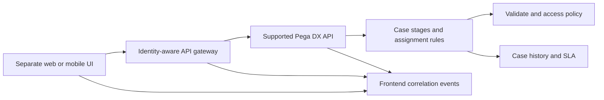

# Deciding when a separate frontend is justified

**Audience:** Pega Lead System Architects and platform engineers. Design guidance is not a claim of laboratory validation.

A national utilities provider already operates Pega case management for meter disputes. Its mobile team proposes a custom React application because the standard portal cannot reproduce a consumer-facing journey. Six months later, the React team has copied eligibility rules into TypeScript, built a second assignment router and started caching customer entitlements in the browser. A release changes the Pega flow action but not the frontend. Customers see a valid-looking Submit button for an action that the server rejects. The architectural error was not selecting React. It was moving business authority outside the case platform without a contract.

## Decision test: experience boundary or process duplication?

Keep case state, assignments, SLA transitions, validation, access control and audit in Pega. Consider a separate frontend when the product needs a demonstrably different interaction model, an existing cross-product shell, specialist offline behavior or a design system that cannot be met economically through supported Constellation extension points. Do not justify it merely because the team prefers a JavaScript framework.

Write a capability decision record with five columns: required experience, supported Constellation option, cost of extension, independent frontend cost, and operational owner. Prove the gaps with an executable spike on the actual Pega and Constellation versions. Evaluate accessibility, localization, file upload, authentication, mobile network recovery and the ability to resume a long-running assignment. A separate frontend introduces a second release lifecycle, security surface and observability path.

## Pega contract and ownership

Define the case type, stages, assignment actions and server-side validation in App Studio and Dev Studio. Treat the DX API as a server-defined interaction contract where the selected Pega release supports the required operations. Do not assume the API is a general-purpose database CRUD layer or that private endpoints are stable. The frontend renders the view metadata and submits actions permitted by the server. Pega owns whether the action is currently available.

Represent each customer journey with an explicit mapping: UI route -> case reference -> assignment reference -> supported view/action operation -> outcome. The frontend may maintain presentation state such as an expanded panel; it must not own the authoritative case status or permission to approve a dispute. Use the identity provider and supported OAuth/session pattern for the selected deployment. Avoid storing tokens, clipboard pages or raw PII in browser persistence.

## Implementation sequence

1. Inventory the 12 highest-value journeys and classify each as read, create case, perform assignment, upload, search or external navigation. Identify the actual business rule for every visible action.
2. Build a thin proof of concept against a disposable Pega environment. Demonstrate assignment retrieval, optimistic conflict handling, validation messages, authentication expiry and deep-link recovery before building a component library.
3. Specify a typed adapter at the gateway boundary. Translate API transport models into presentation models but preserve server-supplied action availability and validation outcomes. Keep the adapter versioned.
4. Use Pega data pages to expose reference data through supported APIs where appropriate. Key server caches by authorized identity and business context. Do not duplicate customer authorization in the browser.
5. Enforce access on Work- and Assign- classes with roles, privileges and, where appropriate, Access Control Policy rules. A hidden button is never a security control.
6. Define a browser-to-gateway-to-Pega correlation identifier, with a server-side request audit that excludes tokens and sensitive field values.
7. Run a contract suite against both the existing and target Pega versions. Include a pending assignment whose flow action changes while the user has the screen open.
8. Release frontend and Pega changes independently only where the contract is backward compatible. Otherwise use an explicit coordinated cutover and a route-level fallback.

## Tradeoffs and production mechanics

Constellation reduces duplicated rendering and upgrade exposure but may constrain unusual interaction patterns. A bespoke UI can optimize a highly differentiated journey, yet the team now owns schema drift, localization, assistive-technology behavior and failed network submissions. A gateway can protect the public interface from API changes but becomes another latency and availability dependency. Avoid building an entire second workflow engine inside it.

A particularly dangerous failure occurs when the browser retries a submission after a timeout. The first call may have completed the assignment while the retry targets an obsolete assignment ID. Design the UI to re-read current case state on ambiguous outcomes, not to blindly repeat the transition. If the server responds with a conflict, preserve unsaved user input but require an explicit refresh and revalidation. A second failure occurs when a portal bookmark opens a case without an active assignment: show the case summary and permitted next action, not a fabricated assignment.

## Reproducible verification matrix

| Scenario | Procedure | Acceptance |
| --- | --- | --- |
| Stale action | Change flow action eligibility after the view loads | Server rejects unauthorized transition; UI refreshes |
| Double submit | Replay identical assignment submission during network loss | No duplicate business side effect |
| Access revoked | Remove operator privilege while tab remains open | Next server action denied |
| Deep link | Open case after assignment is reassigned | Correct case and current permitted assignment displayed |
| Upgrade | Run adapter suite against candidate Pega version | No undocumented endpoint dependency |
| Screen reader | Navigate and submit a validation failure | Focus, error and recovery are accessible |
| Expired identity | Expire access while editing | No leaked state; explicit reauthentication path |

## Release gate

The architecture review must include a costed alternative using native Constellation, a signed ownership map, an API compatibility matrix and an incident response runbook. If the team cannot demonstrate how it handles a stale assignment and a revoked privilege, the separate frontend is not ready for production.

**Primary reference:** [Pega Platform: more about Service REST rules](https://docs.pega.com/bundle/platform-23/page/platform/data-integration/more-about-service-rest-rules.html). Service authentication and session details are release-dependent; verify the supported DX API documentation for the deployed version.
