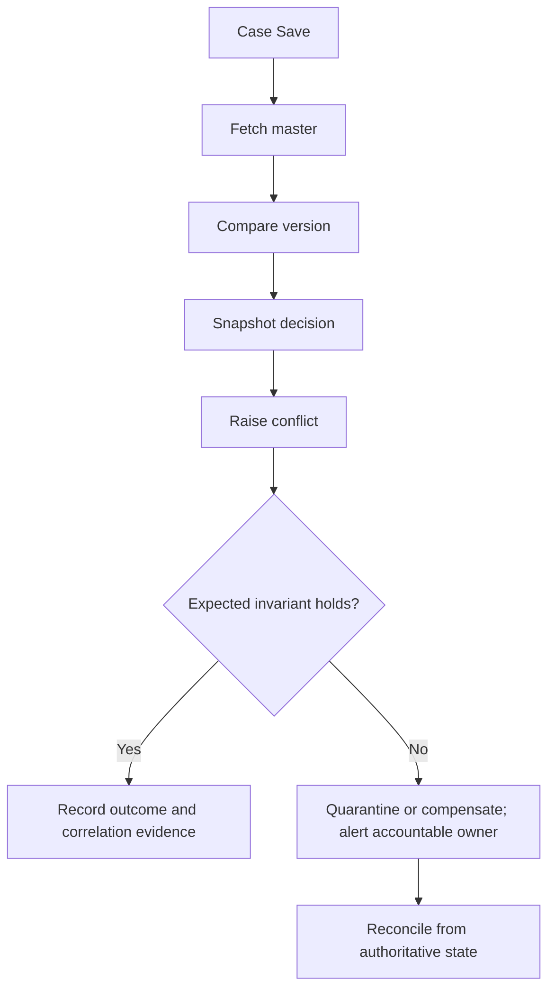

# Choosing the system of record for case data

## Enterprise failure scenario and architectural question

An insurer's claim case stores a policy address both in Pega and a policy master. Overnight reconciliation overwrites a corrected address while a claim adjuster is submitting a settlement. The immediate symptom looks like a localized configuration defect, but the root problem is a missing enterprise boundary: the platform cannot explain who owns the state, which contract is authoritative, or what should happen after a partial failure. The lead system architect must establish a decision that remains valid across teams, deployments, asynchronous processing and support handovers. The proposed approach below is a design pattern, not a claim of production or lab validation.

The design question is not whether Pega has a rule capable of implementing the feature. It is whether the selected rule placement and operating contract make failure predictable, visible and recoverable. A production-grade answer identifies the authoritative owner, input invariants, transactional boundary, fallback behavior, and evidence needed to prove a repair was safe.

## Target architecture and ownership

Policy master owns policy demographics; Pega owns claim workflow state, assignments, correspondence evidence and the case lifecycle. A versioned policy snapshot is captured at the claim decision boundary, with source identifier and retrieval timestamp.

**Pega rule and platform touchpoints:** Data-Reference properties, a keyed Data Page D_PolicyById, a REST connector, a Case Type Claim, Data Transform MapPolicySnapshot, savable data pages only where ownership permits, and a data retention rule for claim evidence. Rule resolution, application inheritance and the installed Pega Platform release must be checked before implementing these recommendations. In particular, connector, queue-processing, UI and deployment capabilities differ by platform version and deployment model. Do not infer that a capability available in a newer release is present in an older installation.

The architecture contract must name the team accountable for the business outcome and the team accountable for the underlying runtime. It must distinguish synchronous validation from eventual reconciliation, and specify which changes are atomic within a Pega case transaction. Cross-system updates are not automatically part of the same database transaction. Avoid designing a fictitious distributed rollback.

## Technical flow

## Implementation sequence for an LSA

1. **Model the boundary.** Document the authoritative business record, case lifecycle, interfaces, and retention policy. Capture the identity of the consuming application, correlation key and operational owner. Use an explicit class and RuleSet layering diagram rather than relying on inherited rule resolution to express architecture implicitly.
2. **Create the Pega contract.** Identify the Case Type, data model, Data Page or connector where relevant, access group and authentication profile. Define property mapping in Data Transforms and validation through appropriate rules. Keep integration credentials outside source-controlled rule content.
3. **Define idempotent execution.** Assign a durable business operation identifier. For asynchronous work, ensure Queue Processor retry behavior cannot apply a side effect twice. Where a remote system cannot guarantee idempotency, maintain a reconciliation ledger and a manual recovery path.
4. **Implement failure classification.** Distinguish malformed requests, authorization failures, transient transport faults, business conflicts and exhausted retries. Each class needs a different recovery policy. Avoid catch-all activity steps that suppress an exception and return a success-shaped response.
5. **Protect the transaction boundary.** Save case state only after required validation; avoid holding a case lock while waiting on unpredictable remote latency. If processing must be deferred, persist an intent and correlation identifier, then complete through supported background processing with clear retry and reconciliation semantics.
6. **Add security and observability.** Apply least-privilege roles and access controls, mask sensitive values in logs, and emit correlation IDs, outcome categories, age and retry counters. Record the source and version of data used for material decisions without retaining unnecessary personal data.
7. **Validate before promotion.** Use branch and RuleSet version controls, PegaUnit where suitable, contract tests for external dependencies, a deployment rollback plan and production-like workload observations. Record version-specific differences as explicit assumptions.
8. **Assign an operational owner.** Publish a runbook covering alert triage, safe replay, reconciliation, rollback and post-incident evidence collection. Confirm that support staff can determine whether a transaction is complete without manually editing the database.

## Production failure mechanics and recovery

Treat external master reads as stale-capable; do not silently write master data from case Save. On a mismatch, raise a reconciliation work item and preserve the original decision snapshot.

A dangerous failure mode is an apparently successful case transition after the external side effect has failed. Another is retrying an operation after an ambiguous timeout when the remote service may already have committed. In both cases, repeating the entire flow is not a safe default. Operators need a read-only status query, a correlation key and an explicitly approved replay or compensation procedure. Ensure the recovery action itself is auditable.

During an incident, establish the last confirmed authoritative state before attempting correction. Preserve the request identifier, relevant rule version, case key, error category and timestamps. Use PDC or equivalent supported diagnostics to investigate performance and exceptions; use Tracer only in a controlled, time-bounded way with data-handling safeguards. Do not assert an incident is resolved merely because the queue is empty; verify business outcomes and downstream acknowledgements.

## Design trade-offs and rejected alternatives

A read-through Data Page simplifies freshness but adds dependency latency. A snapshot protects audit reconstruction but must be invalidated deliberately for current operational decisions.

**Rejected shortcut:** copying logic into an Activity or a shared helper simply because it reduces the immediate implementation effort. This can obscure business ownership and increase upgrade or release coupling. A narrow, explicit interface may require more initial design but offers clearer versioning and failure isolation. Conversely, introducing a service boundary for every rule can increase network hops, observability overhead and operational cost. The decision should follow measurable change frequency, failure blast radius and ownership, not fashion.

**Alternative worth testing:** keep the workflow in the existing application but isolate its volatile decision or integration contract behind a versioned rule boundary. Compare it with a separate component or service on deployment independence, test coverage, latency, security and rollback complexity. The appropriate choice may differ between a single-tenant platform and a multi-portfolio enterprise estate.

## Reproducible verification matrix

| Test | Setup and action | Expected evidence | Failure response |
| --- | --- | --- | --- |
| Happy path | Execute a representative case with valid authoritative input | Correct case transition and correlation record | Block promotion if ownership or outcome differs |
| Duplicate delivery | Submit the same operation identifier twice | Exactly one business side effect or a documented deduplicated outcome | Reconcile, then fix the idempotency boundary |
| Remote timeout | Delay or interrupt the dependency after request dispatch | Explicit unknown state, no fabricated success | Query status before replay |
| Invalid authorization | Use a role lacking required privilege | Denied action with safe diagnostic evidence | Correct access policy, not blanket privilege escalation |
| Schema drift | Remove or rename an optional and a required field in test payloads | Compatible handling or controlled contract failure | Version the interface and notify consumers |
| Concurrency | Update the same case from two workers | Lock/conflict behavior preserves invariant | Retry with bounded backoff or operator resolution |
| Deployment rollback | Revert the new RuleSet or integration version in staging | Old contract remains usable, no orphaned work | Activate compatibility shim and reconcile pending work |
| Recovery drill | Inject an exhausted retry and execute runbook | Named owner restores state with audit trail | Revise runbook and monitoring before release |
| Performance | Compare representative baseline and candidate workloads | Documented latency and queue-age distributions | Investigate regression; avoid unsupported numeric claims |

This is a **design-backed, lab-pending** study. The matrix describes tests to run, not tests already performed. Do not invent throughput, PDC screenshots, timing measurements or compatibility results. Capture the Pega version, deployment model, RuleSet versions, dataset and actual run evidence when validation occurs.

## Architecture acceptance checklist

The release is acceptable only when business ownership is unambiguous, security checks fail closed, ambiguous outcomes can be reconciled, duplicate operations cannot silently double-apply, and operations staff can recover without modifying case tables directly. A reviewer should be able to trace each architectural choice to a specific rule or interface, test and accountable owner. Record outstanding exceptions with a dated expiry and a rollback condition.

## Version and evidence notes

This study intentionally does not assert product behavior for an unverified Pega release. Validate specific rule forms and feature availability against the licensed platform documentation for the installed version, and keep the design decision record alongside the test evidence. Publication dates and historical Git author dates are separate audit facts; this article's verification status remains lab pending.
